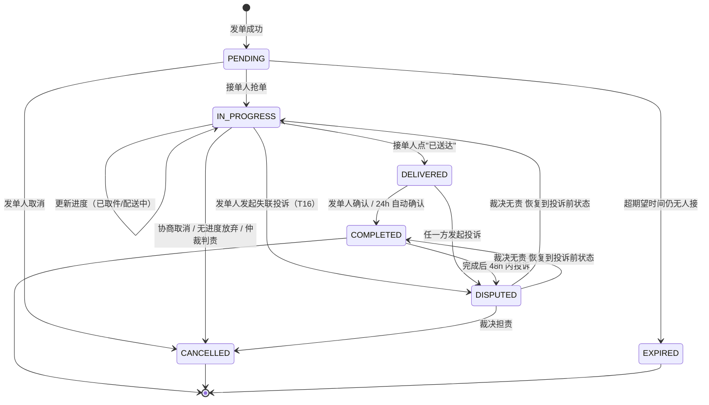
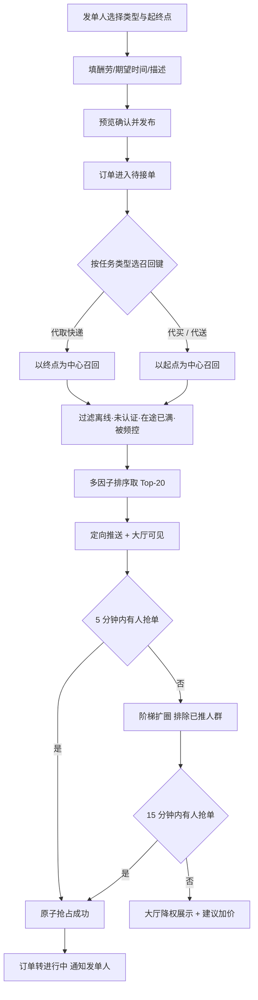
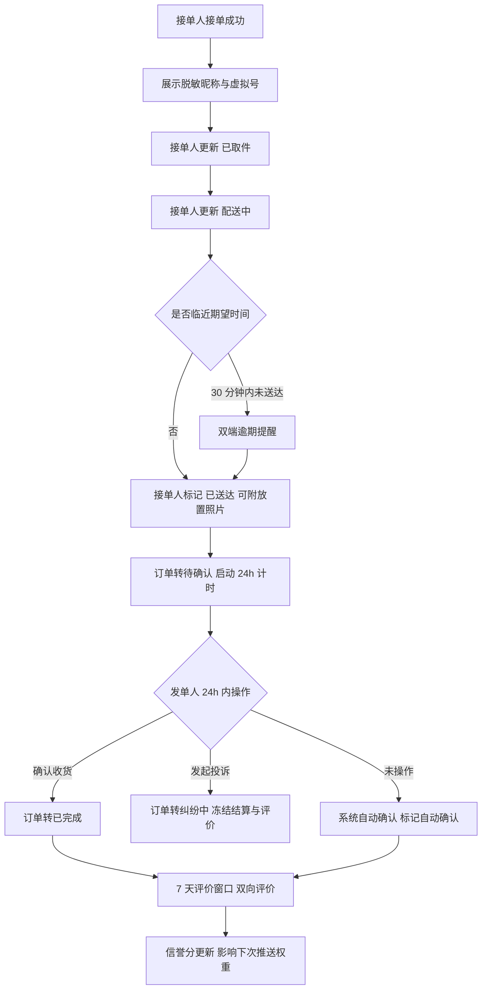
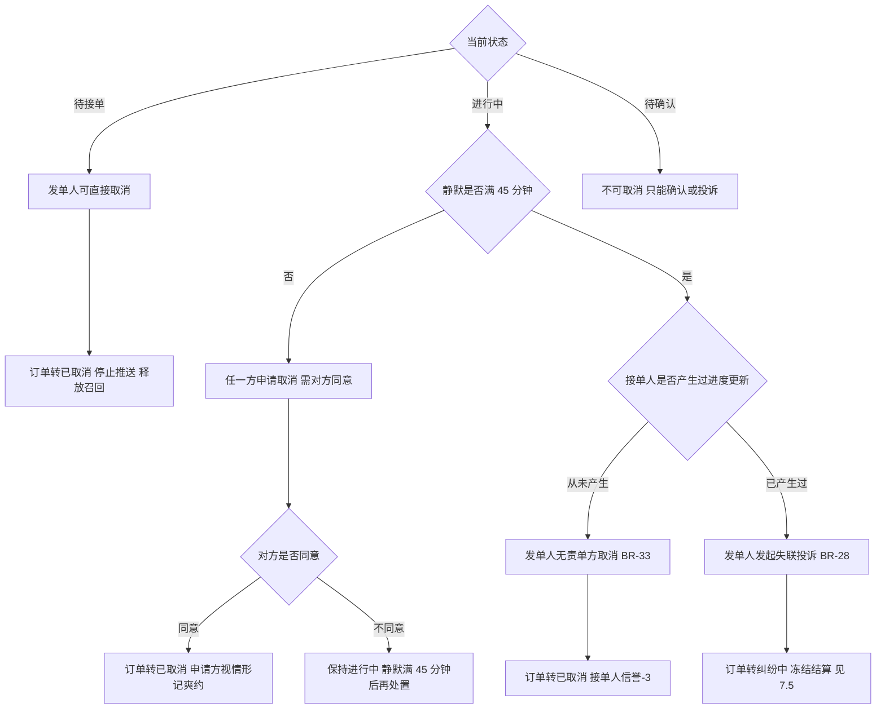
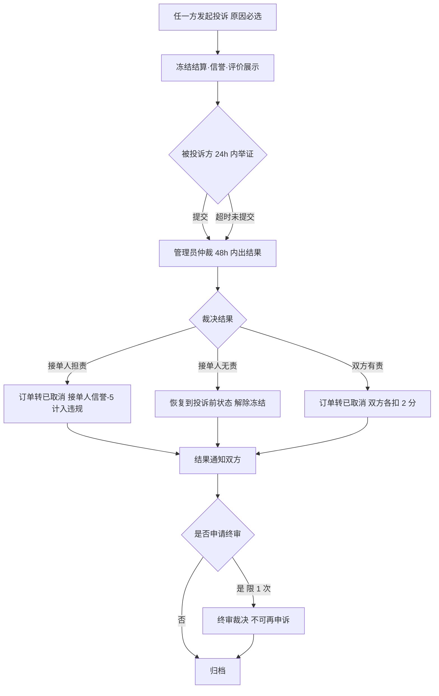

# 校园跑腿系统 CampusRun · 产品需求文档（方案定型版）

| 项目 | 内容 |
|---|---|
| 产品名称 | 校园跑腿 CampusRun |
| 文档版本 | v1.0（方案定型版） |
| 文档性质 | 产品视角方案定型稿，可直接作为架构设计与开发任务分解的输入 |
| 端形态 | Web（响应式 H5）+ 微信小程序 + 运营后台 |
| 目标用户 | 单校区在校本科生 / 研究生 |
| 交付约束 | 独立开发者一人全栈；复用既有 FastAPI + React 技术栈脚手架 |
| 不在本文档内 | 数据库表结构、API 路径、缓存与并发实现细节 —— 由架构设计文档承接 |
| 文档状态 | 定稿待用户拍板（3 项阻塞决策见第 11 章） |

---

## 1. 一页纸摘要（TL;DR）

**一句话**：把"校园微信群里喊人帮忙取快递"升级成一个**有身份认证、有智能匹配、有状态追溯、有信誉沉淀**的校内互助交易平台。

**给谁用**：南京审计大学单校区在校学生。两类行为、同一账号 —— 忙的时候**发单**（我出 5 块，帮我从菜鸟驿站把快递带回 12 栋），闲的时候**接单**（我正好路过驿站，顺路赚 5 块）。

**怎么转起来**（核心循环）：

```
发单（选择校内地点 + 酬劳）→ 系统按地理位置召回附近在线接单人并只推 Top-N
   → 接单人抢单 → 接单人更新进度（取到件 / 在路上）→ 接单人点"已送达"
   → 发单人确认（24h 不确认自动确认）→ 双向评价 → 信誉分变化 → 影响下一次被推送的权重
```

**三个关键产品判断**（已在方案层面定型，不再讨论）：

| # | 判断 | 理由 |
|---|---|---|
| J1 | 状态机**必须是 4 态**（待接单 / 进行中 / **待确认** / 已完成），对外仍折叠展示为 3 个进度节点 | 原需求的三态无法区分"接单人声称送达"与"发单人认可送达"：责任分界消失、24h 自动确认没有计时起点、真实履约时长无法统计 |
| J2 | "按目的地推送"**只对代取快递成立**；代买 / 代送必须按**起点**召回 | 代取快递起点集中（2–3 个驿站）、终点分散（几十栋宿舍楼），目的地能形成有效人群分群；代买代送起点分散，接单人的真实成本在"要去哪买"，按起点召回才有意义。结论：**召回键按任务类型动态选** |
| J3 | **不做全员广播**，只推排序后 Top-N，无人接再阶梯扩圈 + 频控 | 全校 5000 人每天几十单，全员广播 = 每人每天几十条骚扰，产品会被卸载 |

**人力现实**：一人开发，所以本 PRD 的价值一半在于"写清楚做什么"，另一半在于**写清楚不做什么**。第 6 章的 MVP 边界是硬边界。

---

## 2. 目标与适用场景

### 2.1 产品目标

| # | 目标 | 可衡量结果 |
|---|---|---|
| G1 | 让"临时需要人帮忙跑一趟"能在 **10 分钟内完成匹配**，而不是在群里等运气 | 发单→接单中位时长 ≤ 8 分钟 |
| G2 | 让每一次跑腿**可追溯、可评价、可申诉**，把人身与财物的信任成本降下来 | 订单完成率 ≥ 85%，纠纷率 ≤ 3% |
| G3 | 把服务范围**严格限制在校内认证人群**，校外人员不可进入 | 100% 发单/接单账号通过学号本校认证 |

### 2.2 三个真实使用场景

**场景 A ·「周三下午有课，快递到驿站了」**（主场景，代取快递）
小李周三 13:30–15:10 连着两节课。11:20 菜鸟驿站发短信说一个中通件到站，18:00 后驿站关门。他 12:50 在课上打开小程序发单：起点「菜鸟驿站（一食堂旁）」→ 终点「12 栋宿舍楼下」，酬劳 5 元，期望 15:40 前送达。系统判断这是代取快递 → **按终点（12 栋）召回**附近 1km 内、处于接单模式的 20 名学生。小张正好住 11 栋、下午没课，收到推送 → 抢单 → 去驿站取件（更新进度"已取件"）→ 走到 12 栋（更新"配送中"）→ 放在楼下快递架拍照（"已送达"）。小李下课看到通知，确认收货并给 5 星 + "准时"标签。

**场景 B ·「感冒了不想下楼，帮忙带份饭」**（代买）
小王发烧在宿舍躺了一天，晚饭想吃二食堂的粥。19:00 发单：起点「二食堂」→ 终点「8 栋 305 楼下」，酬劳 4 元。这是代买 → **按起点（二食堂）召回**，因为只有"准备去二食堂"的人接这单才不亏。小陈刚打完球要去吃饭，收到推送，顺手接单。

**场景 C ·「急需把材料送到教务处盖章」**（代送，时效优先）
小赵的奖学金材料必须在 16:00 前送到行政楼教务处。15:10 在图书馆发现时间不够，发单：起点「图书馆」→ 终点「行政楼 208」，酬劳 12 元（高于建议价），期望 30 分钟内。代送 → **按起点召回**，同时因期望时间极短，系统在推送卡片上标注"急单"，并在排序中提升同楼栋/近距离候选人权重。

### 2.3 适用边界

| 维度 | 边界 |
|---|---|
| 空间 | **单校区内部**。起点与终点必须是后台维护的校内 POI（地点字典），不支持手输自由地址 |
| 人群 | 通过**本校学号认证**的在校生；校外人员、教职工、毕业生不可发单或接单 |
| 时间 | 07:00–23:00 可发单；23:00–07:00 不可发单、不推送、不可抢单（在途单可继续完成） |
| 金额 | 单笔酬劳 2–50 元，全部**线下结算**（平台不代收资金） |
| 关系 | 信息撮合，**非雇佣、非劳务派遣**；接单人不是平台骑手，无排班无考核无底薪 |
| 履约方式 | **抢单制**，不是派单制。平台不指派、不强制接单 |

### 2.4 不适用场景（明确不做，遇到请走其他渠道）

| 不适用场景 | 为什么不做 |
|---|---|
| 跨校区 / 跨校跑腿（如寄到市区、送到隔壁学校） | POI 字典、召回半径、校历口径全部要重做；一人开发无法维护多校区数据 |
| 校外代取（外卖柜、社会快递点、药店） | 出入校门涉及校方安保规则，且距离与安全风险不可控，无兜底能力 |
| 夜间配送（23:00–07:00） | 单人开发者无法提供夜间客服；夜间纠纷与人身安全事故的成本远超收益 |
| 现金代付 / 大额垫付（如代买超过 50 元、代缴费用） | 无资金托管能力，赖账与卷款风险由接单人承担，产品赔不起 |
| 违法、违规、危险品、代考、代课、代签到 | 违反校规甚至法律，一次事件即可导致产品被叫停 |
| 宠物寄养、搬家、需要专业技能的服务 | 非"跑腿"范畴，责任界定复杂，不在定位内 |
| 专职跑腿 / 兼职骑手招募与考核 | 一旦有"专职"，就产生劳动关系、保险与安全责任，超出个人项目承载力 |
| 实时轨迹直播 / 路线规划导航 | 隐私争议大、实现成本高，本期只做"进度节点 + 距离参考" |

> 判断原则：**凡是需要平台兜底赔付、需要 7×24 人工响应、需要跨组织协调的需求，本期一律不做。**

---

## 3. 成功指标

上线后 8 周内（试点 1–2 栋宿舍楼起量）的评估口径。

| 类型 | 指标 | 定义 | 目标值 |
|---|---|---|---|
| **北极星** | 周成单量 | 一周内状态到达 COMPLETED 的订单数 | **≥ 300 单/周** |
| 核心 1 | 发单→接单中位时长（TTFG） | `accepted_at - created_at` 的中位数 | **≤ 8 分钟** |
| 核心 2 | 推送→抢单转化率 | 同一轮推送中产生抢单的比例 | **≥ 12%** |
| 核心 3 | 订单完成率 | COMPLETED / (COMPLETED + CANCELLED + EXPIRED + DISPUTED) | **≥ 85%** |
| 护栏 1 | 纠纷率 | DISPUTED 单 / 完成单 | **≤ 3%** |
| 护栏 2 | 推送打扰投诉率 | 因推送投诉/关闭接单模式的人数 / 被推送人数 | **≤ 0.5%** |

**辅助观测指标**（不设硬目标，用于定位问题）：认证通过率、人均发单次数、接单人在途单数分布、扩圈次数占比、自动确认占比、平均接单人响应时长。

**必须盯的风险指标**：**T17 无责自助取消单占比**（T17 单量 / 有效发单量），目标 **≤ 2%**。越线说明 45 分钟静默阈值对某些场景偏短（典型是午间代买排队），应优先按任务类型分档而非直接放宽全局阈值。

**口径说明**：护栏指标一旦越线，优先降推送频次与缩小半径 —— 宁可少成单，不可骚扰人。这是本产品的第一优先级取舍。

**时长口径（重要）**：履约时长一律按 `delivered_at − accepted_at` 计算，**不得用 `completed_at`** —— 纠纷回滚（BR-34）会把 `completed_at` 重写为裁决时刻，用它算会被仲裁等待时间污染（一单卡 3 天纠纷，履约时长就虚增 3 天）。`completed_at` 只用于终态判定、完成率计数与评价窗口起算。

---

## 4. 角色与权限矩阵

**设计原则**：不设双角色注册。"发单人"和"接单人"是同一账号的两种行为，用户随时切换。只有开启"接单模式"后才上报位置、才可能被召回。

| 角色 | 定义 | 说明 |
|---|---|---|
| R0 游客 | 未登录 | 只能看落地页与规则说明 |
| R1 待认证用户 | 已注册（手机号/微信），未通过学号认证 | 可浏览大厅与订单，不可发单/抢单/评价 |
| R2 认证用户 | 通过本校学号认证，同时具备发单与接单能力 | 默认发单能力开启；接单能力需主动开启"接单模式" |
| R3 运营管理员 | 校级运营 / 客服 | 订单干预、用户审核与封禁、纠纷仲裁、POI 维护 |
| R4 超级管理员 | 系统 owner | R3 全部权限 + 管理员账号管理 + 业务参数配置（半径/上限/时长/权重） |

| 能力 | R0 | R1 | R2 | R3 | R4 |
|---|:--:|:--:|:--:|:--:|:--:|
| 浏览落地页 / 规则 | ✅ | ✅ | ✅ | ✅ | ✅ |
| 浏览抢单大厅 | ❌ | ✅ | ✅ | ✅ | ✅ |
| 提交学号认证 | ✅ | ✅ | ❌（已通过） | ❌ | ❌ |
| 发单 / 取消自己的单 | ❌ | ❌ | ✅ | ❌ | ❌ |
| 开启接单模式 / 上报位置 | ❌ | ❌ | ✅ | ❌ | ❌ |
| 抢单 / 更新进度 / 标记送达 | ❌ | ❌ | ✅（本人所接单） | ❌ | ❌ |
| 确认收货 / 评价 / 发起投诉 | ❌ | ❌ | ✅（本人相关单） | ❌ | ❌ |
| 查看对方真实手机号 | ❌ | ❌ | ❌（仅脱敏昵称 + 虚拟号） | ✅（留痕） | ✅（留痕） |
| 订单检索 / 强制关闭 / 补录备注 | ❌ | ❌ | ❌ | ✅ | ✅ |
| 认证审核 / 封禁解封 / 信誉调整 | ❌ | ❌ | ❌ | ✅（留痕） | ✅ |
| 纠纷仲裁 / 申诉终审 | ❌ | ❌ | ❌ | ✅（仲裁） | ✅（终审） |
| POI 字典维护 | ❌ | ❌ | ❌ | ✅ | ✅ |
| 业务参数配置（半径/上限/时长） | ❌ | ❌ | ❌ | ❌ | ✅ |
| 管理员账号管理 | ❌ | ❌ | ❌ | ❌ | ✅ |

### 4.1 关键术语

| 术语 | 定义 |
|---|---|
| POI | 校内地点字典项（驿站、宿舍楼、教学楼、食堂、打印店、行政楼等）。发单必须从字典选，不手输地址 |
| 召回 | 按地理范围筛出候选接单人集合 |
| 召回键 | 召回时使用的地理中心点。代取快递用**终点**，代买/代送用**起点**（见 J2） |
| 顺路度 | 候选接单人当前在途任务的终点与新订单起点的贴合程度 |
| 扩圈 | 首轮推送无人接单后，阶梯放大半径并排除已推送人群的二次推送 |
| 在途单 | 状态为 IN_PROGRESS 或 DELIVERED 的、本人作为接单人的单量 |
| 折叠展示 | 后端 4 态对外映射为 3 个进度节点：待接单 / 进行中（含待确认） / 已完成 |

---

## 5. 核心用户故事

> 每条含验收要点。编号 US-xx，供开发任务分解引用。

### 5.1 认证与准入

| # | 用户故事 | 验收要点 |
|---|---|---|
| US-01 | 作为**新用户**，我想用手机号/微信一键登录，以便不用记密码就能开始使用 | 首次登录自动建档；未认证状态明确提示"完成学号认证后才能发单"；同一微信 openid 与手机号不会重复建档 |
| US-02 | 作为**在校生**，我想用校园邮箱收验证码完成学号认证，以便最快进入产品而不必等人工审核 | 只接受白名单后缀邮箱；验证码 10 分钟有效、5 次错误失效；同一学号全局唯一，已被占用则明确报错并转人工 |
| US-03 | 作为**邮箱不可用的学生**，我想上传学生证/校园卡照片并等待审核，以便也能完成认证 | 上传前提示打码（保留姓名、学号、院系）；提交后状态为"审核中"；管理员 24h 内出结果；驳回时给出**具体原因**并可重提 |
| US-04 | 作为**已认证用户**，我想在个人中心看到认证徽标，以便确认自己的账号状态 | 徽标分 4 态（未认证/审核中/已认证/已驳回）；已认证用户不会再看到认证入口 |

### 5.2 发单

| # | 用户故事 | 验收要点 |
|---|---|---|
| US-05 | 作为**发单人**，我想从校内地点字典里选起点和终点、填酬劳和时间，以便 30 秒内发出一单 | 地点只能从字典选（可搜索、"最近使用"置顶）；酬劳 2–50 元、0.5 元步进、给建议价；期望时间 4 档（30 分钟 / 1 小时 / 2 小时 / 今日内）；发布前有二次确认页展示距离、酬劳、超时规则 |
| US-06 | 作为**发单人**，我想在描述里写清件数、取件码、放置要求，以便接单人不问也能办对 | 描述 ≤ 200 字；图片 ≤ 3 张；上传取件码时强制提示"请遮盖取件码后截图"；同一账号同时进行中的 PENDING 单 ≤ 3 |

### 5.3 推送与抢单

| # | 用户故事 | 验收要点 |
|---|---|---|
| US-07 | 作为**接单人**，我想在自己方便时只收到附近、我能顺路完成的单，以便不被无关推送打扰 | 只有开启接单模式且在线才被召回；按任务类型选召回键（代取快递按终点，代买/代送按起点）；单轮只推 Top-20；频控生效（10 分钟内 ≤ 3 条，1 小时内 ≤ 10 条），超额自动降级为"仅大厅可见、不推送" |
| US-08 | 作为**接单人**，我想在抢单大厅按距离/酬劳自己挑单，以便不完全依赖推送 | 默认"距我距离升序"，可切酬劳降序/最新发布；可筛类型、最低酬劳、距离档；游标分页每页 20；卡片显示类型、起终点、距离、酬劳、剩余时间倒计时、发单人信誉等级 |
| US-09 | 作为**接单人**，我想抢单时立刻知道自己抢到没、为什么没抢到，以便不用反复刷新猜 | 二次确认后原子抢占；100 并发抢同一单**恰好 1 人成功**；失败必须返回可区分原因（手慢了 / 已达在途上限 / 订单已过期）；重复点击不产生第二条接单记录 |
| US-10 | 作为**接单人**，我想控制自己同时接几单，以便不因贪多而超时 | 在途单（进行中 + 待确认）≥ 3 时不可再抢，且提示"你当前有 3 单进行中" |

### 5.4 履约

| # | 用户故事 | 验收要点 |
|---|---|---|
| US-11 | 作为**接单人**，我想点一下就能更新"已取件 / 配送中 / 已送达"，以便发单人随时知道进展 | 4 个节点（已接单→已取件→配送中→已送达）只能顺序推进，不可跳级回退；每次更新自动通知发单人；节点记录不可删改（仅追加） |
| US-12 | 作为**接单人**，我想在送达时拍一张放置位置的照片，以便日后有纠纷能自证 | 照片作为送达凭证挂在该次进度事件上；发单人可从订单详情直接查看 |
| US-13 | 作为**发单人**，我想在订单详情看到一条清晰的时间轴，以便知道现在卡在哪一步 | 时间轴含每步的时间戳与操作人；距离期望时间 30 分钟未送达时，双方均收到提醒 |

### 5.5 确认与评价

| # | 用户故事 | 验收要点 |
|---|---|---|
| US-14 | 作为**发单人**，我想在拿到东西后自己点确认，以便接单人的信誉分及时更新 | 仅 DELIVERED 状态可确认；确认后状态流转到 COMPLETED 并写完成时间；非本人不可操作 |
| US-15 | 作为**发单人**，我想在 24 小时忘记确认时系统自动确认，以便接单人不会因为我的疏忽被卡住 | 送达后 24h 未确认自动转 COMPLETED 并标记"自动确认"；自动确认不影响我后续发起投诉的权利 |
| US-16 | 作为**双方**，我想用星级 + 标签快速评价，以便不用写长文也能表达 | 1 次双向评价，5 星 + 预设标签（准时/沟通顺畅/包装完好/态度好；迟到/沟通差/物品损坏）+ 文字 ≤ 100 字；完成后 7 天内可评，过期视为放弃且不计分；同一订单同一人对同一人只能评一次 |

### 5.6 纠纷与治理

| # | 用户故事 | 验收要点 |
|---|---|---|
| US-17 | 作为**发单人**，我想在东西没送到、接单人失联或物品损坏时发起投诉，以便问题不是只能私聊解决 | 可在**进行中（仅限接单人失联，免举证）**、待确认期间、或完成后 48h 内发起；其他原因必选 + 举证（≤5 图 + ≤300 字）；发起后**立即冻结**结算与信誉变动、隐藏评价 |
| US-18 | 作为**被投诉方**，我想在 24h 内提交我的证据，以便不被单方面判责 | 申诉入口明确、可上传凭证；超时未申诉由管理员按现有证据裁决；每单只能申诉 1 次、只能终审 1 次 |
| US-19 | 作为**运营管理员**，我想在后台看到双方举证并一次裁决，以便纠纷 48h 内闭环 | 仲裁结果三选一（支持发单人 / 支持接单人 / 双方有责）；每种结果对应的订单终态、信誉扣分、是否计入统计必须自动执行；结果自动通知双方；所有管理动作留痕且不可删改 |

### 5.7 后台管理

| # | 用户故事 | 验收要点 |
|---|---|---|
| US-20 | 作为**运营管理员**，我想按订单号/学号/状态/时间检索任意订单并强制关闭，以便处理线上事故 | 检索响应 < 1s（万级订单）；强制关闭必须填原因并留痕；被强制关闭的单不计入双方完成率 |
| US-21 | 作为**运营管理员**，我想审核认证、封禁违规用户并调整信誉分，以便维持准入门槛 | 封禁必填原因、即时生效（被封禁用户 token 失效）；信誉调整必须留痕（谁/何时/改前/改后/原因） |
| US-22 | 作为**超级管理员**，我想改推送半径、在途上限、自动确认时长等参数，以便不用发版就能调优 | 参数修改 5 分钟内生效、不需重启；每次修改记录改前改后值 |

### 5.8 个人中心与订单中心

| # | 用户故事 | 验收要点 |
|---|---|---|
| US-23 | 作为**接单人**，我想查看自己的接单记录和累计收入，以便知道自己这段时间挣了多少 | 累计接单数、完成率、累计金额、按月明细；分页可回溯历史 |
| US-24 | 作为**任一用户**，我想在一个页面切换"我发布的 / 我接的"，以便不用在两个入口之间找 | 双 Tab 同页切换（URL 可携带角色参数）；状态筛选（全部/进行中/已完成/已取消）；分组显示"待确认"单以提醒我去确认 |
| US-25 | 作为**用户**，我想随时关掉接单模式，以便不想被打扰时停止被召回和位置上报 | 关闭后立即停止召回与位置上报，已在途的单不受影响、可继续履约 |

---

## 6. 功能范围与优先级

> 优先级：**P0 = MVP 必须**，**P1 = 首版应做**，**P2 = 迭代再做**。归属端：Web / 小程序 / 后台。

### 6.1 MVP 边界（一句话）

> **M1 只做「单校区、以代取快递为主、线下结算、Web 单端跑通」的完整履约闭环 —— 认证 → 发单 → 定向推送 → 抢单 → 履约 → 确认 → 评价；不做小程序端、不做平台代收资金、不做完整纠纷举证-仲裁工作流（M1 只做"发起投诉 + 冻结订单 + 后台人工备注处理"）、不做评价标签沉淀与信誉等级降权。**

### 6.2 模块级范围

| 模块 | 编号前缀 | P0 | P1 | P2 | 端 |
|---|---|:--:|:--:|:--:|---|
| 认证与准入 | FR-AUTH | 5 | 1 | 1 | Web + 小程序 + 后台 |
| 发单 | FR-ORDER | 7 | 2 | 1 | Web + 小程序 |
| 智能推送 | FR-PUSH | 6 | 1 | 1 | 后端（触达双端） |
| 抢单大厅 | FR-GRAB | 6 | 2 | 1 | Web + 小程序 |
| 履约进度 | FR-FULFILL | 4 | 2 | 0 | Web + 小程序 |
| 确认与评价 | FR-REVIEW | 4 | 2 | 0 | Web + 小程序 |
| 个人中心 | FR-ME | 4 | 3 | 0 | Web + 小程序 |
| 订单中心 | FR-CENTER | 5 | 1 | 0 | Web + 小程序 |
| 纠纷处理 | FR-DISPUTE | 3 | 2 | 1 | Web + 小程序 + 后台 |
| 后台管理 | FR-ADMIN | 5 | 2 | 1 | 后台 |
| **合计** | | **49** | **18** | **6** | |

### 6.3 功能清单

> 编号前缀即模块（AUTH 认证 / ORDER 发单 / PUSH 推送 / GRAB 大厅 / FULFILL 履约 / REVIEW 确认评价 / DISPUTE 纠纷 / ME 个人中心 / CENTER 订单中心 / ADMIN 后台）。

| 编号 | 功能 | P | 端 | 说明 |
|---|---|:--:|---|---|
| FR-AUTH-01 | 手机号验证码 / 微信授权登录 | P0 | 双端 | 小程序走 openid 静默绑定，Web 走短信 |
| FR-AUTH-02 | 学号本校认证（邮箱验证码） | P0 | 双端 | 后缀白名单；未认证不得发单/抢单（UI 与接口双重拦截） |
| FR-AUTH-03 | 学号本校认证（证件 OCR + 人工审核） | P0 | 双端 | 邮箱不可用时的兜底通道 |
| FR-AUTH-04 | 认证状态查询与重提 | P0 | 双端 | 4 态：未认证/审核中/已认证/已驳回（含原因） |
| FR-AUTH-05 | 防枚举与频控 | P0 | 后端 | 同 IP 5 次/小时，同学号 3 次/24h，连错 5 次锁 24h |
| FR-AUTH-06 | 账号注销与数据删除 | P1 | 双端 | 有在途单不可注销，需先结清 |
| FR-AUTH-07 | 校园邮箱域名自助配置 | P2 | 后台 | 多校区复用预留 |
| FR-ORDER-01 | 任务类型选择 | P0 | 双端 | 代取快递 / 代买 / 代送 / 其他（决定召回键，见 FR-PUSH-01） |
| FR-ORDER-02 | 起终点 POI 选择 | P0 | 双端 | 字典选择 + 搜索 + 最近使用；禁止手输自由地址 |
| FR-ORDER-03 | 酬劳设置与建议价 | P0 | 双端 | 2–50 元，0.5 元步进；建议价 = f(距离, 类型, 时段)，仅供参考不强制 |
| FR-ORDER-04 | 描述与图片 | P0 | 双端 | ≤ 200 字，≤ 3 图；图片不得包含完整取件码（取件码走 FR-ORDER-10 独立字段） |
| FR-ORDER-05 | 期望送达时间 | P0 | 双端 | 30 分钟 / 1 小时 / 2 小时 / 今日内；到期未接单自动关闭 |
| FR-ORDER-06 | 发布前预览二次确认 | P0 | 双端 | 展示距离、酬劳、超时与取消规则 |
| FR-ORDER-07 | 发单上限与冷却 | P1 | 后端 | 同时待接单 ≤ 3；每日取消 > 5 次触发风控提示 |
| FR-ORDER-08 | 一键复用历史订单 | P1 | 双端 | 同起终点同类型快速重发 |
| FR-ORDER-09 | 加价催单 | P2 | 双端 | 15 分钟无人接时可加价（线下补差，仅改展示金额） |
| FR-ORDER-10 | 取件码结构化字段 | P0 | 双端 | 代取快递必填；加密存储，仅发单人与**抢单成功的接单人**可见；列表、未接单态详情、其他角色一律掩码；管理员查看需留痕 |
| FR-PUSH-01 | 按任务类型动态选召回键 | P0 | 后端 | 代取快递＝终点；代买/代送＝起点；其他＝起终点双键并集（J2） |
| FR-PUSH-02 | 多因子排序 | P0 | 后端 | 距离衰减 + 顺路度 + 信誉 + 活跃度 + 随机扰动；在途 ≥ 3 直接剔除 |
| FR-PUSH-03 | Top-N 定向推送 | P0 | 后端 | 每轮只推排序前 20 人（J3） |
| FR-PUSH-04 | 阶梯扩圈 | P0 | 后端 | 5 分钟无人接 → 半径 ×2 且排除已推人群；15 分钟 → 大厅降权展示 + 建议加价 |
| FR-PUSH-05 | 推送频控 | P0 | 后端 | 10 分钟 ≤ 3 条、1 小时 ≤ 10 条；超额降级为仅大厅可见 |
| FR-PUSH-06 | 多通道触达 + 站内兜底 | P0 | 双端 | 站内消息（必达 + 红点）为主，小程序订阅消息为增强；缺通道时不得静默失败 |
| FR-PUSH-07 | 冷启动兜底 | P1 | 后端 | 在线接单人 < 5 时跳过定向推送，全部进大厅 |
| FR-PUSH-08 | 推送效果回流与调参 | P2 | 后端 | 曝光/点击/抢单回流，用于权重灰度 |
| FR-GRAB-01 | 大厅列表 | P0 | 双端 | 默认距我距离升序，游标分页每页 20 |
| FR-GRAB-02 | 筛选与排序 | P0 | 双端 | 类型 / 最低酬劳 / 距离档（500m / 1km / 2km） |
| FR-GRAB-03 | 卡片信息完整性 | P0 | 双端 | 类型、起终点、距离、酬劳、倒计时、发单人信誉等级 |
| FR-GRAB-04 | 抢单（原子） | P0 | 双端 | 二次确认 → 原子抢占；失败返回可区分原因；重复提交幂等 |
| FR-GRAB-05 | 在途上限校验 | P0 | 后端 | 进行中 + 待确认 ≤ 3 |
| FR-GRAB-06 | 接单后联络 | P0 | 双端 | 脱敏昵称 + **站内消息（文本，带推送提醒）**；**不暴露真实手机号**；M1 不做虚拟号、不做实时 IM（依据见 11.6） |
| FR-GRAB-07 | 列表实时性 | P1 | 双端 | 轮询或增量刷新；已被接走的卡片置灰并提示 |
| FR-GRAB-08 | 抢单防抖 | P1 | 后端 | 1 秒内最多 1 次抢单请求 |
| FR-GRAB-09 | 顺路单推荐 | P2 | 双端 | 基于当前在途终点推荐同方向单 |
| FR-FULFILL-01 | 四节点进度推进 | P0 | 双端 | 已接单→已取件→配送中→已送达，只能顺序推进 |
| FR-FULFILL-02 | 进度更新通知 | P0 | 双端 | 每次更新主动通知发单人 |
| FR-FULFILL-03 | 送达凭证 | P0 | 双端 | 送达可附放置位置照片，作为纠纷举证 |
| FR-FULFILL-04 | 逾期提醒与迟到标记 | P1 | 双端 | 距期望时间 30 分钟未送达双端提醒；超时单标 `is_late` |
| FR-FULFILL-05 | 发单人催单 | P1 | 双端 | 进行中可催单，接单人每单最多收 2 次催单 |
| FR-FULFILL-06 | 静默预警推送 | P0 | 双端 | 进行中静默满 40 分钟向**接单人**推送预警（BR-35），每单 1 次；产生任意进度更新即停止 |
| FR-REVIEW-01 | 发单人确认收货 | P0 | 双端 | 待确认 → 已完成 |
| FR-REVIEW-02 | 24h 自动确认 | P0 | 后端 | 定时器兜底，标记"自动确认" |
| FR-REVIEW-03 | 双向评价（星级 + 标签 + 文字） | P0 | 双端 | 7 天窗口；一单一次 |
| FR-REVIEW-04 | 信誉分计算与展示 | P0 | 双端 + 后台 | 初始 100，区间 0–120，规则见 BR-25 |
| FR-REVIEW-05 | 信誉等级与展示 | P1 | 双端 | 优秀 / 良好 / 正常 / 受限 四档，大厅卡片展示 |
| FR-REVIEW-06 | 个人主页评价列表 | P1 | 双端 | 近 20 条，含隐私内容隐藏 |
| FR-DISPUTE-01 | 发起投诉 | P0 | 双端 | 进行中（理由仅「接单人失联」，需已产生进度且静默 ≥ 45 分钟，免举证）/ 待确认 / 完成后 48h 内；其余原因必选 + 举证 |
| FR-DISPUTE-02 | 冻结机制 | P0 | 后端 | 发起即冻结结算、信誉变动、评价展示 |
| FR-DISPUTE-03 | 后台人工处置（M1 简化版） | P0 | 后台 | 只做"查看双方文字 + 备注 + 选择终态"，不做完整举证工作流 |
| FR-DISPUTE-04 | 完整举证-仲裁-申诉工作流 | P1 | 双端 + 后台 | 被投诉方 24h 举证 → 48h 内裁决 → 允许 1 次终审 |
| FR-DISPUTE-05 | 恶意投诉限制 | P1 | 后端 | 成立率 < 20% 且累计 ≥ 3 次 → 限制投诉 30 天 |
| FR-DISPUTE-06 | 小额自动规则 | P2 | 后端 | ≤ 5 元且无凭证的争议按预设规则自动判 |
| FR-ME-01 | 资料（头像/昵称/院系/年级/认证徽标） | P0 | 双端 | — |
| FR-ME-02 | 统计卡（累计发单/接单/完成率/评分/信誉分） | P0 | 双端 | — |
| FR-ME-03 | 接单模式开关（开启才上报位置、才被召回） | P0 | 双端 | — |
| FR-ME-04 | 通知设置（推送开关、免打扰时段） | P0 | 双端 | — |
| FR-ME-05 | 常用地址（最近 5 个 POI 一键复用） | P1 | 双端 | — |
| FR-ME-06 | 我的评价（收到的/发出的） | P1 | 双端 | — |
| FR-ME-07 | 帮助与规则、客服入口 | P1 | 双端 | — |
| FR-CENTER-01 | 双 Tab（我发布的 / 我接的） | P0 | 双端 | 同页切换，URL 可带角色参数 |
| FR-CENTER-02 | 状态筛选 | P0 | 双端 | 全部 / 进行中（含待确认） / 已完成 / 已取消 |
| FR-CENTER-03 | 订单详情（时间轴 + 事件流 + 动态操作按钮） | P0 | 双端 | 按钮按状态 × 角色矩阵渲染 |
| FR-CENTER-04 | 接单记录与收入统计 | P0 | 双端 | 累计接单/完成率/累计金额/月明细 |
| FR-CENTER-05 | 操作面板（取消/催单/确认/评价/投诉/更新进度） | P0 | 双端 | 按钮按状态 × 角色渲染（进行中投诉按钮**仅对发单人渲染**）。进行中单须展示**静默时长 + 处置倒计时**（如「接单人已 32 分钟无进展，满 45 分钟可介入」，置灰 + 原因），否则 BR-33 / BR-34 虽存在但用户不可见、使用率归零 |
| FR-CENTER-06 | 空态与引导 | P1 | 双端 | 无订单时引导去发单/去大厅 |
| FR-ADMIN-01 | 订单管理（检索/详情/强制关闭/补录备注） | P0 | 后台 | 强制关闭必填原因，不计入双方完成率 |
| FR-ADMIN-02 | 用户管理（检索/认证审核/封禁解封/信誉调整） | P0 | 后台 | 全部动作留痕 |
| FR-ADMIN-03 | 纠纷处理台 | P0 | 后台 | M1 简化版，见 FR-DISPUTE-03 |
| FR-ADMIN-04 | POI 字典维护（增删改 + 批量导入） | P0 | 后台 | 上线前必须完成全校区 POI 录入 |
| FR-ADMIN-05 | 操作审计日志 | P0 | 后台 | 谁/何时/对什么/做了什么/前后值，不可删改 |
| FR-ADMIN-06 | 数据看板（发单/接单/完成率/TTFG/纠纷率/活跃接单人） | P1 | 后台 | 对齐第 3 章指标口径 |
| FR-ADMIN-07 | 业务参数配置（半径/Top-N/上限/时长/权重） | P1 | 后台 | 5 分钟内生效，不需重启 |
| FR-ADMIN-08 | 内容安全检测（描述与评价敏感词） | P2 | 后台 | 命中转人工 |

---

## 7. 核心业务流程

### 7.1 订单状态机总图

> 对外只展示 3 个进度节点；**后端必须有"待确认"这一态**（J1）。



**对外折叠映射**：`PENDING` → 待接单；`IN_PROGRESS / DELIVERED / DISPUTED` → 进行中；`COMPLETED` → 已完成；`CANCELLED / EXPIRED` → 已取消。

**迁移清单（T1–T17，D3 的验收依据）**

| # | 当前 → 目标 | 触发动作 | 操作者 | 守卫条件 |
|---|---|---|---|---|
| T1 | — → 待接单 | 发布订单 | 发单人 | 已认证；发单时间窗内；同时待接单 ≤ 3 |
| T2 | 待接单 → 进行中 | 抢单 | 接单人 | 原子抢占；在途 ≤ 3；未过期 |
| T3 | 待接单 → 已取消 | 取消 | 发单人 | — |
| T4 | 待接单 → 已过期 | 到期未接 | 系统 | 超过期望送达时间 |
| T5 | 进行中 → 进行中 | 推进节点（已取件 / 配送中） | 接单人 | 节点只能顺序推进；重置静默计时 |
| T6 | 进行中 → 进行中 | 留备注（不改节点） | 接单人 | 重置静默计时；使 BR-33 通道永久关闭 |
| T7 | 进行中 → 待确认 | 标记已送达 | 接单人 | 已到最后节点 |
| T8 | 进行中 → 已取消 | 协商取消 | 双方 | 对方同意 |
| T9 | 待确认 → 已完成 | 确认收货 | 发单人 | — |
| T10 | 待确认 → 已完成 | 24h 自动确认 | 系统 | 送达 ≥ 24h 且未操作 |
| T11 | 待确认 → 纠纷中 | 发起投诉 | 任一方 | 同单仅 1 次纠纷 |
| T12 | 已完成 → 纠纷中 | 发起投诉 | 任一方 | 完成后 ≤ 48h |
| T13 | 纠纷中 → **原状态（= 进行中）** | 裁决无责（恢复） | 管理员 | `pre_dispute_status = 进行中`（BR-34） |
| T14 | 纠纷中 → **原状态（待确认 / 已完成）** | 裁决无责（恢复） | 管理员 | `pre_dispute_status ∈ {待确认, 已完成}`；**目标态 = 投诉前状态本身**，`PRE=待确认` 时必须回「待确认」而非「已完成」（BR-34） |
| T15 | 纠纷中 → 已取消 | 裁决担责 | 管理员 | — |
| **T16** | **进行中 → 纠纷中** | **发起投诉（接单人失联）** | **发单人** | **订单已有至少一条进度记录（节点或备注）且 静默 ≥ 45 分钟（BR-28）；免举证** |
| **T17** | **进行中 → 已取消** | **失联自助取消** | **发单人** | **订单无任何进度记录（不含接单事件本身）且 距抢单 ≥ 45 分钟（BR-33）；信誉 −3** |

### 7.2 流程一：发单 → 智能推送 → 抢单



**关键约束**：抢单必须原子（并发 100 抢 1 单只能成功 1 次）；在途满 3 单不可抢；已被抢走的单不可再抢。

### 7.3 流程二：履约 → 确认 → 评价



### 7.4 流程三：取消



**取消规则要点**：
- 待接单可无条件取消；待确认**不可**取消（只能确认或投诉），否则会出现「东西已送达却被取消」的赖账漏洞。
- `进行中` 的处置由「静默时长」×「是否产生过进度」交叉决定，两条出口**严格互斥**（见上图与 BR-28 / BR-33）：
  - 静默 < 45 分钟 → 只能协商取消（保护接单人，避免刚接单就被冻结）；
  - 静默 ≥ 45 分钟 且 **从未**产生进度 → 发单人**自助取消**（BR-33，零人工）；
  - 静默 ≥ 45 分钟 且 **已产生过**进度 → 发单人**只能投诉**（BR-28，走人工，免举证）。
- **反应窗口**：静默满 **40 分钟**先给接单人推送预警（BR-35），满 45 分钟才放开给发单人操作，中间 5 分钟是接单人补一次进度或留一句备注的机会。
- **已知代价**：期望送达 ≤ 30 分钟的急单，在此规则下需等到 45 分钟（已超出期望时间约 15 分钟）才可处置。这是为保护接单人而接受的延迟，M2 可考虑按期望时间缩短阈值。
- **取消申请的响应时限**：申请取消后 **30 分钟**对方未响应，视为不同意，申请失效；此后发单人回到「等待失联条件成立 / 发起失联投诉」两条出口，不得无限挂起。
- 这里补的是一处真实缺口：原设计里 `进行中` 既不可单方取消、又不可投诉、也没有自动超时，接单人抢单后直接失联时订单会永久卡住。

### 7.5 流程四：纠纷



**失联类投诉的差异**：由「进行中 + 接单人失联」进入的纠纷（T16），发单人**无需上传举证**（BR-28），裁决主要依据接单人的进度事件流与静默时长；其余原因仍按常规举证流程。

**恢复语义（重要）**：`纠纷中` 是挂起态而非终态。裁决接单人无责时，订单**恢复到投诉前的状态**（来自 `进行中` 就回 `进行中`，来自 `待确认`/`已完成` 就回原状态），而不是一律置为已完成 —— 否则一个还在路上的单会被判成已完成。

**M1 简化**：M1 只实现"发起投诉 → 冻结 → 后台查看双方文字描述 → 管理员选择终态 + 备注 → 通知"，被投诉方举证、48h 时限、终审申诉留到 M3。

---

## 8. 页面清单与信息架构

### 8.1 信息架构

```
用户端（Web / 小程序同构，5 个一级入口）
├─ 抢单大厅（首页）── 筛选面板 · 订单卡片列表 · 订单详情
├─ 发单 ──────────── 类型选择 · POI 选择器 · 酬劳与时间 · 发布预览
├─ 订单中心 ──────── 我发布的 · 我接的 · 订单详情（时间轴 + 操作面板）
├─ 消息 ──────────── 系统通知 · 会话（虚拟号 / 站内 IM）
└─ 我的 ──────────── 认证 · 接单模式开关 · 统计与信誉 · 接单记录
                     · 我的评价 · 通知设置 · 帮助与规则

管理后台（6 个一级入口）
├─ 数据看板 ──────── 指标卡 + 7 日趋势
├─ 订单管理 ──────── 检索 · 详情 · 强制关闭 · 补录备注
├─ 用户管理 ──────── 检索 · 认证审核 · 封禁解封 · 信誉调整
├─ 纠纷处理 ──────── 纠纷队列 · 举证对照 · 裁决
├─ POI 维护 ──────── 列表 · 增删改 · 批量导入 · 上下架
└─ 系统参数 / 审计 ─ 业务参数配置 · 审计日志
```

### 8.2 页面清单

**用户端**

| 页面 | 层级 | 职责 | 关键元素 |
|---|---|---|---|
| 抢单大厅 | 一级 | 让接单人快速扫到能顺路接的单 | 距离/酬劳/最新切换、筛选条、卡片（类型标签、起终点、距离、酬劳、倒计时、发单人信誉等级）、下拉刷新、空态引导 |
| 发单页 | 一级 | 30 秒内发出结构完整的订单 | 类型四选一、起终点 POI 选择器（搜索 + 最近使用）、酬劳步进器 + 建议价、期望时间四档、描述 + 图片（取件码打码提示） |
| 发布预览页 | 二级 | 发布前防错，讲清超时与取消规则 | 起终点与地图距离、酬劳、期望时间、超时与取消规则摘要、确认发布 |
| 订单详情页 | 二级 | 一屏看懂"现在到哪一步、我该做什么" | 状态时间轴、进度事件流（含照片）、双方脱敏信息、酬劳、**按状态×角色渲染的操作按钮** |
| 订单中心 | 一级 | 集中管理我的所有单 | 双 Tab（我发布的/我接的）、状态筛选、待确认单置顶提醒、游标分页 |
| 评价页 | 二级 | 低成本表达口碑 | 5 星、预设标签、≤100 字、匿名开关（P2） |
| 投诉页 | 二级 | 收集可裁决的最小信息 | 原因单选（未送达/物品损坏/物品不符/虚假送达/态度恶劣）、举证图片 ≤5、≤300 字 |
| 认证页 | 二级 | 完成准入，说明为什么要认证 | 学号 + 姓名、双通道（邮箱验证码 / 证件上传）、隐私说明、状态与驳回原因 |
| 个人中心 | 一级 | 身份、能力开关、数据沉淀 | 头像昵称院系、认证徽标、统计卡（发/接/完成率/评分/信誉）、接单模式开关、入口列表 |
| 接单记录页 | 二级 | 让接单人看到自己的积累 | 累计接单/完成率/累计金额、按月明细、分页 |
| 通知设置页 | 二级 | 把打扰的控制权交给用户 | 推送总开关、免打扰时段、分类订阅 |
| 规则与帮助页 | 二级 | 降低客服压力 | 违规清单、纠纷规则、信誉分说明、客服入口 |

**管理后台**

| 页面 | 职责 | 关键元素 |
|---|---|---|
| 数据看板 | 一屏看清产品是否健康 | 日发单量/接单量/完成率/TTFG/纠纷率/在线接单人数、7 日趋势 |
| 订单管理 | 处理任意订单异常 | 多条件检索（订单号/学号/状态/时间/金额）、详情抽屉（含进度事件流）、强制关闭（必填原因）、补录备注 |
| 用户管理 | 守住准入门槛 | 检索、认证审核队列（邮箱/证件对照）、封禁解封（必填原因）、信誉调整（留痕） |
| 纠纷处理 | 让争议 48h 内闭环 | 纠纷队列、双方描述与凭证并排视图、裁决三选一 + 说明、结果通知 |
| POI 维护 | 保证发单可选到正确地点 | 列表、增删改、批量导入、上下架 |
| 系统参数 / 审计 | 不重启就能调优 + 一切可追溯 | 半径、Top-N、在途上限、自动确认时长、频控阈值、信誉权重；审计日志检索 |

---

## 9. 业务规则清单

> 编号 BR-xx，是后续开发与测试的可执行依据。默认值均可在后台配置（R4 权限）。

### 9.1 认证与账号

| 编号 | 规则 |
|---|---|
| BR-01 | 只有 `已认证` 用户可发单、抢单、评价；未认证用户可浏览大厅但不能任何写操作（UI 与接口双重拦截） |
| BR-02 | 学号全局唯一。一个学号只能绑定一个账号；解绑/换绑需管理员介入并留痕 |
| BR-03 | 认证邮箱后缀必须在白名单内（默认 `@nau.edu.cn`）；验证码 6 位、10 分钟有效、错 5 次失效 |
| BR-04 | 认证频控：同 IP ≤ 5 次/小时；同学号 ≤ 3 次/24 小时；连续失败 5 次锁定 24 小时 |
| BR-05 | 证件材料仅用于审核，审核通过后 **30 天**删除原图，仅保留审核结论与操作记录 |
| BR-06 | 有在途单（进行中/待确认）的账号不可注销；注销后学号保留 90 天不可重新注册 |

### 9.2 发单

| 编号 | 规则 |
|---|---|
| BR-07 | 酬劳范围 **2–50 元**，0.5 元步进；超范围不允许发布 |
| BR-08 | 起终点必须来自 POI 字典；同一起终点（同楼栋同驿站）允许发布，但同一用户 10 分钟内不可重复发布完全相同起终点 + 描述的订单 |
| BR-09 | 期望送达时间只有 4 档：30 分钟 / 1 小时 / 2 小时 / 今日内（≤ 当日 23:00） |
| BR-10 | 发单时间窗 **07:00–23:00**；窗口外不可发单、不推送、不可抢单 |
| BR-11 | 同一账号同时处于 `待接单` 的订单 ≤ **3** 单；超出需先取消或等待成交 |
| BR-12 | 单账号每日主动取消 `待接单` 订单 ≤ 5 次，第 6 次起弹风控提示并记录；≥ 10 次/日限制发单 24 小时 |

### 9.3 推送与抢单

| 编号 | 规则 |
|---|---|
| BR-13 | 召回键：**代取快递＝终点；代买/代送＝起点；其他＝起终点双键并集**。首轮半径 **1000m**，扩圈 1km → 2km → 3km（上限 3000m） |
| BR-14 | 单轮推送 **Top-20**；扩圈必须排除已推送过的人；扩圈触发点 **5 分钟 / 15 分钟** |
| BR-15 | 推送频控：单用户 **10 分钟 ≤ 3 条、1 小时 ≤ 10 条**；超额者自动降级为"仅大厅可见、不推送"，且不进扩圈名单 |
| BR-16 | 在途上限：`进行中 + 待确认` ≤ **3** 单；已达上限者不进候选集，抢单直接拒绝 |
| BR-17 | 抢单原子性：同一订单在任意并发下只能有 **1** 次成功接单；重复请求幂等返回首次结果，不产生第二条记录 |
| BR-18 | 在线接单人 < 5 时跳过定向推送，订单直接进大厅并要求发单人知悉"当前接单人较少" |
| BR-19 | 位置上报仅在"接单模式开启"且前端处于活跃状态时进行（心跳 30 秒）；关闭开关立即停止上报，服务端不保留历史轨迹 |

### 9.4 履约与确认

| 编号 | 规则 |
|---|---|
| BR-20 | 进度节点必须顺序推进，不可跳级、不可回退；节点记录仅追加，不可修改删除 |
| BR-21 | 送达后 **24 小时** 未确认自动确认（标记 `auto_confirmed`）；自动确认不剥夺发单人 48h 内投诉权 |
| BR-22 | `待确认` 状态不可取消，只能"确认"或"发起投诉" |
| BR-23 | 超过期望送达时间仍未送达的订单标记 `is_late`，计入接单人超时次数 |

### 9.5 评价与信誉

| 编号 | 规则 |
|---|---|
| BR-24 | 评价窗口：订单 `已完成` 后 **7 天**内；过期视为放弃，不计分、不展示"未评价"负面标记 |
| BR-25 | 信誉分区间 **0–120**，初始 **100**。加分：完成 1 单 +1（上限 120）、收到好评 +0.5；扣分：超时送达 −2、接单后取消 −3、投诉被判有责 −5 |
| BR-26 | 信誉等级：优秀 ≥ 110 / 良好 95–109 / 正常 80–94 / 受限 < 80。`受限` 用户不进入定向推送候选集，大厅列表降权展示 |
| BR-27 | 同一订单同一评价人对同一被评价人只能评 1 次；评价内容含联系方式等隐私信息时隐藏展示 |

### 9.6 纠纷与治理

| 编号 | 规则 |
|---|---|
| BR-28 | 可投诉窗口：`待确认` 期间、`已完成` 后 **48 小时**内，以及 **`进行中`（带守卫）**。`进行中` 投诉须**同时**满足三条：① 理由唯一且固定为「接单人失联」，不接受其他理由；② 接单人**已产生过至少一条进度记录**（定义见 BR-33，仅算接单人本人的节点与备注）—— 这条保证被投诉方有举证基础，不会出现「刚接单 2 分钟就被冻结、活白干还没证据」；③ 距最后一次进度更新 ≥ **45 分钟**。三条不齐则不可投诉（只能协商取消或等待）。`待接单` 不可投诉（应走取消）。同一订单只允许发起 1 次纠纷 |
| BR-29 | 投诉发起即冻结结算、信誉变动与评价展示，直到裁决完成 |
| BR-30 | 被投诉方举证时限 **24 小时**；管理员裁决时限 **48 小时**；允许 **1 次** 终审申诉 |
| BR-31 | 恶意投诉限制：投诉成立率 < 20% 且累计投诉 ≥ 3 次，限制投诉权限 **30 天** |
| BR-32 | 管理员强制关闭订单必须填原因并留痕；被强制关闭的单不计入双方完成率，也不计入北极星指标 |
| BR-33 | **失联自助出口**：`进行中` 且**订单不存在任何进度记录**，距**抢单时刻** ≥ **45 分钟** → 发单人可**无责单方取消**，订单转 `已取消`、接单人信誉 −3、不计入完成率分母。**「进度记录」的定义（BR-28 / BR-33 / T16 / T17 共用，仅此一处）**：指**由接单人本人产生**、且动作属于「已取件 / 配送中 / 已送达 / 留备注」之一的事件。**抢单、发单人催单、取消申请、投诉与举证、仲裁、以及所有系统事件一律不计入** —— 否则发单人自己催一次单、或发起一次取消申请，就会把自助取消通道永久关掉，反过来把自己锁死。与 BR-28 的互斥是**守卫层互斥**而非运行时「用过就关」：是否有进度记录在判定时直接查，因此并发请求与重放同样无法进入本通道。**残留风险**：若接单人实际已取件但从未留下任何记录，系统无法与「未到场」区分，本通道仍会开放 —— 此情形只能靠 −3 与完成率约束，无法靠状态机堵住，故要求入口强提示「取件后请先点已取件」 |
| BR-34 | **纠纷回滚**：`纠纷中` 是挂起态而非终态。裁决接单人无责时订单**恢复到投诉前的状态**（进行中回进行中、待确认回待确认、已完成回已完成）；裁决担责时转 `已取消`。裁决前订单不得被判为已完成。**配套一**：接单人已产生任意进度记录后，BR-33 自助取消通道关闭，只能走 BR-28 投诉 —— 防止「东西已在接单人手里、订单却被终结」的卷件口子。**配套二（自动确认计时）**：T14 回滚到 `待确认` 时，**`delivered_at` 保留、不改写**（履约时长口径依赖它，见第 3 章），订单重新进入「待发单人确认」状态；但 BR-21 的 24h 自动确认**截止时刻从回滚时刻重新起算**，不沿用原 `delivered_at` 计时 —— 否则送达已超 24h 的单会在回滚瞬间即被自动确认，等于仲裁绕一圈仍替发单人签收。实现上另存 `auto_confirm_due_at` 并在回滚时重设，**不要改写 `delivered_at`** |
| BR-35 | **静默预警**：`进行中` 订单静默满 **40 分钟**（静默起点 = 最后一次进度更新时刻，从未更新则取抢单时刻）→ 向接单人推送预警「发单人可能在 5 分钟后申请介入，请立即点『已取件』或留一句备注」；满 **45 分钟**才允许发单人执行 BR-28 或 BR-33 的动作。预警每单只发 **1 次**，产生任意进度更新后不再重复 |

---

## 10. 验收标准（Definition of Done）

### 10.1 功能闭环

| # | 验收项 | 通过标准 |
|---|---|---|
| D1 | 准入拦截 | 未认证账号调用发单/抢单接口返回明确拒绝码；UI 层不展示可点击的发单/抢单按钮 |
| D2 | 主链路完整跑通 | 真实走通一遍：认证 → 发单 → 被推送到附近 Top-20 → 抢单 → 已取件 → 配送中 → 已送达 → 确认 → 双向评价 → 双方信誉分变化正确 |
| D3 | 状态机全覆盖 | 第 7.1 节 **17 条迁移（T1–T17）** 全部有自动化测试用例并覆盖守卫条件；非法迁移返回可识别错误，不产生脏数据。两条新增守卫必须单测：**T16（进行中→纠纷中）守卫 = 已产生过进度 且 静默 ≥ 45 分钟（BR-28）**；**T17（进行中→已取消）守卫 = 从未有进度 且 距抢单 ≥ 45 分钟（BR-33）**。未满足守卫时接口必须拒绝并给出可读提示；T16 与 T17 互斥，同一订单不得同时满足。**T13 / T14 必须断言回滚后目标态严格等于 `pre_dispute_status`** —— 特别地 `PRE=待确认` 时回滚后必须是「待确认」而非「已完成」，且回滚后 `completed_at` 为空、`settle_state` 已解冻 |
| D4 | 自动确认 | 送达后 24h 未操作，订单自动转已完成并标记自动确认（用可配置短时长做测试验证，不改代码） |
| D5 | 纠纷闭环（M1 版） | 发起投诉 → 订单冻结 → 后台可见 → 管理员选择终态 → 双方收到通知 → 审计日志可查 |
| D6a | 后台治理 · **M1 必须有界面** | 三类界面缺一不可：① **认证审核队列**（走上审时没有它用户进不来）② **订单检索 + 强制关闭**（必填原因）③ **纠纷处置台**（M1 版）。全部动作留痕且不可删改 |
| D6b | 后台治理 · **可用接口/脚本验收** | 数据看板、POI 批量导入、业务参数配置、审计日志检索 UI：M1 可用接口或脚本验收，界面放 M1.1。POI 数据准备的导入脚本算作 M1 交付物 |
| D21 | 静默预警可达 | `进行中` 订单静默满 **40 分钟**时，接单人在 **60 秒内**收到预警（站内信必达，推送为增强）；同一订单预警只发 **1 次**；产生任意进度更新后不再重复。**扫描任务可观测**：定时扫描连续 **2 个周期（120 秒）**未成功执行须产生告警；验证方式 —— 手动停掉 beat 进程 3 分钟，须能观察到告警（或每小时自检日志断档被发现）。依据：调度进程挂掉时规则会「静默停摆且无声」，与 BR-35 未落地是同一类失效 |

### 10.2 并发与性能

| # | 验收项 | 通过标准 |
|---|---|---|
| D7 | 一单多接 | 100 并发抢同一单，数据库最终状态恰好 1 条"进行中"，其余返回"已被接走"；压测用例进回归 |
| D8 | 在途上限并发 | 用户已有 2 单在途时并发抢 5 单，成功数 ≤ 1 |
| D9 | 推送耗时 | 800 名在线接单人下，召回 + 过滤 + 排序 + 落推送记录 **P95 < 50ms**；发单到触达 < 5 秒 |
| D10 | 列表性能 | 大厅列表 P95 < 300ms；翻至第 500 条无性能衰减（禁止深分页） |
| D11 | 复杂度不退化 | 用 1 万注册用户 / 2000 在线接单人的数据量重跑 D9、D10，耗时不出现数量级劣化（对应需求中"时间复杂度合理"） |
| D12 | 过期扫描 | 每分钟扫描一次超时未接单订单，关闭延迟 ≤ 2 分钟，不出现漏关 |

### 10.3 双端一致（M4 生效）

> M1 只交付 Web，本节 3 条在 M1 不具备验收条件，顺延至 M4 小程序端交付时验收。M1 的前置要求只有一条：**业务逻辑不得写进 Web 专属代码**，接口层必须可替换（由架构保证）。

| # | 验收项 | 通过标准 |
|---|---|---|
| D13（M4） | 功能矩阵一致 | Web 与小程序在"发单 / 抢单 / 更新进度 / 确认 / 评价"5 个动作上行为一致、字段级对齐 |
| D14（M4） | 推送兜底 | 关闭小程序订阅消息后，站内消息仍能触达且红点准确；不存在"推送失败但用户毫不知情"的情况 |
| D15（M4） | 跨端数据一致 | 同一账号在 Web 发单、小程序接单，两端状态、时间戳、金额完全一致 |

### 10.4 治理与安全

| # | 验收项 | 通过标准 |
|---|---|---|
| D16 | 隐私脱敏（平台侧） | 接口响应中手机号为脱敏态、对方真实号码不可获取（抓包验证）；位置仅用于召回，不返回精确坐标。注意：本条约束的是「平台不得泄露」；用户自行在聊天里换微信不属本条失守，属独立的**订单外流风险**，按 D16b 观测 |
| D16b | 订单外流观测（M1 起埋点） | 统计「接单后 10 分钟无任何站内消息 且 24h 无任何进度更新」的单占比，作为沟通能力不足的代理指标；目标 ≤ 15%，越线触发 M2 评估轻量 IM |
| D17 | 频控生效 | 构造高频推送场景，验证 10 分钟/1 小时阈值生效，超额后仅进大厅不推送 |
| D18 | 认证防刷 | 连续错误触发频控与锁定；学号重复注册被拒绝 |
| D19 | 内容安全 | 描述与评价中超长、纯表情、联系方式、敏感词按预期处理 |
| D20 | 数据可回溯 | 任意一笔订单可还原完整事件流（谁在何时做了什么）；任意一次管理操作可还原改前改后值 |

---

## 11. 假设条件与待确认问题

> 标注 🔴 的 3 项为**阻塞项**，未拍板前不应开始对应模块的开发。

### 11.1 🔴 资金方案

| 项 | 内容 |
|---|---|
| 当前假设 | **方案 A：线下结算**。平台只记录金额与结算状态，双方微信/支付宝自行转账。平台不经手任何资金 |
| 选择理由 | 零支付合规风险；与个人主体小程序类目兼容；不引入资金池、提现、对账、退款四套系统（估算可省整体工作量的 40%） |
| 若不成立的影响 | 若要平台代收，需企业商户号 + 资金池合规 + T+1 结算 + 提现与对账 + 退款链路，**整体工期约 +40%**，且 M1 无法上线 |
| 方案 A 的固有缺陷 | 赖账无强制力，只能靠信誉分 + 完成率公示约束。缓解手段：大厅卡片展示发单人信誉等级；> 20 元订单在 M1.1 建议线上预付 |
| 需用户确认 | M1 是否锁定方案 A？高额单（> 20 元）是否暂时禁止发布以规避赖账风险？ |

### 11.2 🔴 小程序类目资质

| 项 | 内容 |
|---|---|
| 当前假设 | 以**个人主体**注册小程序，类目报"工具类"（信息撮合定位，不代收资金、不做交易闭环支付） |
| 依据 | "跑腿代购"属生活服务类目，个人主体通常无法开通，且可能要求增值电信业务许可 |
| 若不成立的影响 | 若审核判定为生活服务类目而驳回，小程序端将无法上线，只能先交付 Web（H5 分享到班级群），**双端一致这一验收项（D13）整体推迟** |
| 缓解 | 尽早提交审核试探口径；同时与学校创业园/学院沟通企业主体可能性；Web 端先跑通不依赖小程序 |
| 需用户确认 | 是否已有企业主体可用？若无，能否接受 M1 只交付 Web 端？ |

### 11.3 🔴 学号认证方式（校园邮箱可达性）

| 项 | 内容 |
|---|---|
| 当前假设 | 南审学生可正常收发 `@nau.edu.cn` 邮件，**邮箱验证码为认证主通道**，证件 OCR + 人工审核为兜底 |
| 依据 | 邮箱通道零人工成本、可自助完成，是一人开发能承受的唯一主通道 |
| 若不成立的影响 | 若校园邮箱无法收外部邮件，认证只能全走证件 + 人工审核。按首月 50–100 单/天估算，**需要每天 1–2 小时审核人力**，这与"一人开发、无运营"的现实冲突，可能需要缩减试点范围或延后开放 |
| 缓解 | 上线前先用真实学号试跑一次收信；若不通，先只对"已认证白名单"（如班委、勤工助学岗）开放，用邀请码替代学号认证跑通闭环 |
| 需用户确认 | 你的南审邮箱能收到外部系统发的验证码吗？（这一项一条命令就能验证，但必须先验证） |

### 11.4 其他假设（不阻塞，但需知晓）

| # | 假设 | 若不成立的影响 |
|---|---|---|
| A1 | 复用既有 FastAPI + React 脚手架（认证骨架、Alembic 迁移、Docker Compose），可省约 30% 工期 | 若从零搭建，M1 至少 +1 个迭代 |
| A2 | 试点范围控制在 1–2 栋宿舍楼 + 1 个驿站，冷启动靠种子接单人（勤工助学岗 / 班委） | 若一开始就全校铺开，双边冷启动会失败（有单无人接 / 有人无单可接） |
| A3 | 全校区 POI 数据（驿站、宿舍楼、教学楼、食堂等）可在上线前一次性录入完毕，约 100–200 条 | POI 不全 → 用户选不到目的地 → 发单转化率崩塌。这是 M1 上线前的**硬前置条件** |
| A4 | 单人可承担的管理工作量为每天 ≤ 30 分钟（审核 + 纠纷） | 超出则必须引入第二个人，或把认证全自动化、纠纷全走模板化自动规则 |
| A5 | 微信小程序订阅消息为一次性授权，到达率不可保证 | 已按"站内消息为主通道"设计，不依赖订阅消息，风险已吸收 |
| A6 | 不考虑未成年人支付合规（无平台支付即不涉及） | 若未来上平台代收，需补充监护人相关条款与退款规则 |
| A7 | 校方对"校内互助跑腿"持默许态度，不出面干预 | 若被认定为违规经营，可能被要求下线。缓解：明确定位为"学生间互助信息撮合"，不抽成、不雇人、不代收 |

### 11.5 需要产品层面后续决策（非阻塞）

| # | 问题 | 当前倾向 |
|---|---|---|
| Q1 | M1 是否禁用"其他"类型（只留代取快递 / 代买 / 代送三种）？ | 倾向禁用，减少召回兜底逻辑与内容审核压力 |
| Q2 | 是否需要"匿名评价"？ | 倾向不做，双向实名（昵称）评价更有约束力 |
| Q3 | 大厅是否展示发单人的历史完成率（而非仅信誉等级）？ | 倾向 M1 只展示等级，M2 再看数据决定是否加完成率 |
| Q4 | 是否需要"邀请同学得信誉分"的拉新机制？ | 倾向不做，容易被刷，且一人开发无精力做风控 |

### 11.6 已裁决口径（与架构对齐，2026-10 二次评审）

> 本节记录架构评审中暴露的 3 处产品口径问题及其结论，**结论即为定稿**，架构与测试按此对齐。

**（1）`进行中` 的出口缺口 —— 已修，新增 BR-33 / BR-34 / BR-35，BR-28 扩窗**

原设计存在一个死结：`进行中` 既不可单方取消（需协商）、又不在投诉窗口内（BR-28 原文只覆盖待确认/已完成）、也没有自动超时（24h 自动确认只挂在 `待确认`）。三者叠加的后果是**接单人抢单后直接失联，订单会永久卡死**，且接单人的在途名额被自己占满（算是轻惩罚，但对恶意用户无效）。

结论：
- 投诉窗口扩到 `进行中`，但**带三条守卫**（BR-28）：理由唯一为「接单人失联」、接单人须已产生过进度、静默 ≥ 45 分钟。**不加守卫会重演同一类缺陷，只是受害者从发单人换成接单人**——接单人在路上干活时被一键冻结，活白干且无证据。
- **BR-33 失联自助出口**（无责取消，零人工）与 BR-28 的投诉**严格互斥**：从未有进度 → 只能自助取消；已产生过进度 → 只能投诉。刻意用「任意进度更新（节点**或备注**）」作为分界，是因为代买在午间排队时确实取不到件，此时接单人打一行备注即可保住这一单 —— 规则在奖励「报一声」的行为，顺带降低了对 IM 的依赖。
- 新增 **BR-35 静默预警**：40 分钟先推接单人，45 分钟才放开给发单人，中间 5 分钟是接单人的反应窗口。**先预警再处罚**，比直接冻结更公平，也减少误伤。
- **BR-34 纠纷回滚**：裁决无责时恢复到投诉前状态。否则一个还在路上的单会被判成「已完成」。

**（2）接单后沟通能力 —— M1 定为「脱敏昵称 + 站内文本消息 + 取件码结构化字段」**

否决了虚拟号（个人主体开不了隐私号服务）。也否决了 M1 建轻量 IM（+3~5 天，且要处理消息存储、未读数、内容安全、撤回，性价比低）。

关键做法是**用产品设计消灭沟通需求，而不是建聊天工具**：

| 沟通需求 | 出现频率 | M1 的解法 | 是否需要 IM |
|---|---|---|---|
| 传取件码 | 代取快递几乎 100% | **FR-ORDER-10 结构化字段**，抢单后自动对指定接单人解锁 | 不需要 |
| 告知放置位置 / 已放好 | 高 | FR-FULFILL-03 送达凭证照片 + 进度节点 | 不需要 |
| 异常沟通（门禁、缺货、找不到件） | 约 10–15% | 站内文本消息 + 推送提醒 | 不需要实时 IM |

同时更正一处验收口径错误：**D16 约束的是"平台不得泄露"，用户自行在聊天里交换微信不构成 D16 失守**，那是"订单外流"这一独立商业风险。已拆出 D16b 作为观测指标（目标 ≤ 15%），越线再在 M2 评估轻量 IM —— 用数据决策，而不是现在拍脑袋加 5 天工期。

**（3）后台 UI 与双端一致的分级 —— 已接受架构建议，但加了一条硬约束**

- D6 拆为 D6a / D6b：**认证审核队列、订单检索+强制关闭、纠纷处置台 这 3 个界面 M1 必须有**，因为它们是 P0 闭环的组成部分（没有审核队列用户进不来，没有仲裁台投诉关不掉）。看板、POI 导入、参数配置、审计检索可用接口/脚本验收，放 M1.1。
- D13–D15（双端一致）标注 **M4 生效**，M1 不验收。前置要求：业务逻辑不得写进 Web 专属代码。

**（4）Q1 确认**：M1 关闭"其他"类型（用户不可见），代码保留 BR-13 的双键并集路径，后续开启零改动。架构当前设计正确，无需调整。

---

## 附录 A · 关键参数默认值速查

| 参数 | 默认值 | 对应规则 |
|---|---|---|
| 酬劳区间 | 2–50 元，0.5 元步进 | BR-07 |
| 发单时间窗 | 07:00–23:00 | BR-10 |
| 同时待接单上限 | 3 单 | BR-11 |
| 每日取消上限 | 5 次警告 / 10 次限制发单 24h | BR-12 |
| 首轮召回半径 | 1000m | BR-13 |
| 扩圈梯度 | 1km → 2km → 3km | BR-13 |
| 单轮推送人数 Top-N | 20 | BR-14 |
| 扩圈触发 | 5 分钟 / 15 分钟 | BR-14 |
| 推送频控 | 3 条/10 分钟，10 条/1 小时 | BR-15 |
| 在途上限 | 3 单 | BR-16 |
| 自动确认时长 | 24 小时 | BR-21 |
| 可评价窗口 | 7 天 | BR-24 |
| 可投诉窗口 | 待确认 / 完成后 48 小时 / 进行中（仅「接单人失联」） | BR-28 |
| 静默阈值（放开给发单人处置） | 45 分钟 | BR-28、BR-33 |
| 静默预警（推给接单人） | 40 分钟（每单 1 次） | BR-35 |
| 取消申请响应时限 | 30 分钟未响应视为不同意 | 7.4 |
| 举证时限 / 裁决时限 | 24 小时 / 48 小时 | BR-30 |
| 信誉分区间 / 初始值 | 0–120 / 100 | BR-25 |
| 信誉等级分界 | 110 / 95 / 80 | BR-26 |
| 位置心跳间隔 | 30 秒（仅前台、仅接单模式） | BR-19 |

---

## 附录 B · 与 v0.1 草稿的差异说明

| 项 | v0.1 草稿 | 本版处理 |
|---|---|---|
| 表结构 / 索引 / API 路径 / 响应码 | 完整给出 | **移除**，移交架构设计文档 |
| 抢单 Lua 脚本、并发三道闸、复杂度公式 | 含代码与 O 记号 | **改写为 BR-17 与验收项 D7–D11**，只留可测量的产品口径，实现移交架构 |
| 使用场景 / 用户故事 / MVP 边界 | 缺失 | **新增** 3 个场景 + 不适用清单（第 2 章）、25 条用户故事（第 5 章）、一句话硬边界（6.1） |
| 业务规则 | 散落各章 | **统一为 BR-01 ~ BR-35**（第 9 章），供架构与测试直接引用 |
| 三个核心产品判断 | 散落在算法章节 | **提炼为 J1 / J2 / J3 前置到一页纸**，作为不可推翻的结论 |
### B.1 2026-10-26 二次评审修订（共 5 条）

| 裁定人 | 交付总监 |
|---|---|
| 依据 | 「进行中」原本不可投诉、不可单方取消、也没有自动超时，接单人失联时订单会永久卡死。必须给出**平台内自助出口**，不能把每一单失联都变成需要管理员逐单介入的人工工单；同时必须**防止反向伤害**——不允许发单人在接单人刚接单、还在路上时一键冻结他。 |

| # | 条目 | 内容 |
|---|---|---|
| 1 | **BR-28 扩窗带守卫** | 「进行中」可投诉，但须同时满足：理由唯一为「接单人失联」、接单人已产生过至少一次进度更新、静默 ≥ 45 分钟 |
| 2 | **BR-33 失联自助取消** | 从未产生任何进度且距抢单 ≥ 45 分钟 → 发单人无责单方取消，接单人信誉 −3。与 BR-28 严格互斥 |
| 3 | **BR-34 纠纷回滚** | `纠纷中` 为挂起态，裁决无责时恢复到投诉前状态，裁决担责转已取消 |
| 4 | **BR-35 静默预警** | 静默满 40 分钟先推接单人预警，满 45 分钟才放开给发单人，留 5 分钟反应窗口 |
| 5 | **FR-ORDER-10 取件码结构化字段** | 新增 P0 字段，抢单后仅指定接单人可见；砍掉「用户自己给取件码截图打码」的旧设计（打码截图在纠纷举证环节无效） |

**状态机**：迁移由 16 条增至 **17 条（T1–T17）**，新增 T16（进行中→纠纷中）、T17（进行中→已取消），二者守卫互斥。
