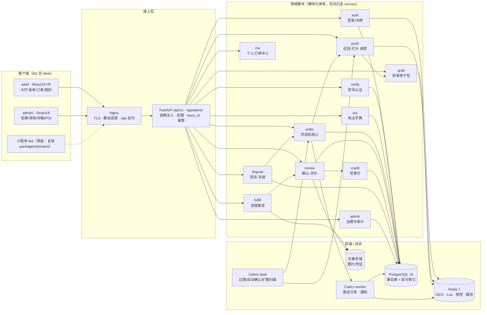
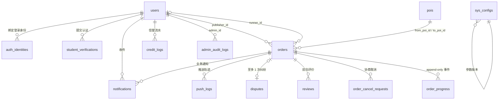

# 校园跑腿 CampusRun · 系统架构设计与任务分解

| 项目 | 内容 |
|---|---|
| 文档版本 | v1.0 |
| 上游输入 | `docs/01-PRD.md`（v1.0 方案定型版）、`校园跑腿系统-PRD.md`（v0.1 技术草稿，仅作实现参考） |
| 设计约束 | C1 Web 单端 / C2 线下结算 / C3 单人开发 / C4 复用 FastAPI+React 脚手架 / C5 Alembic 管变更 / C6 复杂度可解释 / C7 BR-13 召回键动态选 |
| 目标 | 一份能被一个人按顺序执行完的设计：模块划分 → 数据模型 → 接口 → 关键实现 → 35 个可验收任务 |
| 不在本文档内 | 视觉稿、UI 组件细节、运营话术、小程序 M4 的具体页面 |

---

## 0. 范围声明与设计红线

| # | 红线 | 落地方式 |
|---|---|---|
| R-1 | 后端 API 与端无关 | 所有接口只吃/吐 JSON，无端专属字段；`client_type` 仅用于日志与推送通道选择 |
| R-2 | 不出现任何支付/结算/提现/对账代码 | 只保留 `orders.reward` 与 `settle_state`（`UNSETTLED/SETTLED/FROZEN`）三个值，无金额流水表 |
| R-3 | 无微服务、无 K8s、无 Kafka/RabbitMQ | 1 个 API 进程 + 1 个 Celery worker + 1 个 beat + PG + Redis，全部跑在一个 Compose 里 |
| R-4 | 所有 schema 变更只能由 Alembic 产生 | 手写 SQL 一律进 `alembic/versions/`，CI 校验 `alembic check` 无差异 |
| R-5 | **召回键按任务类型动态选（BR-13）** | 唯一入口 `push/recall_key.py::recall_keys()`，全仓库禁止其他位置出现写死坐标来源 |
| R-6 | 禁深分页、禁 `ORDER BY RANDOM()`、禁 `LIKE '%x%'`、禁循环查库 | 见第 8 章「禁止写法清单」，Code Review 硬性拦截 |

---

## 1. 架构决策记录（ADR）

| # | 决策 | 备选 | 选定理由 | 代价 |
|---|---|---|---|---|
| ADR-01 | **模块化单体**（1 个 FastAPI 应用内 12 个 domain 包，包间只允许经 `service` 调用，禁止跨包用别人 `models`） | ① 微服务（order/push/user 三服务）② 单层大应用（api 里写业务） | C3 单人开发：微服务的容器编排、链路追踪、分布式事务会吃掉全部剩余工时；单层大应用在 M3 加纠纷时必然腐化。模块化单体保留「拆分面」，又只需 1 次部署 | 后期真拆服务需重构 import 边界；跨模块事务只能用本地事务（本项目恰好都是本地事务） |
| ADR-02 | **地理索引：Redis GEO（唯一热路径）+ PostgreSQL 仅存经纬度做冷备与后台检索** | ① PostGIS `GIST(geography)` 唯一存储 ② 应用层 Geohash 前缀匹配 ③ Redis GEO + PostGIS 双写 | ①PostGIS 查询质量最好但要装扩展、写 SQL 地理函数、每个召回都打 DB（800 在线 × 每单 1 次召回 = 打 DB，且无法做「候选过滤 Pipeline 一次 RTT」）；②Geohash 前缀在 1km 半径要查 9 宫格 + 边界补查，前缀长度选错就漏数据，且无法按距离排序；③双写会带来一致性 bug。Redis GEO 底层 ZSET 跳表，`GEOSEARCH BYRADIUS ... ASC` 就是 **O(log N + M)**，且与位置心跳天然同源（心跳本来就写 Redis），零同步问题 | 位置数据不持久（BR-19 本来就不许存轨迹，正好）；Redis 挂掉时定向推送降级为「仅大厅」（FR-PUSH-06 兜底） |
| ADR-03 | **抢单三道闸：Redis Lua 订单锁 → PG 行级 CAS（`WHERE status='PENDING'`）→ 幂等键**，另加 PG advisory lock 保证「在途上限」不被并发击穿 | ① 只用 DB 悲观锁 `SELECT FOR UPDATE` ② 只用 Redis 分布式锁 ③ 队列化串行抢单 | 只用 DB：100 并发全部打到行锁，P95 会冲到几百 ms，且长事务占连接；只用 Redis：Redis 主从切换或进程崩溃会丢锁，出现一单多接（数据错乱，代价最高）；队列化：本量级纯属过度设计。三闸各挡一类失败：Lua 挡 99% 流量、CAS 是**唯一正确性权威**、幂等键挡用户手抖与网络重试 | 需要补偿逻辑（DB 失败要回滚 Redis 锁），代码多约 60 行；见 7.3 |
| ADR-04 | **推送调度：发单事务提交后立即异步任务（首轮）+ Celery beat 每分钟扫描驱动扩圈（第 2/3 轮）** | ① 全定时扫描（每 30s 扫所有 PENDING 单）② 纯事件驱动（为每单注册 eta 任务）③ 同步推送（接口里直接算完再返回） | ①首轮延迟不可控（D9 要求发单到触达 <5s）；②纯事件驱动在 worker 重启/容器重建时 eta 任务会丢，订单永久不扩圈且无人发现；③同步推送把打分耗时压进发单接口，用户感知卡顿。混合方案：**首轮即时（保时延），扩圈靠扫描（保可靠，扫描只查 `PENDING AND last_push_at < now()-5min` 的部分索引）** | 扩圈最多延迟 60s（BR-14 的 5/15 分钟触发点足够粗，无感）；beat 与 worker 需共库，单点故障时队列积压 |
| ADR-05 | **JWT 无状态 access（2h）+ 有状态撤销（`users.token_version`）+ Redis 高频标志缓存（60s）** | ① 纯 JWT 无状态 ② 服务端 session（Redis store）③ 短 token + 每请求查 DB | 纯无状态无法满足 US-21「封禁即时生效 token 失效」；Redis session 每请求 1 次 RTT 且要处理 session 集群；每请求查 DB 直接压垮 PG。折中：token 只带 `uid/role/tv(version)`，封禁即 `token_version += 1` 使全部旧 token 失效（**即时、无 RTT**）；认证状态、接单模式这类高频易变标志放 Redis Hash `u:{uid}:flag`，TTL 60s，接受最长 60s 的状态滞后（唯一例外：封禁走 token_version，零滞后） | 认证状态变更最长 60s 才生效（可接受：认证本来就是异步审核）；需要维护一份缓存失效清单 |
| ADR-06 | **前端：Web 单端 = 2 个 Vite 应用（`web/` 用户端 + `admin/` 管理端），共享 `packages/api-client`（由后端 OpenAPI 生成的 TS 类型）与 `packages/ui-kit`** | ① 1 个 Vite 应用内 `/admin` 路由树 ② M1 就上 Taro 3 一套多端 ③ 管理端用低代码/现成 admin 模板 | ①管理端要独立鉴权、独立部署、独立 IP 白名单，与用户端的路由守卫/构建产物耦合在一起会互相拖累；②C1 明确 M1 不要 Taro 容器，且 Taro 构建链会拖慢每次热更；③引模板要改造权限模型，比自己写 8 个页面更贵。选 2 个 app：模板代码独立，但**接口层 100% 共享**——M4 加小程序时只需新建 `packages/api-client` 的 fetch adapter（换成 `wx.request`），业务 hook 全部在 `packages/domains`，UI 只做分叉 | pnpm workspace 配置约 1–2 小时；两个 app 的 Tailwind/TS 配置需共用 preset |
| ADR-07 | **状态机用「显式迁移表 + 守卫函数 + 统一事务出口」，不用第三方 FSM 库** | ① `python-transitions` 库 ② 在 service 里到处 `if status ==` 判断 | 17 条迁移（T1–T17）本质是一张 dict；第三方库要额外学 DSL，且副作用（写 progress、发通知、起定时器）仍需自己接。自研 100 行内可测、可生成单测矩阵、可返回结构化非法迁移错误（D3 要求） | 无库带来的图校验能力，靠单测枚举覆盖（T-12 要求 17 条 + 非法迁移全矩阵） |
| ADR-08 | **金额用 `NUMERIC(6,2)` + Python `Decimal`，禁止 float** | float / 分整数 | 0.5 元步进且要展示，`Decimal` 直读直写不出精度事故；分整数方案要在前后端做两次转换，反而多一个 bug 面 | 序列化时统一 `str` 输出，前端用字符串处理 |

---

## 2. 技术选型

| 层 | 选型 | 版本 | 理由 | 备选 |
|---|---|---|---|---|
| 运行时 | Python | 3.12 | C4 团队现有；3.12 的 `asyncio` 性能与 typing 改善 | 3.11 |
| Web 框架 | FastAPI | ^0.115 | 异步 + Pydantic v2 校验 + 自动 OpenAPI（前端类型生成的来源） | Flask（无异步/无 OpenAPI） |
| ASGI | uvicorn | ^0.32 | 标配，`--workers 2` 即可 | gunicorn+uvicorn worker |
| ORM | SQLAlchemy | ^2.0 | 2.0 风格 `Mapped[]` + `select()`，迁移生态最好 | Tortoise（迁移弱） |
| 迁移 | Alembic | ^1.14 | C5 硬要求 | — |
| 数据库 | PostgreSQL | 16 | JSONB（举证/图片/前后值）、部分索引、`pg_advisory_xact_lock`（在途上限权威锁） | MySQL 8（无部分索引、无 advisory lock，直接排除） |
| 缓存/地理 | Redis | 7.2 | GEO + Lua + 频控计数，一个组件顶三个用途 | KeyDB |
| 任务队列 | Celery + Redis broker | ^5.4 | C4 复用；只用在**推送分发、定时扫描、housekeeping**三处，不用来做事务消息 | APScheduler（重启丢任务） |
| 认证 | PyJWT + passlib 无密码流程 | ^2.9 | 只需 HS256 签发/校验 | python-jose（已不维护） |
| 前端 | React + TypeScript + Vite | 18.3 / 5.5 / 5.4 | C4 | — |
| 样式 | Tailwind + 少量 headless 组件（Radix） | 3.4 / ^1 | 移动端 H5 优先；不引重型 UI 库（MUI 体积对 H5 不友好） | MUI |
| 状态/数据 | TanStack Query + Zustand | ^5.5 / ^4.5 | Query 管服务端状态（游标分页、乐观刷新），Zustand 只管 UI 态 | Redux Toolkit |
| 路由 | react-router-dom | ^6.26 | — | — |
| 地图/地理 | 高德 JS API 仅用于**后台 POI 坐标拾取**；用户端不嵌地图，只显示距离文本 | 2.0 | 用户端嵌地图会引入 key 管理与授权合规问题；POI 坐标是运营一次性录入 | 腾讯地图 |
| 对象存储 | 兼容 S3 协议（COS/OSS/MinIO 均可） | boto3 ^1.35 | 签名直传，服务端不中转大文件 | 本地磁盘（仅 dev） |
| 短信/邮件 | 阿里云短信 + SMTP（校园邮箱通道为收件方，发件用自有 SMTP） | — | 可替换为腾讯云，接口抽象成 `Notifier` | — |
| 测试 | pytest + pytest-asyncio + httpx + 自写压测脚本（asyncio + httpx） | ^8 / ^0.24 / ^0.27 | 压测脚本进仓库，D7 可回归 | Locust（重） |
| 部署 | Docker Compose（api / worker / beat / postgres / redis / nginx） | — | C3：一台 2C4G 云主机足够（D9 量级） | — |
| 可观测 | structlog（JSON 日志 + trace_id）+ `/healthz` + 慢查询日志 | ^24 | 一个人不需要 ELK，`docker logs \| jq` 就够定位 | Prometheus（M4 再上） |
| CI（P2） | GitHub Actions：ruff + mypy(部分) + pytest + alembic check | — | 保证迁移不漂移 | — |

---

## 3. 系统架构图



**调用方向原则**：`api/*` 只做参数校验与权限，不写业务；`modules/*/service.py` 是唯一业务入口；`modules/*/repo.py` 是唯一 SQL 出口；跨模块调用只能是 `service → service`，禁止 `repo → repo`。

---

## 4. 后端模块划分

| 模块 | 职责 | 对外接口（HTTP） | 内部关键类/服务 | 依赖 |
|---|---|---|---|---|
| `common` | 错误码、统一响应、分页游标、时钟、trace_id、幂等、Notifier 抽象 | —（横切） | `ApiError` `CursorPage` `Idempotency` `Clock` `Notifier` | 无 |
| `auth` | 短信/邮箱验证码登录、JWT 签发与刷新、token 撤销、封禁即时失效 | `POST /auth/send-code` `POST /auth/login` `POST /auth/refresh` `POST /auth/logout` | `AuthService` `TokenService` `TokenVerifier(dep)` `RateLimiter` | common, verify(读认证态) |
| `verify` | 学号认证双通道（邮箱码 / 证件+人工）、防枚举、频控、状态查询 | `POST /verify/student` `POST /verify/email/code` `POST /verify/evidence` `GET /verify/status` | `VerifyService` `VerificationStateMachine` `StudentNoGuard` | common, auth, storage |
| `poi` | POI 字典查询、最近使用、坐标 | `GET /pois` `GET /pois/recent` | `PoiService` `PoiCache`（Redis 全量缓存） | common |
| `order` | 发单、状态机、取消、详情、订单中心查询 | `POST /orders` `GET /orders/{id}` `POST /orders/{id}/cancel` `GET /me/orders` | `OrderService` `StateMachine` `OrderNoGenerator` | common, poi, push, credit |
| `push` | **召回键决策**、候选召回、过滤、打分、Top-N、频控、推送落库与通知 | 无对外接口（内部服务），仅 `GET /push/inbox` 读站内消息 | `RecallKeyResolver` `CandidateRecall` `Scorer` `PushDispatcher` `QuotaGuard` | common, poi, order(读), redis |
| `grab` | 大厅列表、抢单原子性、在途上限、防抖 | `GET /orders/hall` `POST /orders/{id}/accept` | `HallQuery` `GrabService` `GrabLock` `InflightGuard` | common, order, push, credit |
| `fulfill` | 4 节点进度推进、送达凭证、逾期标记、催单 | `POST /orders/{id}/progress` `POST /orders/{id}/deliver` `POST /orders/{id}/urge` | `FulfillService` `ProgressAppender` | common, order, storage |
| `review` | 确认收货、自动确认、双向评价 | `POST /orders/{id}/confirm` `POST /orders/{id}/review` `GET /users/{id}/reviews` | `ConfirmService` `ReviewService` | common, order, credit |
| `credit` | 信誉分变动与等级、变动流水 | `GET /me/credit` | `CreditService` `CreditPolicy`（规则表驱动 BR-25） | common |
| `dispute` | 发起投诉、冻结、M1 人工处置、通知 | `POST /orders/{id}/dispute` `GET /orders/{id}/dispute` | `DisputeService` `FreezeGuard` | common, order, credit |
| `me` | 资料、接单模式开关、统计卡、接单记录、通知设置 | `GET /me` `PATCH /me/profile` `GET /me/stats` `GET /me/runner-records` `PATCH /me/notify-settings` | `ProfileService` `StatsService` | common, credit, auth |
| `admin` | 订单/用户/POI/纠纷/参数/审计 | `/api/admin/**` 共 11 个 | `AdminOrderService` `AdminUserService` `ConfigService` `AuditWriter` | 全部（只读为主 + 强制关闭/裁决写） |

**模块依赖图（无环）**：`common → {auth, verify, poi} → order → {push, grab, fulfill} → {review, dispute} → {credit, me, admin}`

---

## 5. 数据模型

### 5.1 ER 全图



### 5.2 表结构（14 张）

**users**

| 字段 | 类型 | 约束 | 说明 |
|---|---|---|---|
| id | bigserial | PK | |
| student_no | varchar(20) | UNIQUE NULL | BR-02 全局唯一；未认证为 NULL |
| nickname | varchar(32) | NOT NULL | 默认「同学+尾号4位」 |
| avatar_url | text | | |
| phone_enc | bytea | | AES-GCM 加密（D16 脱敏展示） |
| phone_mask | varchar(11) | | `138****8888`，直接供接口返回 |
| dept / grade | varchar(64)/(8) | | |
| verify_status | varchar(16) | NOT NULL default 'UNVERIFIED' | `UNVERIFIED/REVIEWING/APPROVED/REJECTED`（FR-AUTH-04） |
| credit_score | numeric(5,2) | NOT NULL default 100 | BR-25 区间 0–120 |
| credit_level | varchar(8) | GENERATED | 由分数派生：`EXCELLENT/GOOD/NORMAL/LIMITED`（BR-26） |
| status | varchar(12) | NOT NULL default 'ACTIVE' | `ACTIVE/BANNED/DELETED` |
| token_version | int | NOT NULL default 0 | ADR-05，+1 即全部旧 token 失效 |
| is_runner_mode | bool | NOT NULL default false | FR-ME-03，召回硬条件 |
| notify_settings | jsonb | default '{}' | 推送开关/免打扰时段 |
| created_at / updated_at | timestamptz | | UTC |

**auth_identities**（登录身份，与 users 分离以支持多通道）

| 字段 | 类型 | 约束 | 说明 |
|---|---|---|---|
| id | bigserial | PK | |
| user_id | bigint | FK→users ON DELETE CASCADE | |
| provider | varchar(12) | NOT NULL | `PHONE / WECHAT` |
| provider_uid | varchar(64) | NOT NULL | 手机号哈希 / openid |
| UNIQUE | — | `(provider, provider_uid)` | US-01 不重复建档 |

**student_verifications**

| 字段 | 类型 | 约束 | 说明 |
|---|---|---|---|
| id | bigserial | PK | |
| user_id | bigint | FK | |
| method | varchar(12) | NOT NULL | `EMAIL / OCR` |
| student_no_input / name_input | varchar(20)/(32) | | 用户填写原值 |
| email | varchar(64) | | 认证邮箱 |
| evidence_key | text | | 对象存储 key；BR-05 审核后 30 天删原图 |
| status | varchar(12) | NOT NULL | `PENDING/APPROVED/REJECTED` |
| reject_reason | varchar(200) | | US-03 必须给具体原因 |
| reviewer_id / reviewed_at | bigint/timestamptz | | |
| created_at | timestamptz | | 一用户多条，取最新 |

**pois**

| 字段 | 类型 | 约束 | 说明 |
|---|---|---|---|
| id | bigserial | PK | |
| campus_id | smallint | NOT NULL default 1 | 预留多校区（M? 不做） |
| name | varchar(64) | NOT NULL，UNIQUE(campus_id,name) | |
| type | varchar(16) | NOT NULL | `STATION/DORM/CANTEEN/BUILDING/ADMIN/PRINT/SHOP` |
| lat / lng | numeric(9,6) | NOT NULL | WGS84→GCJ02 统一存 GCJ02（高德系） |
| is_active | bool | default true | 下架后新单不可选 |
| sort_hint | int | default 0 | 搜索排序权重 |

**orders**（核心表）

| 字段 | 类型 | 约束 | 说明 |
|---|---|---|---|
| id | bigserial | PK | |
| order_no | varchar(20) | UNIQUE | `CR` + yyMMdd + 6 位随机（人读） |
| publisher_id | bigint | FK, NOT NULL | |
| runner_id | bigint | FK NULL | 抢单后写 |
| type | varchar(12) | NOT NULL | `EXPRESS/BUY/SEND/OTHER`（FR-ORDER-01，OTHER 由开关关闭） |
| from_poi_id / to_poi_id | bigint | FK NOT NULL | BR-08 必须来自字典 |
| from_lat / from_lng / to_lat / to_lng | numeric(9,6) | NOT NULL | 冗余自 POI，避免召回时 join |
| reward | numeric(6,2) | NOT NULL, CHECK 2<=x<=50 | BR-07；`.5` 步进在 API 层校验 |
| description | varchar(200) | | |
| images | jsonb | default '[]' | 最多 3 个 key（FR-ORDER-04，禁止上传含完整取件码的截图） |
| pick_code_enc | bytea | NULL；`type='EXPRESS'` 时非空（应用层 + CHECK） | **FR-ORDER-10** 取件码，AES-GCM 加密，同一密钥体系（同 phone_enc）。明文只在授权 DTO 中短暂存在，**禁止落日志、禁止进 list DTO** |
| expect_minutes | smallint | NOT NULL | 30/60/120/720（今日内→当日23:00） |
| deadline | timestamptz | NOT NULL | 到期未接 → EXPIRED（BR-09/T4） |
| status | varchar(12) | NOT NULL, idx | 7 值见 5.4 |
| settle_state | varchar(8) | NOT NULL default 'UNSETTLED' | `UNSETTLED/SETTLED/FROZEN`（C2：只记状态不记钱） |
| push_round | smallint | NOT NULL default 0 | 已推轮次，0=未推（BR-14） |
| last_push_at | timestamptz | | 扩圈扫描依据 |
| is_late | bool | default false | BR-23 |
| auto_confirmed | bool | default false | BR-21 |
| **auto_confirm_due_at** | timestamptz | NULL | **BR-21/BR-34：24h 自动确认的到期时刻**。`DELIVER`（T7）时 = `now+24h`；`restore_status` 回滚到 `DELIVERED`（T14）时**重写为** `now+24h`（重新起算）。**扫描只读此字段，不读 `delivered_at`** —— 回滚场景下 `delivered_at` 已是 3 天前，用它会**立刻**触发自动确认，等于仲裁刚放行就被系统判完成 |
| accepted_at / delivered_at / completed_at | timestamptz | | 冗余时间戳，供统计与索引。**`delivered_at` 一律不改写**：它是 K-12 履约时长（`delivered_at − accepted_at`）的唯一基准，只读 |
| cancel_reason | varchar(200) | | |
| pre_dispute_status | varchar(12) | NULL | **BR-35 挂起态语义**：进 DISPUTED 时写入投诉前状态，裁决无责按此回滚（T13/T14），出 DISPUTED 后置 NULL。仅在 `status='DISPUTED'` 时有意义 |
| version | int | NOT NULL default 0 | 后台编辑与进度并发校验 |
| created_at | timestamptz | NOT NULL | |

**order_progress**（append-only 事实流，不 UPDATE 不 DELETE）

| 字段 | 类型 | 约束 | 说明 |
|---|---|---|---|
| id | bigserial | PK | |
| order_id | bigint | FK, NOT NULL | |
| seq | smallint | NOT NULL，UNIQUE(order_id, seq) | 单调递增，防乱序 |
| action | varchar(20) | NOT NULL | 见 5.4 |
| from_status / to_status | varchar(12) | NOT NULL | 迁移前后，可重放 |
| actor_id | bigint | NULL | NULL=系统 |
| actor_role | varchar(8) | NOT NULL | `PUBLISHER/RUNNER/ADMIN/SYSTEM` |
| note | varchar(200) | | 进度备注/催单/关闭原因 |
| images | jsonb | default '[]' | 送达凭证（FR-FULFILL-03） |
| created_at | timestamptz | NOT NULL | |

**order_cancel_requests**（T7/T8 协商取消）

| 字段 | 类型 | 约束 | 说明 |
|---|---|---|---|
| id / order_id / requester_id | bigint | | |
| status | varchar(10) | NOT NULL | `PENDING/APPROVED/REJECTED`，UNIQUE(order_id) WHERE status='PENDING' |

**reviews**

| 字段 | 类型 | 约束 | 说明 |
|---|---|---|---|
| id / order_id / from_id / to_id | bigint | UNIQUE(order_id, from_id) | BR-27 一单一评价人一次 |
| direction | varchar(10) | NOT NULL | `P2R / R2P` |
| rating | smallint | CHECK 1..5 | |
| tags | jsonb | | 预设标签（FR-REVIEW-03） |
| content | varchar(100) | | |
| is_hidden | bool | default false | 隐私内容/冻结隐藏（BR-29） |
| created_at | timestamptz | | 7 天窗口在服务层校验（BR-24） |

**credit_logs**

| 字段 | 类型 | 约束 | 说明 |
|---|---|---|---|
| id / user_id | bigint | | |
| delta | numeric(5,2) | NOT NULL | 正负均可 |
| score_after | numeric(5,2) | NOT NULL | 供回溯 |
| reason_code | varchar(24) | NOT NULL | `ORDER_DONE/GOOD_REVIEW/LATE/ACCEPT_CANCEL/DISPUTE_LOST/ADMIN_ADJUST` |
| order_id / operator_id | bigint | | |
| note | varchar(200) | | 管理员调整必填理由（US-21） |

**disputes**

| 字段 | 类型 | 约束 | 说明 |
|---|---|---|---|
| id / order_id | bigint | UNIQUE(order_id) | BR-28 一单一次 |
| initiator_id | bigint | | |
| reason | varchar(24) | NOT NULL | `NOT_DELIVERED/DAMAGED/MISMATCH/FAKE_DELIVER/BAD_ATTITUDE` |
| evidence | jsonb | | `{images:[...], text:""}` ≤5 图 ≤300 字 |
| status | varchar(14) | NOT NULL | M1: `OPEN → RESOLVED`；M3 加 `EVIDENCE/ARBITRATING/APPEALED` |
| result | varchar(14) | NULL | `FOR_PUBLISHER/FOR_RUNNER/PARTIAL` |
| result_note / arbitrator_id / resolved_at | | | |

**push_logs**

| 字段 | 类型 | 约束 | 说明 |
|---|---|---|---|
| id / order_id / runner_id | bigint | | |
| round | smallint | NOT NULL | 1/2/3 |
| channel | varchar(12) | NOT NULL | `INBOX/PUSH/HALL_ONLY`（降级也留痕，D17） |
| distance_m | int | | 到召回键距离 |
| score | numeric(6,4) | | 打分值，供调参（FR-PUSH-08） |
| is_clicked / is_grabbed | bool | default false | 效果回流 |
| created_at | timestamptz | | 频控另走 Redis，此表仅审计与调参 |

**notifications**（站内消息 = 必达主通道 FR-PUSH-06）

| 字段 | 类型 | 约束 | 说明 |
|---|---|---|---|
| id / user_id | bigint | | |
| kind | varchar(24) | NOT NULL | `PUSH_NEW_ORDER/ACCEPTED/PROGRESS/DELIVERED/NEED_CONFIRM/AUTO_CONFIRMED/DISPUTE_*/CREDIT/VERIFY_RESULT/BAN` |
| title / body | varchar(64)/(200) | | |
| payload | jsonb | | 深链参数 `{order_id, tab}` |
| read_at | timestamptz | NULL | 红点 = `read_at IS NULL` 计数 |

**sys_configs**（US-22 参数热更新）

| 字段 | 类型 | 约束 | 说明 |
|---|---|---|---|
| key | varchar(48) | PK | `push.radius_m` 等 |
| value | jsonb | NOT NULL | 类型化读取 |
| updated_by / updated_at | bigint/timestamptz | | |
| version | int | NOT NULL | 每次改 +1，写审计 |

**admin_audit_logs**（不可变，D20）

| 字段 | 类型 | 约束 | 说明 |
|---|---|---|---|
| id / admin_id | bigint | | |
| target_type / target_id | varchar(16)/bigint | | `ORDER/USER/POI/CONFIG/DISPUTE` |
| action | varchar(32) | | `FORCE_CLOSE/BAN/UNBAN/VERIFY_PASS/VERIFY_REJECT/CREDIT_ADJUST/CONFIG_UPDATE/ARBITRATE_FREE/ARBITRATE_LIABLE/VIEW_PICK_CODE` |
| before / after | jsonb | | 改前改后值 |
| note | varchar(200) | | 强制关闭必填原因（BR-32） |
| created_at | timestamptz | | 只 INSERT 权限，DB 层收回 UPDATE/DELETE |

### 5.3 索引清单（每条索引都必须写明服务哪个查询）

| 表 | 索引 | 类型 | 支撑查询 |
|---|---|---|---|
| users | `UNIQUE(student_no)` | btree | 学号唯一校验（BR-02）、后台按学号检索 |
| users | `(verify_status, created_at)` | btree | 后台认证待审队列（FR-ADMIN-02） |
| auth_identities | `UNIQUE(provider, provider_uid)` | btree | 登录查档（US-01） |
| student_verifications | `(user_id, created_at DESC)` | btree | 查最新一次认证状态 |
| student_verifications | `(status, created_at)` | btree | 审核队列 |
| pois | `(campus_id, is_active, type)` | btree | 字典列表/筛选（FR-ORDER-02） |
| orders | `(status, deadline)` **WHERE status='PENDING'** | btree 部分索引 | 过期扫描 T4（D12）、扩圈扫描 |
| orders | `(publisher_id, created_at DESC, id DESC)` | btree | 「我发布的」游标分页（FR-CENTER-01） |
| orders | `(runner_id, status, created_at DESC, id DESC)` | btree | 「我接的」+ **在途数统计**（BR-16） |
| orders | `(runner_id, completed_at DESC)` **WHERE status='COMPLETED'** | btree 部分索引 | 接单记录与月收入（FR-CENTER-04） |
| orders | `(auto_confirm_due_at)` **WHERE status='DELIVERED'** | btree 部分索引 | 24h 自动确认扫描（BR-21/D4）。**不建 `(status, delivered_at)`**：`delivered_at` 在回滚后不是到期依据（见 5.2），把它做索引等于索引了一个不会被 WHERE 用到的列 |
| orders | `UNIQUE(order_no)` | btree | 按订单号检索（US-20） |
| orders | `(created_at DESC)` | btree | 后台时间范围检索、看板 |
| order_progress | `UNIQUE(order_id, seq)` | btree | 时间轴顺序读（FR-CENTER-03）+ 幂等去重 |
| order_cancel_requests | `UNIQUE(order_id) WHERE status='PENDING'` | btree 部分索引 | 防重复申请 |
| reviews | `UNIQUE(order_id, from_id)` | btree | BR-27 |
| reviews | `(to_id, created_at DESC)` | btree | 个人主页近 20 条（FR-REVIEW-06） |
| credit_logs | `(user_id, created_at DESC)` | btree | 信誉明细 |
| disputes | `UNIQUE(order_id)`；`(status, created_at)` | btree | 一单一次 + 纠纷队列 |
| push_logs | `(runner_id, created_at DESC)` | btree | 频控审计与调参回查 |
| push_logs | `(order_id, round)` | btree | 扩圈排除已推人群（BR-14） |
| notifications | `(user_id, read_at, created_at DESC)` | btree | 站内信列表与红点计数 |
| admin_audit_logs | `(target_type, target_id, created_at DESC)`；`(admin_id, created_at DESC)` | btree | 追溯（D20） |

| orders | `(accepted_at)` **WHERE status='IN_PROGRESS'** | btree 部分索引 | **FR-FULFILL-06 静默预警扫描**（T-24，每 60s，`WHERE status='IN_PROGRESS' AND accepted_at < now()-40min`）；T16/T17 的守卫判定**不依赖**此索引（请求时算） |

> **不建**：`orders(to_geohash)`、`GIST` 地理索引 —— 地理检索全走 Redis GEO（ADR-02），DB 里的经纬度只用于后台展示与冷备重算。建了不用就是纯写放大。
> **T16/T17 的守卫判定不需要任何新索引**：复用 `order_progress UNIQUE(order_id, seq)`（见 7.4）；`pick_code_enc` 只出现在单条详情查询里；`pre_dispute_status` 只按主键读写。

### 5.4 状态枚举 vs `order_progress` 事件流的关系

**核心原则**：`orders.status` 是**聚合结果**（可重放得到），`order_progress` 是**append-only 事实**（不可改）。两者在同一事务内写：先 append 事实，再 `UPDATE orders SET status=... WHERE id=? AND status=?`，一切以 CAS 成功为准。

| status | 对外折叠（PRD 7.1） | 可执行 action |
|---|---|---|
| `PENDING` | 待接单 | `ACCEPT`(T2) `CANCEL`(T3) `EXPIRE`(T4) |
| `IN_PROGRESS` | 进行中 | `PICKED_UP`/`ON_THE_WAY`(**T5** 自环) `NOTE`(**T6** 自环，留备注) `DELIVER`(**T7**) `REQUEST_CANCEL`（自环） `APPROVE_CANCEL`(**T8**) `REJECT_CANCEL`（自环） `CANCEL_LOST`(**T17**，无进度+45min) `DISPUTE_OPENED`(**T16**，有进度+45min) `URGE` |
| `DELIVERED` | 待确认 | `CONFIRM`(**T9**) `AUTO_CONFIRM`(**T10**) `DISPUTE_OPENED`(**T11**) |
| `COMPLETED` | 已完成 | `DISPUTE_OPENED`(**T12**，48h 内)　※评价不产生 progress 事件，载体是 `reviews` 表 |
| `DISPUTED` | 进行中（**挂起态、非终态**，BR-34） | `ARBITRATE_FREE`(**T13**/**T14**，无责→回 `pre_dispute_status`) `ARBITRATE_LIABLE`(**T15**，担责→CANCELLED)；**补丁 B**：`PICKED_UP`/`ON_THE_WAY`/`DELIVER` 只写事件 |
| `CANCELLED` | 已取消 | —（终态） |
| `EXPIRED` | 已取消 | —（终态） |

**progress.action 全集（19 个）**：`CREATE / ACCEPT / PICKED_UP / ON_THE_WAY / NOTE / DELIVER / CONFIRM / AUTO_CONFIRM / REQUEST_CANCEL / APPROVE_CANCEL / REJECT_CANCEL / CANCEL / CANCEL_LOST / EXPIRE / DISPUTE_OPENED / ARBITRATE_FREE / ARBITRATE_LIABLE / FORCE_CLOSE / URGE`

> **勘误（2026-10-26）**：
> 1. `URGE`（催单）原未列入全集，但 FR-FULFILL-05 要求「每单最多 2 次」且需可审计、可举证，次数放 Redis 会在重启时丢失 → **加入全集，18 → 19**；`(IN_PROGRESS, URGE)` 为自环，守卫 `actor_id = publisher_id` 且 `urge_count < 2`。
> 2. `REVIEW` 原列在 `COMPLETED` 可执行动作中，但评价的唯一载体是 `reviews` 表（`UNIQUE(order_id, from_id)`），再写一条 progress 事件属于重复事实、会给投影对账引入噪声 → **不纳入 action 全集**。
> 3. `POST_FREEZE_EVIDENCE`（补丁 B）**仅 `DISPUTED` 生效**。此前 `DELIVERED` 行也列了同样三项，属笔误（`DELIVERED` 本就允许正常 `CONFIRM`，不存在"冻结"）。
> 4. `orders` 实际为 **31 列**（5.2 表逐行统计），此前任务书写的「30 个字段」有误。


**投影规则（用于对账脚本）**：`status = last(progress where action in STATUS_MUTATING).to_status`。写一条 `tests/test_state_machine.py::test_projection_matches_status` 随机生成事件序列校验聚合一致。

> **✅ 出口裁定（终版，`01-PRD.md` 第 358–379 行迁移表为唯一权威编号，本文档不再自建编号）**
>
> **问题**：`进行中` 原本被三重封死——BR-28 不覆盖投诉、取消需协商一致、24h 自动确认只挂在 `待确认`。三者叠加 = 接单人抢单后失联，订单**永久卡死**，且接单人的在途名额被自己占满。
>
> **解法：`进行中` 给发单人两条出口，靠「接单人是否产生过进度」在守卫层硬互斥（不是运行时"用过就关"——后者挡不住并发与重放）。**
>
> | 接单人状态 | 静默 < 45min | 静默 ≥ 45min |
> |---|---|---|
> | **从未有任何进度**（无节点、无备注） | 只能协商取消（T8） | **只能自助取消 T17**（BR-33，接单人 −3，零人工，不计完成率分母） |
> | **已产生过任意进度**（节点**或**备注） | 只能协商取消（T8） | **只能投诉 T16**（BR-28，免举证，走人工仲裁） |
>
> `has_progress` 一旦为真就**永久**关闭 T17 通道（BR-34 配套条款：防止「东西已在接单人手里、订单却被终结」的卷件口子）。**静默起点** = 最后一次 `RUNNER_EVIDENCE` 事件时刻；从未有过则取 `accepted_at`。阈值单一常量 **45 分钟**（`dispute.silent_minutes`），预警 **40 分钟**（`dispute.silent_warn_minutes`，BR-35 / FR-FULFILL-06）。**「进度记录」的唯一定义在 7.4 的 `RUNNER_EVIDENCE`**，本节及其他章节只引用、不重写（避免多处口径漂移）。
>
> **挂起态语义（BR-34）**：`DISPUTED` 是挂起态、非终态。进 DISPUTED 时把当时状态写进 `orders.pre_dispute_status`；裁决**无责**按此回滚（T13 → `IN_PROGRESS`，T14 → `pre_dispute_status`），裁决**担责**走 T15 → `CANCELLED`。**裁决前订单不得被判为已完成。**
>
> **完整迁移表（T1–T17，逐条照搬 PRD 第 358–379 行，编号/操作者/守卫一字未改；这是 D3 的验收依据）**
>
> | # | from → to | 触发动作 | 操作者 | 守卫 |
> |---|---|---|---|---|
> | T1 | — → PENDING | 发布订单 | 发单人 | 已认证；发单时间窗内；同时待接单 ≤ 3 |
> | T2 | PENDING → IN_PROGRESS | 抢单 | 接单人 | 原子抢占；在途 ≤ 3；未过期 |
> | T3 | PENDING → CANCELLED | 取消 | 发单人 | — |
> | T4 | PENDING → EXPIRED | 到期未接 | 系统 | 超过期望送达时间 |
> | T5 | IN_PROGRESS → IN_PROGRESS | 推进节点（已取件/配送中） | 接单人 | 节点只能顺序推进；重置静默计时 |
> | T6 | IN_PROGRESS → IN_PROGRESS | 留备注（不改节点） | 接单人 | 重置静默计时；使 BR-33 通道永久关闭 |
> | T7 | IN_PROGRESS → DELIVERED | 标记已送达 | 接单人 | 已到最后节点 |
> | T8 | IN_PROGRESS → CANCELLED | 协商取消 | 双方 | 对方同意 |
> | T9 | DELIVERED → COMPLETED | 确认收货 | 发单人 | — |
> | T10 | DELIVERED → COMPLETED | 24h 自动确认 | 系统 | 送达 ≥ 24h 且未操作 |
> | T11 | DELIVERED → DISPUTED | 发起投诉 | 任一方 | 同单仅 1 次纠纷 |
> | T12 | COMPLETED → DISPUTED | 发起投诉 | 任一方 | 完成后 ≤ 48h |
> | T13 | DISPUTED → IN_PROGRESS | 裁决无责 | 管理员 | 投诉前状态为进行中（BR-34） |
> | T14 | DISPUTED → COMPLETED | 裁决无责 | 管理员 | 投诉前状态为待确认/已完成（BR-34） |
> | T15 | DISPUTED → CANCELLED | 裁决担责 | 管理员 | — |
> | **T16** | IN_PROGRESS → DISPUTED | **发起投诉（接单人失联）** | **发单人** | **已产生过进度 且 静默 ≥ 45min（BR-28）；免举证** |
> | **T17** | IN_PROGRESS → CANCELLED | **失联自助取消** | **发单人** | **无任何进度 且 距抢单 ≥ 45min（BR-33）；信誉 −3** |
>
> **两条口径补充（PRD 未写死，架构侧统一，实现按此）**
> 1. **T5 与 T6 都会让 `has_progress=True`**。PRD 只在 T6 行标注"使 BR-33 通道永久关闭"，但 T16 的守卫原文是「已有至少一条进度记录（**节点或备注**）」，两处取并集：`PICKED_UP / ON_THE_WAY / DELIVER / NOTE` **且操作者是接单人**都算进度（精确白名单见 7.4 `RUNNER_EVIDENCE`）。否则"点了已取件但没留备注"的单会被 T17 无责取消掉已取走的件——这是最坏的一条错误路径。**注意这是「接单人的进度」，不是「单上的任何事件」**：发单人的 `NOTE`（催单）、`URGE`、`REQUEST_CANCEL` 都不算——否则发单人第 10 分钟催一次单，就把自己唯一的零人工出口永久关死了（见 7.4 反例）。
> 2. **T14 的目标态按 BR-34 正文执行 `pre_dispute_status`**（`DELIVERED` 回 `DELIVERED`、`COMPLETED` 回 `COMPLETED`），**不是一律 `COMPLETED`**。与 PRD 表格 T14 的"→ 已完成"存在张力，我选 BR-34 正文，理由：BR-34 同一条里明文「裁决前订单不得被判为已完成」，把 `PRE=DELIVERED` 的单直接判 `COMPLETED` 等于仲裁替发单人确认收货。**回 `DELIVERED` 后不会立刻再自动确认**：`restore_status` 同步把 `auto_confirm_due_at` 重写为 `now+24h`，发单人拿到完整 24h（若不重写、仍看 `delivered_at`，10/1 送达 + 10/4 裁决回滚会在同一毫秒满足 24h —— 这是原方案的隐藏 bug）。**此差异已报 team-lead 与产品经理确认；如需改为强制 COMPLETED，只是 1 行改动。**

---

## 6. 接口清单

> 统一前缀 `/api/v1`（用户端）、`/api/admin`（管理端）。统一响应 `{code, data, message, trace_id}`；`code=0` 成功。所有列表用 `cursor` 游标分页，`limit` 默认 20、上限 50。

### 6.1 用户端

| 方法 | 路径 | 权限 | 入参要点 | 出参要点 | FR |
|---|---|---|---|---|---|
| POST | `/auth/send-code` | 游客 | `scene`(login/verify), `target` | 统一「已发送」不暴露存在性 | FR-AUTH-01/05 |
| POST | `/auth/login` | 游客 | `provider`, `code` | `access(2h)`, `refresh(30d)`, `user{verify_status}` | FR-AUTH-01 |
| POST | `/auth/refresh` | 持 refresh | refresh token | 新 access + 轮换 refresh | FR-AUTH-01 |
| POST | `/auth/logout` | R2 | — | `token_version+1`（该端） | FR-AUTH-01 |
| POST | `/verify/email/code` | R1 | `student_no`,`name`,`email` | 已发信（不校验学号是否存在） | FR-AUTH-02 |
| POST | `/verify/student` | R1 | `student_no`,`name`,`email`,`code` | 认证成功/学号冲突（**仅在验证码校验通过后**才可能返回冲突，防枚举） | FR-AUTH-02/05 |
| POST | `/verify/evidence` | R1 | multipart 图片 | `status=REVIEWING` | FR-AUTH-03 |
| GET | `/verify/status` | 登录 | — | 4 态 + `reject_reason` | FR-AUTH-04 |
| GET | `/pois` | R1 | `keyword`(前缀/别名匹配), `type`, `limit≤30` | 列表（含 `lat/lng/distance_m` 若传 `near`） | FR-ORDER-02 |
| GET | `/pois/recent` | R2 | — | 最近 5 个 | FR-ME-05 |
| POST | `/orders` | R2 已认证 | `type, from_poi_id, to_poi_id, reward, expect_minutes, description, images[], pick_code?`（`type=EXPRESS` 时**必填**，4–20 位字符） | `order{id,order_no,status,deadline}` + `suggest_reward` 不入参 | FR-ORDER-01~07, **FR-ORDER-10** |
| GET | `/orders/hall` | R1 | `type, min_reward, radius(500/1000/2000), sort(distance/reward/new), cursor` | 卡片数组 + `next_cursor`（FR-GRAB-03 全字段） | FR-GRAB-01/02/03 |
| POST | `/orders/{id}/accept` | R2 已认证 | Header `Idempotency-Key`（必填） | 见 6.3 错误码表 | FR-GRAB-04/05/08 |
| GET | `/orders/{id}` | 相关人/R1 | — | 详情 + 时间轴 + `available_actions[]`（按状态×角色服务端算，前端只渲染）；**`silent_since`（仅 `IN_PROGRESS` 且 `uid=publisher_id`，按 7.4 `RUNNER_EVIDENCE`+actor 口径算，供前端现算倒计时，不新增表字段）**；**`pick_code` 仅当 `uid=publisher_id` 或（`uid=runner_id` 且 `status≠PENDING`）时返回明文，其余返回 `"****"`** | FR-CENTER-03/05, FR-ORDER-10 |
| POST | `/orders/{id}/progress` | R2 接单人 | `action`(PICKED_UP/ON_THE_WAY/**NOTE**), `note?` | 新状态 + 通知已发；**`NOTE` 只写事件、不改节点，但会重置静默计时并永久关闭 T17 通道（T6）** | FR-FULFILL-01/02/06, **T5/T6** |
| POST | `/orders/{id}/deliver` | R2 接单人 | `images[]`(≤3), `note?` | `status=DELIVERED` | FR-FULFILL-03 |
| POST | `/orders/{id}/urge` | R2 发单人 | — | 每单最多 2 次 | FR-FULFILL-05 |
| POST | `/orders/{id}/confirm` | R2 发单人 | — | `COMPLETED` | FR-REVIEW-01 |
| POST | `/orders/{id}/cancel` | R2 相关人 | `reason`, `note?`, `mode`(`normal\|lost`) | `PENDING`→CANCELLED(T3)；`IN_PROGRESS`+`normal`→生成协商申请（自环，30 分钟未响应自动失效）；`IN_PROGRESS`+**`lost`**→**T17 失联自助取消**（守卫：无任何进度 + 距抢单 ≥45min + 仅发单人；接单方 −3，不计完成率分母） | FR-ORDER-08, T3/T8, **BR-33** |
| POST | `/orders/{id}/cancel/approve` | R2 对方 | `agree:bool` | 同意→CANCELLED(**T8**)；拒绝→保持 IN_PROGRESS，投诉入口仍开 | T8 |
| POST | `/orders/{id}/review` | R2 相关人 | `rating, tags[], content` | 7 天窗口校验 | FR-REVIEW-03 |
| GET | `/users/{id}/reviews` | 登录 | `cursor` | 近 20 条、隐私隐藏 | FR-REVIEW-06 |
| POST | `/orders/{id}/dispute` | R2 相关人 | 窗口（BR-28）：`DELIVERED` 期间 / `COMPLETED` 后 48h / **`IN_PROGRESS`（三条全满足：理由仅「接单人失联」+ 已产生过进度 + 静默 ≥45min，T16）**。字段 `reason, images[]≤5, text≤300`；**T16 时 `reason` 固定 `RUNNER_LOST`、免举证** | 创建即冻结；写 `pre_dispute_status` | FR-DISPUTE-01/02, **BR-28** |
| GET | `/me` | 登录 | — | 资料 + 徽标 + 统计卡 | FR-ME-01/02 |
| PATCH | `/me/profile` | R2 | `nickname, dept, grade, is_runner_mode` | 关闭接单模式即 `DEL geo member` + 停心跳 | FR-ME-03/US-25 |
| PATCH | `/me/notify-settings` | R2 | 开关/免打扰时段 | | FR-ME-04 |
| GET | `/me/stats` | 登录 | — | 发/接/完成率/评分/信誉 | FR-ME-02 |
| GET | `/me/orders` | 登录 | `role=publisher\|runner, status_group, cursor` | 双 Tab + 待确认置顶分组 | FR-CENTER-01/02 |
| GET | `/me/runner-records` | 登录 | `month?` | 累计/按月中明细 | FR-CENTER-04 |
| GET | `/me/credit` | 登录 | — | 分值/等级/流水 | FR-REVIEW-04 |
| GET | `/push/inbox` | 登录 | `cursor`, `unread_only` | 站内消息 + 未读计数 | FR-PUSH-06 |
| POST | `/presence/heartbeat` | R2 接单模式 | `lat, lng` | 写 Redis GEO，TTL 90s | BR-19 |

### 6.2 管理端

| 方法 | 路径 | 权限 | 入参要点 | FR |
|---|---|---|---|---|
| POST | `/api/admin/auth/login` | 游客 | 账号密码 + 可选 IP 白名单 → 独立 role=ADMIN 的 token | FR-ADMIN-* |
| GET | `/api/admin/dashboard` | R3 | `range` | FR-ADMIN-06 |
| GET | `/api/admin/orders` | R3 | `order_no/student_no/status/from/to/amount`，游标分页 | FR-ADMIN-01 |
| POST | `/api/admin/orders/{id}/force-close` | R3 | `reason`(必填) → 写审计 + progress(`FORCE_CLOSE`)；**M1 的唯一线上事故兜底**（D6a 三界面之一） | FR-ADMIN-01/BR-32 |
| POST | `/api/admin/orders/{id}/note` | R3 | `note` | FR-ADMIN-01 |
| GET | `/api/admin/users` | R3 | `keyword/verify_status/status` | FR-ADMIN-02 |
| POST | `/api/admin/users/{id}/verify` | R3 | `pass`, `reason?` | FR-AUTH-03 |
| POST | `/api/admin/users/{id}/ban` | R3 | `ban:bool, reason` → `token_version+1` | US-21 |
| POST | `/api/admin/users/{id}/credit` | R3 | `delta, reason` → 写 credit_logs | US-21 |
| GET | `/api/admin/disputes` | R3 | `status` | FR-ADMIN-03 |
| POST | `/api/admin/disputes/{id}/resolve` | R3 | `result`(`FOR_RUNNER`/`FOR_PUBLISHER`/`PARTIAL`) + `note` → T13/T14 回滚到 `pre_dispute_status`、T15 → CANCELLED；信誉与冻结同步处理 | FR-DISPUTE-03, BR-35 |
| GET | `/api/admin/orders/{id}/pick-code` | R3 | 无需入参；**返回明文且必写 `admin_audit_logs`**（action=`VIEW_PICK_CODE`） | FR-ORDER-10 |
| GET/POST/PUT/DELETE | `/api/admin/pois`，`POST /api/admin/pois/import` | R3 | CSV/Excel 批量 | FR-ADMIN-04 |
| GET/PUT | `/api/admin/configs` | R4 | `key, value` → 版本+审计，Redis 缓存 60s 内生效 | FR-ADMIN-07/US-22 |
| GET | `/api/admin/audit-logs` | R3 | `target_type, admin_id, from, to` | FR-ADMIN-05 |

### 6.3 抢单接口错误码表（US-09 必须可区分）

`POST /orders/{id}/accept`，Header 必带 `Idempotency-Key`。

| HTTP | code | 语义 | 前端文案 | 触发点 | 依据 |
|---|---|---|---|---|---|
| 200 | 0 | 抢单成功（或幂等重放首次成功结果） | 抢单成功 | Lua 通过 + CAS 成功 | FR-GRAB-04 |
| 400 | 40001 | 缺 `Idempotency-Key` | 请求异常，请重试 | 入口校验 | FR-GRAB-08 |
| 403 | 40301 | 未通过学号认证 | 完成认证后才能接单 | `require_verified` | BR-01/D1 |
| 403 | 40302 | 账号被封禁 | 账号状态异常 | token_version 失效 | US-21 |
| 403 | 40303 | 不能接自己发布的单 | 这是你自己发布的单 | `publisher_id == uid` | 设计约束 |
| 404 | 40401 | 订单不存在 | 订单不存在 | | — |
| 409 | 40901 | 已被接走（含并发失败） | 手慢了，订单已被接走 | CAS 0 行 / Lua 锁存在 | BR-17/D7 |
| 409 | 40902 | 已达在途上限 3 单 | 你当前有 3 单进行中，完成后再接 | 在途校验（DB 权威） | BR-16/D8 |
| 409 | 40903 | 订单状态不可抢（非 PENDING） | 该单已不可接 | 状态预检 | BR-17 |
| 409 | 40904 | 幂等键已被不同订单使用 | 请求异常 | 幂等记录 order 不匹配 | FR-GRAB-08 |
| 410 | 41001 | 订单已过期 | 该单已过期 | `deadline < now()` | T4 |
| 422 | 42201 | 状态机非法迁移 | 该单当前状态不允许接单 | `StateMachine` 拒绝 | D3 |
| 429 | 42901 | 抢单过于频繁（1s 内 >1 次） | 别急，慢慢点 | 防抖令牌桶 | FR-GRAB-08 |

---

## 7. 关键实现方案

### 7.1 地理召回：Redis GEO 维护 + 动态召回键

**数据进 Redis 的方式**

| 动作 | 命令 | 键 | 说明 |
|---|---|---|---|
| 心跳上报 | `GEOADD geo:runners:{campus} lng lat {uid}` | 单 ZSET | 只有「接单模式开 + 前台活跃」才写（BR-19） |
| 关模式/下线 | `ZREM geo:runners:{campus} {uid}` | | US-25 立即停止被召回 |
| TTL 兜底 | 心跳时写 `runner:alive:{uid}` EX 90，扫描任务 `SREM` 无 alive 的成员 | | 防止关页面未发请求造成僵尸候选 |
| 订单进池 | `GEOADD geo:orders:{campus} lng lat {order_id}`；成交/取消/过期 `ZREM` | | 供大厅距离排序（FR-GRAB-01） |
| 全量重建 | `scripts/rebuild_geo.py` 从 DB 重放当日活跃单 | | Redis 丢失后 30 秒恢复 |

**召回键决策函数（唯一入口，对应 BR-13 / FR-PUSH-01）**

```python
# app/modules/push/recall_key.py
_STRATEGY = {                      # 严禁在其他文件里出现坐标来源选择
    OrderType.EXPRESS: ("TO",),            # 代取快递 → 终点（起点是 2~3 个驿站，无法分群）
    OrderType.BUY:     ("FROM",),          # 代买     → 起点（成本在「去哪买」）
    OrderType.SEND:    ("FROM",),          # 代送     → 起点
    OrderType.OTHER:   ("FROM", "TO"),     # 其他     → 双键并集（M1 由 config 关闭该类型）
}

def recall_keys(order) -> list[tuple[float, float, int]]:
    """返回 [(lat, lng, radius_m), ...]；主键用配置半径，次键用 1.5×半径。"""
    r0 = config.get_int("push.radius_m")          # 默认 1000
    out = []
    for i, key in enumerate(_STRATEGY[order.type]):
        lat, lng = (order.to_lat, order.to_lng) if key == "TO" else (order.from_lat, order.from_lng)
        out.append((lat, lng, r0 if i == 0 else int(r0 * 1.5)))
    return out
```

**半径与扩圈**：第 1 轮 `r=1km`（BR-13）；第 2 轮（t=5min）`r=2km`；第 3 轮（t=15min）`r=3km` 且订单转「仅大厅降权展示 + 建议加价」。每轮必须 `EXCLUDE` 已推人员（`push_logs` 查 `(order_id)` 得 uid 集合 → `GEOSEARCH` 后过滤；集合规模 ≤ 40，内存过滤免二次 RTT）。

**候选召回+过滤**（一次 Pipeline）：

```python
cands = redis.geosearch("geo:runners:1", *key, radius=r, sort="ASC", count=500, withdist=True)
pipe = redis.pipeline()
for uid, dist in cands:                       # M ≈ 20~200
    pipe.hgetall(f"u:{uid}:flag")             # verify_status / is_runner_mode / credit_level
    pipe.scard(f"runner:inflight:{uid}")
flags, loads = zip(*pipe.execute())           # 1 次 RTT 拿全部
# 过滤：离线/未认证/关模式/在途≥3/信誉受限(BR-26)/已推过/被频控
```

### 7.2 打分排序

```
S(r) = 0.45·D + 0.20·R + 0.15·C + 0.10·A + 0.10·N           # 权重全部来自 sys_configs
D = exp(-dist_to_key_r / 500)                               # 距离衰减，d0=500m
R = exp(-route_gap / 800)                                   # 顺路度：在途单终点→本单起点直线距离
C = clamp((credit - 80) / 40, 0, 1)                         # 信誉归一化，100→0.5，120→1
A = min(orders_7d / 10, 1)                                  # 近 7 日接单活跃度（Redis 日计数器）
N = rand()                                                  # 随机扰动，防马太（J3 的公平性保险）
惩罚：load == 2 → S *= 0.6；credit_level == LIMITED → 不进定向候选（BR-26）
```

**实现要点**
- Top-N 用 `heapq.nlargest(20, cand, key=S)`，`O(M log N)`，M≤200 时实测 < 1ms；**禁止全排序**。
- `route_gap` 需要「在途单终点坐标」：从 Redis `inflight:{uid}` 的 order_id 批量 `HMGET order:{id} to_lat to_lng`，一次 Pipeline；无在途则 `route_gap = dist_to_key`（中性）。
- 权重、d0、Top-N、惩罚系数全部 `sys_configs` 可读，Redis 缓存 60s → 满足 US-22「5 分钟内生效不重启」。
- 打分结果写 `push_logs(score, distance_m, round, channel)`，供 FR-PUSH-08 回流调参。

### 7.3 抢单原子性（三道闸 + 补偿）

```
闸1 Redis Lua（挡 99% 并发，O(1)）
闸2 PG 行级 CAS + 在途上限 advisory lock（唯一正确性权威）
闸3 Idempotency-Key（挡用户手抖与网络重试）
```

```lua
-- grab.lua  KEYS[1]=grab:order:{oid}  KEYS[2]=grab:user:{uid}
-- ARGV[1]=uid  ARGV[2]=ttl_ms
if redis.call('SET', KEYS[1], ARGV[1], 'PX', ARGV[2], 'NX') == false then return 0 end  -- 0=已被接/正在接
if redis.call('SET', KEYS[2], ARGV[1], 'PX', ARGV[2], 'NX') == false then
  redis.call('DEL', KEYS[1]); return -2                                                 -- -2=同用户并发
end
return 1
```

```python
# grab/service.py（核心 12 行，错误分支略）
r = await lua_grab(oid, uid)                 # 闸1
if r != 1: raise GrabError(40901 if r == 0 else 42901)
try:
    async with db.transaction():
        await db.execute(text("SELECT pg_advisory_xact_lock(hashtext(:k))"), {"k": f"runner:{uid}"})
        inflight = await order_repo.count_inflight(uid)          # DB 权威，(runner_id,status) 索引
        if inflight >= cfg("order.max_inflight"): raise GrabError(40902)   # 闸2 前置
        rows = await db.execute(update(Order).where(
            Order.id == oid, Order.status == "PENDING").values(          # 闸2 权威 CAS
            status="IN_PROGRESS", runner_id=uid, accepted_at=clock.now(), version=Order.version + 1))
        if rows.rowcount != 1: raise GrabError(40901)
        await progress_repo.append(oid, "ACCEPT", "PENDING", "IN_PROGRESS", uid, "RUNNER")
        await order_repo.bump_inflight_cache(uid, oid)
except GrabError:
    await lua_release(oid, uid); raise                       # 补偿：删两把锁
```

- **闸3 幂等**：`Redis SET idem:{uid}:{key} = {order_id,response} NX EX 86400`。命中且 order_id 一致 → 直接回放首次 200；order_id 不一致 → `40904`。
- **在途上限为什么用 advisory lock**：`count(*) + UPDATE` 之间若无串行化，同一用户并发抢 5 单可同时读到 `inflight=2` 而全部通过（D8 会失败）。advisory lock 按 uid 串行，代价 0.1ms，单实例 PG 完全够用。
- **Redis 在途计数只做召回期预过滤**（允许轻微漂移），抢单时以 DB 计数为准；`scripts/housekeeping.py` 每 10 分钟用 DB 重建 Redis 集合，检测到漂移写 WARN 日志。
- **压测判据**：`pytest tests/test_grab_concurrent.py -k concurrent` → 100 并发同一单，`SELECT count(*) FROM orders WHERE status='IN_PROGRESS'` == **1**，其余 99 个返回 `40901`。

### 7.4 状态机实现

```python
# order/state_machine.py —— 17 条，编号与 PRD 7.1 迁移表逐条对齐（T1 由 create() 直接落库，不进本表）
TRANSITIONS: dict[tuple[Status, Action], Trans] = {
    (PENDING, ACCEPT):             Trans(IN_PROGRESS, guard=grab_guard,            effects=[notify_publisher, cancel_push]),              # T2
    (PENDING, CANCEL):             Trans(CANCELLED,   guard=publisher_only,        effects=[cancel_push]),                                # T3
    (PENDING, EXPIRE):             Trans(EXPIRED,     guard=deadline_passed,       effects=[cancel_push]),                                # T4
    (IN_PROGRESS, PICKED_UP):      Trans(IN_PROGRESS, guard=node_in_order,         effects=[notify_publisher]),                           # T5
    (IN_PROGRESS, ON_THE_WAY):     Trans(IN_PROGRESS, guard=node_in_order,         effects=[notify_publisher]),                           # T5
    (IN_PROGRESS, NOTE):           Trans(IN_PROGRESS, guard=runner_order_ok,       effects=[notify_publisher]),                           # T6
    (IN_PROGRESS, DELIVER):        Trans(DELIVERED,   guard=last_node_reached,     effects=[notify_publisher, mark_late]),                # T7
    (IN_PROGRESS, APPROVE_CANCEL): Trans(CANCELLED,   guard=peer_agreed_cancel,    effects=[release_inflight, notify_both]),              # T8
    (IN_PROGRESS, CANCEL_LOST):    Trans(CANCELLED,   guard=guard_no_progress_45m, effects=[credit(-3), release_inflight, marker("BR-33")]),  # T17 自助取消
    (IN_PROGRESS, DISPUTE_OPENED): Trans(DISPUTED,    guard=guard_silent_45m,     effects=[save_pre_dispute, freeze]),                   # T16 失联投诉（免举证）
    (DELIVERED, CONFIRM):          Trans(COMPLETED,   guard=publisher_only,        effects=[credit_add, open_review]),                    # T9
    (DELIVERED, AUTO_CONFIRM):     Trans(COMPLETED,   guard=system,                effects=[credit_add, open_review, flag_auto]),          # T10
    (DELIVERED, DISPUTE_OPENED):   Trans(DISPUTED,    guard=party,                 effects=[save_pre_dispute, freeze, hide_reviews]),      # T11
    (COMPLETED, DISPUTE_OPENED):   Trans(DISPUTED,    guard=within_48h_party,      effects=[save_pre_dispute, freeze, hide_reviews]),      # T12
    (DISPUTED, ARBITRATE_FREE):    Trans(<pre_dispute_status>, guard=admin_free,   effects=[restore_status, unfreeze, reopen_review]),     # T13/T14（BR-34）
    (DISPUTED, ARBITRATE_LIABLE):  Trans(CANCELLED,   guard=admin_liable,          effects=[credit_penalty, unfreeze]),                    # T15
}
# 补丁 B：冻结期间只补证据、不改 status（不占 T 编号）
POST_FREEZE_EVIDENCE = {(DISPUTED, a) for a in ("PICKED_UP", "ON_THE_WAY", "DELIVER")}
```

```python
# 「进度记录」的唯一定义——全文档只此一处，其他章节只引用这个常量，不重写
# 条件 = action ∈ 白名单 AND actor_id = order.runner_id（必须是接单人自己产生的）
RUNNER_EVIDENCE: tuple[str, ...] = ("PICKED_UP", "ON_THE_WAY", "DELIVER", "NOTE")
# 反例（务必看懂，否则改错）：发单人的 NOTE（催单）/ URGE / REQUEST_CANCEL / REJECT_CANCEL
# 若也算进度，则发单人「第 10 分钟催一次单」就永久关闭了自己唯一的零人工出口 T17，
# 而 T16 又要求静默 ≥45min（催单刚重置过），结果两条路同时不可走 —— 比原 bug 更糟。

async def probe_progress(order) -> tuple[bool, datetime]:
    """一次反向索引扫，同时给出「是否已有接单人进度」与「静默起点」。两个守卫共用。"""
    row = await db.first(
        select(OrderProgress.action, OrderProgress.created_at)
        .where(
            OrderProgress.order_id == order.id,
            OrderProgress.actor_id == order.runner_id,          # ← 关键：过滤掉发单人/系统事件
            OrderProgress.action.in_(RUNNER_EVIDENCE),          # ← 关键：白名单，不是「≠ACCEPT/CREATE」
        )
        .order_by(OrderProgress.seq.desc())
        .limit(1)                                               # Index Scan Backward，命中即停
    )
    if row is None:
        return False, order.accepted_at        # 从未有接单人进度 → 静默起点 = 抢单时刻
    return True, row.created_at                # 有进度 → 静默起点 = 最后一条进度时刻

# T16 失联投诉守卫：已产生过进度 + 静默 ≥45min + 仅发单人
async def guard_silent_45m(order, actor, payload) -> bool:
    if actor.id != order.publisher_id: return False
    has_progress, since = await probe_progress(order)
    if not has_progress: raise ApiError(422, 42201, "接单人尚无任何进度，请走无责取消")
    if clock.now() - since < timedelta(minutes=cfg("dispute.silent_minutes")):     # 45
        raise ApiError(422, 42201, "静默未满 45 分钟")
    return True

# T17 自助取消守卫：无任何进度 + 距抢单 ≥45min + 仅发单人
async def guard_no_progress_45m(order, actor, payload) -> bool:
    if actor.id != order.publisher_id: return False
    has_progress, _ = await probe_progress(order)
    if has_progress: raise ApiError(422, 42201, "接单人已产生进度，只能走投诉")
    if clock.now() - order.accepted_at < timedelta(minutes=cfg("dispute.silent_minutes")):
        raise ApiError(422, 42201, "距抢单未满 45 分钟")
    return True
```

```python
# restore_status：T13/T14 唯一出口。两条不变量写在这里，别的地方不许碰
async def restore_status(order, actor, payload):
    to_status = order.pre_dispute_status
    patch = {"pre_dispute_status": None, "auto_confirm_due_at": None}   # 默认清空到期时刻
    if to_status == Status.DELIVERED:
        # 重新起算 24h（T-26 判据）：不重写 delivered_at，只重写到期的时刻
        patch["auto_confirm_due_at"] = clock.now() + timedelta(hours=24)
    await db.execute(update(Order).where(Order.id == order.id, Order.status == Status.DISPUTED).values(**patch))
    # delivered_at 一律不动：它是 K-12 履约时长的唯一基准
```


```python
# 统一事务出口：17 条迁移都必须经此函数，禁止在 service 里直接改 status
async def apply(order, action, actor, payload):
    t = TRANSITIONS.get((order.status, action))
    if t is None:
        raise ApiError(422, 42201, f"非法迁移 {order.status} -/-> {action}")   # D3 可识别错误
    if not await t.guard(order, actor, payload): raise ApiError(403, 40310, "无权或条件不满足")
    to_status = t.to_status if isinstance(t.to_status, Status) else getattr(order, "pre_dispute_status")
    await progress_repo.append(order.id, action, order.status, to_status, actor.id, actor.role, payload.note)
    rows = await db.execute(update(Order).where(Order.id == order.id, Order.status == order.status)
                            .values(status=to_status, version=Order.version + 1, **_timestamps(action, to_status)))
    if rows.rowcount != 1: raise ApiError(409, 40905, "状态已被其他操作改变，请刷新")   # 并发互斥
    for fx in t.effects: await fx(order, actor, payload)     # 副作用在事务提交后由 outbox 派发
```

- **`_timestamps(action, to_status)` 是时间戳写入的唯一入口**（同一函数、同一事务）：`ACCEPT`→`accepted_at`；`DELIVER`→`delivered_at=now()` **且 `auto_confirm_due_at=now()+24h`**；`CONFIRM/AUTO_CONFIRM`→`completed_at`；`REJECT_CANCEL` 等不写任何时间戳。**禁止在 service 层单独 `SET delivered_at` 或 `SET auto_confirm_due_at`**——一次事务里两个字段必须同源同刻，否则会出现"已送达但永不过期"或"没送达就已过期"。`delivered_at` 一旦写入即为只读（K-12），唯一会重写 `auto_confirm_due_at` 的例外是 T14 的 `restore_status`。
- **T16 / T17 的互斥在守卫层，不在运行时**：两个守卫读同一个 `probe_progress`，一个要求 `has_progress=True`、一个要求 `False`。**同一时刻两者必有一个返回 `42201`**，所以并发请求、网络重放、用户连点都无法同时穿过；不存在"用过就关"需要的额外标记字段。这也正是 `probe_progress` 只查一次的理由（PM 提的"别算两遍"）：一次索引扫同时给出布尔与时间戳。
- **`probe_progress` 的复杂度是 O(log N + k)，零新增索引；k 是「单张订单的事件条数」，不是全表行数**：`order_progress` 已有 `UNIQUE(order_id, seq)`，`order_id=?` 走 `Index Cond` 定位到本单区间，`ORDER BY seq DESC LIMIT 1` 在该区间内反向扫、命中即停；`actor_id` 与 `action IN (...)` 落在 `Filter`，**会多扫几行**（最坏走完本单全部事件）。
  - 为什么接受：k 的业务上界是单张订单的生命周期事件数，正常 ≤8、极端（反复催单/多轮纠纷）≤50，即最坏 50 次索引页内比较 = 微秒级；而 T16/T17 是**用户点按钮触发**的低频操作，不在任何热路径上。为此再建一个 `(order_id, actor_id, seq)` 的部分索引，等于给 append-only 表加写放大，不划算。
  - **测试断言（改过的，照这个写）**：断言 `EXPLAIN (ANALYZE)` 计划里出现 `Index Scan Backward` 且**没有 `Sort` 节点、没有 `Seq Scan`**（这是抗机器差异的稳定性判据），再断言 `actual rows ≤ 50`。**不要再断言 `rows=1`**——加了 `actor`/`action` 过滤后，`LIMIT 1` 是"命中第一条即停"而不是"只读一行"，断言 `rows=1` 会在"发单人已催单、接单人尚无进度"这类合法场景下假失败。
  - `seq` 与 `created_at` 严格同序，不必另建 `(order_id, created_at DESC)`。
- **阈值常量的落点（唯一，可核对）**：`backend/app/core/config.py`（T-06 产出）

```python
# backend/app/core/config.py
12  DEFAULTS: dict[str, Any] = {
...
18      "dispute.silent_minutes": 45,          # BR-28 / BR-33 服务端唯一常量（不按期望时长分档）
19      "dispute.silent_warn_minutes": 40,     # BR-35 / FR-FULFILL-06
```

  种子写入 `sys_configs`（0002），业务代码只调 `cfg("dispute.silent_minutes")`，**由 `ConfigService` 的 Redis 快照（TTL 60s）提供，不产生 per-order 查库**。**禁止**把 45 写进 `state_machine.py` 的字面量——`grep -rn "45" backend/app/modules/order/` 应只剩注释。
- **补丁 B 实现**：`POST_FREEZE_EVIDENCE` 里的三个 action 在 `DISPUTED` 下走旁路——只 `progress_repo.append()`，**不碰 `status`、不碰 `pre_dispute_status`**。这样误冻结不会吞掉接单人的履约证据，且不引入第二条状态真相。
- **T14 目标态读 `pre_dispute_status`**：`Trans(<pre_dispute_status>)` 不是常量；`restore_status` 负责清空字段 + 解冻 + 回滚到 `COMPLETED` 时补 `completed_at` 并开评价窗口；**回滚到 `DELIVERED` 时重写 `auto_confirm_due_at = now+24h`**（见上方 `restore_status` 片段）。`delivered_at` 在任何路径下都不改写。
- **`silent_warn_sweep` 的实现要点（P0，BR-35 的唯一载体）**：T16/T17 是"用户点按钮触发 → 请求时算"，**但 BR-35 是系统主动推的**，没有任何用户请求会触发它，所以必须有这条 beat 扫描，否则规则写了没人执行、功能静默缺失。四个细节：①**批处理上限** `ORDER BY accepted_at LIMIT 500`，积压时也不会一轮拉全表；②**两段式判定**——先用 `accepted_at` 粗筛（索引可走），再对每条调**同一个** `probe_progress` 拿真实静默起点（口径只有一份，绝不在这里另写一个「最后事件时间」的 SQL）；③**一次扫两个分支**——40min 推接单人 `RUNNER_SILENT_WARN`，45min 顺带给发单人推 `CAN_SELF_CANCEL`（同一次扫描多判一个分支，边际成本 0.5h）；④**幂等**用 Redis `SET warn:{order_id} NX EX 7200`（每单仅 1 次，不新增表字段、不依赖 notifications 的 jsonb 查询）。挂载点在 `backend/app/workers/celery_app.py::beat_schedule["silent_warn_sweep"] = {"task": "sweep.silent_warn", "schedule": 60.0}`，任务实现 `backend/app/workers/tasks/sweep.py::silent_warn_sweep`。
- **非法迁移**：查表未命中即拒，返回 `42201` + 结构化 `from/to/action`（D3）。
- **互斥组（4 组，全部靠 CAS `WHERE status=<读到状态>` 的 0 行检测）**：① T16 vs T17（守卫层已互斥）② T13/T14/T15 仲裁只能一次 ③ T9 vs T11 ④ T11/T12/T16 抢 `DISPUTED`（另有 `UNIQUE(disputes.order_id)` 兜底）。
- **定时器（Celery beat，全部为「扫描 + 部分索引」而非 per-order eta）**：

| 任务 | 周期 | SQL 依据 | 对应 |
|---|---|---|---|
| `expire_pending` | 60s | `WHERE status='PENDING' AND deadline<now()`（部分索引） | T4/BR-09/D12 |
| `auto_confirm` | 60s | `WHERE status='DELIVERED' AND auto_confirm_due_at <= now()`（部分索引 `(auto_confirm_due_at) WHERE status='DELIVERED'`；**不读 `delivered_at`**，24h 时长在 `DELIVER`/`restore_status` 写入时刻落到字段上，D4 可把时长配成 60s 做测试） | T10/BR-21 |
| `push_escalate` | 60s | `WHERE status='PENDING' AND push_round<3 AND last_push_at<now()-interval(5m/15m)` | BR-14 |
| `late_remind` | 60s | `WHERE status IN ('IN_PROGRESS') AND deadline-30min<now() AND is_late=false` | FR-FULFILL-04 |
| **`silent_warn_sweep`**（**P0**） | 60s | **两段式**：①粗筛 `WHERE status='IN_PROGRESS' AND accepted_at <= now()-interval '40 min'` `ORDER BY accepted_at LIMIT 500`（部分索引 `(accepted_at) WHERE status='IN_PROGRESS'`）②对每条调 `probe_progress` 拿真实静默起点（复用 T16/T17 同一函数，不重算口径），40min 推接单人、45min 推发单人 | **BR-35 / FR-FULFILL-06** |
| `housekeeping` | 10min | 重建 Redis 在途集合、清理 alive 过期成员、30 天前认证原图删除 | BR-05/BR-19 |

### 7.5 推送频控与降级

- **计数**：固定窗口 `INCR pushq:{uid}:10m` + `EXPIRE 600`；`INCR pushq:{uid}:1h` + `EXPIRE 3600`（Lua 一次做完，避免两次 RTT）。阈值 3/10min、10/1h 来自配置（BR-15）。
- **降级**：超阈值或订阅通道不可用 → `channel='HALL_ONLY'` 写 `push_logs`（不推送但留痕，D17 可验证），且该用户进入本单**扩圈黑名单**（BR-15 明确「不进扩圈名单」）。
- **必达兜底**：**一切推送必写 `notifications`（站内信 + 红点）**，`PUSH`/小程序订阅消息只是增强。写库失败则整轮任务重试（Celery `autoretry_for`），绝不出现「推送失败且用户无感」（D14）。
- **冷启动**：`ZCARD geo:runners:1 < 5` → 跳过定向推送（BR-18），订单标 `push_round=3`（不再扩圈），发单响应带 `hint="当前附近接单人较少"`。
- **免打扰**：`users.notify_settings.quiet_hours` 命中时段 → 只写站内信不发 push。

### 7.6 认证流程与防枚举

**认证状态机（`student_verifications`）**

```
UNVERIFIED ──提交邮箱──> EMAIL_CODE_SENT ──码对且学号未占用──> APPROVED
                                  └──码错 5 次/10 分钟过期──> (回到 UNVERIFIED，计失败次数)
UNVERIFIED ──上传证件──> REVIEWING ──管理员通过──> APPROVED
                                  └──驳回(必填原因)──> REJECTED ──重提──> REVIEWING
APPROVED 后永不回到 UNVERIFIED（US-04：已认证用户不再看到认证入口）
```

**防枚举（FR-AUTH-05 / D18）四条硬规则**

| # | 规则 | 实现 |
|---|---|---|
| 1 | 发码接口永不透露「该邮箱/学号是否已注册」 | 一律返回 `{code:0, message:"验证码已发送"}`；日志记真实原因，不回显 |
| 2 | 学号占用冲突**只在验证码校验通过后**才返回 | 否则可被用来批量探测在册学号（这是最容易漏的一点） |
| 3 | 频控三道 | 同 IP 5 次/h、同学号 3 次/24h、连续失败 5 次锁 24h；计数器全在 Redis，键 `vf:{ip}:h` `vf:{no}:24h` `vf:fail:{no}` |
| 4 | 邮箱必须与白名单后缀匹配（`@nau.edu.cn`，配置化，FR-AUTH-07 预留多校区） | 正则在服务端，前端校验只做体验 |

**JWT 结构与校验位置**

```json
{ "sub": "10086", "role": "USER|ADMIN", "tv": 3, "iat": 1750000000, "exp": 1750007200, "jti": "uuid" }
```

- 校验链（FastAPI dependency）：`TokenVerifier`（签名 + exp + `tv == users.token_version` 从 Redis `u:{uid}:tv` 读，miss 则查 DB 并回填 60s）→ `require_verified`（`verify_status == APPROVED`，写操作装饰）→ `require_role`（管理端）。
- 封禁 = `token_version + 1` + 写 `u:{uid}:tv` → 该用户所有 access/refresh 立刻失效（US-21）。
- **不把 `verify_status` 放进 JWT**：认证是异步审核，放进 token 会导致刚通过认证的用户要等 2h 才能发单。

---

## 8. 复杂度分析

| 环节 | 方案 | 复杂度 | 800 在线接单人 / 300 待接单的实测预期（2C4G） |
|---|---|---|---|
| GEO 召回在线接单人 | Redis `GEOSEARCH BYRADIUS ASC` | O(log N + M) | N=800，M(1km)≈40–80 → **0.3–0.8ms** |
| 候选过滤 | 1 次 Pipeline（HGETALL + SCARD） | O(M) | 80 次读 1 RTT → **1–2ms** |
| 打分 + Top-20 | `heapq.nlargest` | O(M log N) | 80×log20 → **0.2ms** |
| 推送落库 | 批量 INSERT + 站内信 | O(P) | P=20 → **3–6ms** |
| 发单到触达（端到端） | 事务提交 → Celery → 站内信 + 推送 | — | **< 2s**（D9 要求 <5s，召回打分 P95 <50ms 有 10 倍余量） |
| 抢单 | Lua + 行 CAS + advisory lock | O(1) | **8–15ms**（含事务） |
| 在途数校验 | 部分索引 `(runner_id,status)` count | O(log K) | K≤10 → **0.1ms** |
| 大厅列表 | Redis GEO 距离游标 + 内存 facets | O(log N + K) | 一页 20 条 → **4–10ms**（D10 <300ms） |
| 订单中心列表 | 联合索引 keyset 游标 | O(log N + page) | 翻到第 500 条无衰减（D10） |
| 过期扫描 | 部分索引 `(status,deadline)` | O(log N + k) | k=2 → **<1ms/分钟** |
| 自动确认扫描 | 部分索引 `(auto_confirm_due_at) WHERE DELIVERED` | O(log N + k) | **<1ms/分钟** |
| 后台订单检索 | `order_no` / `student_no` 等值 + 时间范围 | O(log N + page) | 万级订单 <50ms（US-20 要求 <1s） |
| 频控判断 | 2 个 INCR + PEXPIRE（Lua 合一） | O(1) | **0.2ms** |
| 静默预警扫描（FR-FULFILL-06） | 部分索引 `(accepted_at) WHERE IN_PROGRESS` + LATERAL 取每条最后事件 | O(log N + k) | 在途单 ~40，每 60s 一次 → **<50ms/次**，对 API 无影响（独立 worker） |
| T16/T17 守卫 `probe_progress` | `UNIQUE(order_id,seq)` 反向扫 + `Filter(actor,action)` | O(log N + k)，k=**本单**事件数（≤50） | **<0.3ms**，与全表规模无关；非热路径（仅点按钮触发） |
| 10 倍数据量（1 万注册/2000 在线） | 同上 | 只 log N 项增大 | D11：召回 M 增大到 200，总耗时约 ×2.5，**无数量级劣化** |

**禁止写法清单（Code Review 硬性拦截）**

| ❌ 禁止 | 为什么 | ✅ 替代 |
|---|---|---|
| `ORDER BY RANDOM()` | 全表排序 + 无法走索引 | 随机扰动放进打分，候选集本身已收敛 |
| `LIMIT 20 OFFSET 480` 深分页 | OFFSET 越大扫描越多，第 500 条会退化 | keyset 游标 `(created_at, id) < (?, ?)` |
| `LIKE '%关键词%'` | 无法用索引，全表扫 | POI 搜索用前缀 + 别名表 `name LIKE 'x%'`；订单号等值 |
| `for o in orders: db.get(User, o.runner_id)` | N+1，20 条列表变 20 次 RTT | 一次 `WHERE id IN (...)` 或 Redis Pipeline |
| 接口里同步调 `GEOSEARCH` + 逐人 `HGETALL` | M 次 RTT | 单次 Pipeline |
| 用 `float` 存金额 | 0.5 步进精度事故 | `NUMERIC(6,2)` + `Decimal` |
| `SELECT *` 到 Pydantic 再裁剪 | 大字段（images/evidence）白读 | 场景化 `select(列...)` + 专用 DTO |
| 在 DB 里做地理距离计算 | 无 PostGIS 时全表算 | 距离由 Redis `WITHDIST` 给 |
| 判定进度用 `action NOT IN ('CREATE','ACCEPT')` | 口径过宽：把发单人的催单/取消申请也算成"接单人进度"，直接关死发单人的零人工出口 | `action IN RUNNER_EVIDENCE AND actor_id = order.runner_id`（唯一定义见 7.4） |
| 自动确认用 `delivered_at < now()-24h` | 纠纷回滚后 `delivered_at` 是旧的，会**立刻**自动确认，仲裁白做 | `auto_confirm_due_at <= now()`，到期时刻在 `DELIVER`/`restore_status` 写入 |

---

## 9. 工程目录结构

```
campus-run/
├── docs/                          # 文档
│   ├── 01-PRD.md
│   ├── 02-ARCHITECTURE.md
│   ├── class-diagram.mermaid
│   └── sequence-diagram.mermaid
├── backend/
│   ├── pyproject.toml / requirements.txt / requirements-dev.txt
│   ├── alembic.ini                # C5：所有 DDL 变更入口
│   ├── alembic/{env.py,versions/0001_init.py,versions/0002_seed_configs.py}
│   ├── app/
│   │   ├── main.py                # FastAPI 实例、中间件、异常处理器、路由挂载
│   │   ├── core/                  # 横切能力（无业务）
│   │   │   ├── config.py          # 环境变量 + sys_configs 读取器（Redis 缓存 60s）
│   │   │   ├── security.py        # JWT 签发/校验、AES、脱敏
│   │   │   ├── errors.py          # ApiError + 错误码常量（唯一错误码来源）
│   │   │   ├── response.py        # {code,data,message,trace_id} 包装
│   │   │   ├── pagination.py      # CursorPage 编解码
│   │   │   ├── clock.py           # Clock.now()（可被测试注入）、时区换算（BR-10）
│   │   │   ├── logging.py         # structlog + trace_id contextvar
│   │   │   ├── idempotency.py     # Idempotency-Key 读写
│   │   │   └── notifier.py        # Notifier 抽象：Inbox / Push / SMS / Mail
│   │   ├── db/
│   │   │   ├── base.py            # DeclarativeBase、Mixin(timestamps)
│   │   │   ├── session.py         # async engine/session、事务装饰器
│   │   │   ├── redis.py           # 连接池、键名规范、Lua 装载
│   │   │   └── lua/{grab.lua,quota.lua,presence.lua}
│   │   ├── models/                # ORM（按聚合根分文件，不按表散落）
│   │   │   ├── user.py, poi.py, order.py, push.py, review.py, dispute.py, governance.py
│   │   ├── schemas/               # Pydantic DTO（请求/响应分离，不直接吐 ORM）
│   │   ├── api/
│   │   │   ├── deps.py            # TokenVerifier / require_verified / require_admin / pagination
│   │   │   ├── v1/{auth,verify,poi,orders,hall,grab,fulfill,review,dispute,me,presence}.py
│   │   │   └── admin/{auth,orders,users,pois,disputes,configs,audit,dashboard}.py
│   │   ├── modules/               # 领域层（业务唯一入口）
│   │   │   ├── common/            # 共享策略：config_reader、notify_templates
│   │   │   ├── auth/{service.py,repo.py}
│   │   │   ├── verify/{service.py,repo.py,state.py,guards.py}
│   │   │   ├── poi/{service.py,repo.py,cache.py}
│   │   │   ├── order/{service.py,repo.py,state_machine.py,no_gen.py}
│   │   │   ├── push/{recall_key.py,recall.py,scoring.py,dispatch.py,quota.py,repo.py}
│   │   │   ├── grab/{service.py,hall.py,lock.py,inflight.py}
│   │   │   ├── fulfill/{service.py,progress_repo.py,storage.py}
│   │   │   ├── review/{service.py,repo.py,confirm.py}
│   │   │   ├── credit/{service.py,policy.py}
│   │   │   ├── dispute/{service.py,repo.py,freeze.py}
│   │   │   ├── me/{service.py,stats.py}
│   │   │   └── admin/{orders.py,users.py,pois.py,disputes.py,configs.py,audit.py}
│   │   └── workers/
│   │       ├── celery_app.py      # broker=Redis、队列 push/sweep/io 三条
│   │       └── tasks/{push.py,sweep.py,housekeeping.py}
│   ├── scripts/
│   │   ├── seed_pois.py           # POI 导入（CSV→DB→Redis 缓存刷新）；M1 硬前置，A3
│   │   ├── rebuild_geo.py         # Redis GEO 全量重建
│   │   ├── rebuild_inflight.py    # 在途集合对账
│   │   ├── loadtest_grab.py       # D7/D8 压测
│   │   └── metric_d16b.py         # D16b 订单外流观测指标
│   ├── data/pois_nau.csv          # 全校区 POI 种子（A3 硬前置）
│   └── tests/{conftest.py,test_state_machine.py,test_recall_key.py,test_scoring.py,
│              test_grab_concurrent.py,test_push_quota.py,test_auth_flow.py,
│              test_verify_antienum.py,test_admin_audit.py,test_hall_cursor.py}
├── packages/
│   ├── api-client/                # 由 OpenAPI 生成的 TS 类型 + fetch 封装（M4 换 adapter 即可）
│   └── domains/                   # 端无关业务 hooks（useHall/useOrder/useGrab…）
├── web/                           # 用户端 Vite 应用（H5 响应式）
│   └── src/{pages(B 大厅/发单/预览/详情/订单中心/我的/认证/评价/投诉),components,stores,router}
├── admin/                         # 管理后台 Vite 应用（M1 只做 D6a 三界面）
│   └── src/pages/{VerifyQueue,Orders,Disputes}.tsx   # 认证审核 / 订单检索+强制关闭 / 纠纷处置台
│       （D6b：Dashboard/Pois/Configs/Audit 四页 → M1.1）
├── deploy/
│   ├── docker-compose.yml         # dev：pg/redis/api/worker/beat
│   ├── docker-compose.prod.yml    # prod：+nginx、资源限额、重启策略
│   ├── backend.Dockerfile
│   ├── nginx.conf                 # TLS、静态、/api 反代、上传体积限制
│   ├── .env.example
│   └── Makefile                   # up/down/migrate/seed/test/lint/loadtest
└── .github/workflows/ci.yml       # P2：ruff + pytest + alembic check
```

---

## 10. 依赖包清单

**backend/requirements.txt**

| 包 | 版本 | 用途 |
|---|---|---|
| fastapi | ^0.115 | Web 框架 |
| uvicorn[standard] | ^0.32 | ASGI 服务器 |
| pydantic | ^2.9 | DTO 与校验 |
| pydantic-settings | ^2.5 | 环境变量配置 |
| sqlalchemy[asyncio] | ^2.0.35 | ORM |
| asyncpg | ^0.30 | PG 异步驱动 |
| alembic | ^1.14 | 迁移（C5） |
| redis | ^5.2 | GEO/Lua/计数（redis-py 提供 `geosearch`） |
| celery[redis] | ^5.4 | 异步任务 + beat |
| pyjwt | ^2.9 | JWT（ADR-05） |
| cryptography | ^43 | AES-GCM 手机号加密 |
| structlog | ^24.4 | JSON 日志 + trace_id |
| boto3 | ^1.35 | S3 兼容对象存储预签名 |
| python-multipart | ^0.0.12 | 文件上传 |
| httpx | ^0.27 | 外部调用（短信/SMTP 无）与测试客户端 |
| aiosmtplib | ^3.0 | 认证邮件发送 |
| `dev`：pytest, pytest-asyncio, pytest-cov, ruff, mypy, Faker | — | 质量 |

**web/package.json / admin/package.json 关键依赖**

| 包 | 版本 | 用途 |
|---|---|---|
| react / react-dom | ^18.3.1 | 运行时 |
| react-router-dom | ^6.26 | 路由（订单详情深链、`?role=` 参数） |
| @tanstack/react-query | ^5.56 | 服务端状态、游标分页、乐观刷新（大厅/Grab） |
| zustand | ^4.5 | 认证态、UI 态 |
| tailwindcss / postcss / autoprefixer | ^3.4 | 样式 |
| @radix-ui/react-dialog, -toast, -select | ^1 | headless 组件（底部弹层/二次确认） |
| vite / @vitejs/plugin-react / typescript | ^5.4 / ^4.3 / ^5.6 | 构建 |
| openapi-typescript | ^7 | 从后端 OpenAPI 生成 `api-client` 类型（防字段漂移 D13/D15） |
| dayjs | ^1.11 | 倒计时、时区显示 |
| admin 额外：@tanstack/react-table, recharts | ^8 / ^2 | 检索表格与看板趋势 |

---

## 11. 任务列表（M1，35 个，按依赖排序）

> 粒度：单人 0.5–4h。所有产出文件路径相对仓库根。

**优先级分组（P0 = M1 上线阻塞，33 个）**
`T-01 T-02 T-03 T-04 T-05 T-06 T-07 T-08 T-09 T-11 T-12 T-13 T-14 T-15 T-16 T-17 T-18 T-19 T-20 T-21 T-22 T-23 T-24 T-26 T-27 T-28 T-29 T-30 T-31 T-32 T-33 T-34 T-35`

**优先级分组（P1 = 可切到 M1.1，2 个）**
`T-10`（OCR 兜底，可先用邀请码白名单顶）· `T-25`（对象存储，可先用本地磁盘）

> **T-34 由 P1 提为 P0**（D6a 裁定）：没有认证审核队列 → 走审用户进不来，准入 P0 不可用；没有纠纷处置台 → FR-DISPUTE-03 执行不了，投诉后永久冻结比不投诉更糟；没有强制关闭 → 失联单与线上事故无兜底。**这三个界面本身就是 P0 闭环的一部分，不是"后台管理"的附属品**，+1.5 天不可省。

| 编号 | 任务名 | 产出文件（相对路径） | 依赖 | 对应 FR/BR | 完成判据 |
|---|---|---|---|---|---|
| T-01 | 仓库骨架与后端依赖声明 | `backend/pyproject.toml` `backend/requirements.txt` `backend/requirements-dev.txt` `backend/app/main.py` `backend/app/core/config.py` `.env.example` `README.md` | — | C4 | `uvicorn app.main:app` 启动；`GET /healthz` 返回 `{code:0,data:{db:ok,redis:ok}}` |
| T-02 | Docker Compose 本地编排 | `deploy/docker-compose.yml` `deploy/backend.Dockerfile` `deploy/Makefile` `deploy/nginx.conf` | T-01 | C3 | `make up` 后 pg/redis/api/worker/beat 五容器 healthy；`make migrate` 可执行 |
| T-03 | Alembic 基线与首版全表迁移 | `backend/alembic.ini` `backend/alembic/env.py` `backend/alembic/versions/0001_init.py` | T-01 | C5 | `alembic upgrade head` 建出 14 张表 + 全部索引；**`orders.auto_confirm_due_at`（可空）与 `pre_dispute_status`（可空）与 `pick_code_enc`（bytea 可空）三个新字段都在 0001、无后续补丁迁移**；`delivered_at` 无任何 UPDATE 语句引用（`grep -n "delivered_at" backend/app/` 只出现在 INSERT 与 SELECT）；`alembic check` 无差异 |
| T-04 | 通用内核：错误码/响应/分页/trace | `backend/app/core/{errors,response,pagination,clock,logging}.py` | T-01 | D20 | 单测：`ApiError(409,40901)` 输出统一结构；日志含 `trace_id` 且响应头带 `X-Trace-Id` |
| T-05 | DB/Redis 会话与 Lua 装载 | `backend/app/db/{base,session,redis}.py` `backend/app/db/lua/grab.lua` | T-03 | ADR-03 | 事务装饰器异常自动回滚；Lua `SCRIPT LOAD` 成功且 sha 缓存可复用 |
| T-06 | 参数化配置（sys_configs + 热生效） | `backend/app/modules/admin/configs.py` `backend/alembic/versions/0002_seed_configs.py` | T-05 | US-22 | 改 `push.radius_m` 后 ≤60s 生效（不重启）；变更写审计且 version+1 |
| T-07 | 登录与令牌（短信/邮箱码 + JWT 签发刷新） | `backend/app/modules/auth/{service,repo}.py` `backend/app/api/v1/auth.py` `backend/app/core/security.py` `backend/app/api/deps.py` | T-05 | FR-AUTH-01 | 登录返回 access/refresh；refresh 轮换可用；token 篡改返回 401 |
| T-08 | 权限依赖与封禁即时失效 | `backend/app/api/deps.py` `backend/app/modules/auth/service.py` | T-07 | BR-01/US-21 | 未认证账号调写接口返回 `40301`；`token_version+1` 后旧 token 立即 401（单测覆盖） |
| T-09 | 学号认证邮箱通道 + 防枚举频控 | `backend/app/modules/verify/{service,repo,state,guards}.py` `backend/app/api/v1/verify.py` | T-08 | FR-AUTH-02/05, BR-03/04, D18 | 学号占用冲突**仅在验证码正确后**返回；IP 5 次/h、学号 3 次/24h、连错 5 次锁 24h 单测全绿 |
| T-10 | 认证兜底通道（证件上传 + 审核接口） | `backend/app/modules/verify/service.py` `backend/app/api/admin/users.py`（verify 部分） | T-09 | FR-AUTH-03/04 | 上传后状态 REVIEWING；后台通过→APPROVED 且原图 30 天删除任务被登记 |
| T-11 | POI 模块 + 种子导入 | `backend/app/modules/poi/{service,repo,cache}.py` `backend/app/api/v1/poi.py` `backend/scripts/seed_pois.py` `backend/data/pois_nau.csv` | T-05 | FR-ORDER-02/ADMIN-04, A3 | `python scripts/seed_pois.py data/pois_nau.csv` 幂等导入 ≥100 条；`GET /pois?keyword=驿` 前缀命中 <50ms |
| T-12 | 订单状态机内核 + **17 条**迁移单测 | `backend/app/modules/order/state_machine.py` `backend/tests/test_state_machine.py` | T-05 | D3/**T1–T17**, BR-20/22/28/33/34 | **17 条迁移**各 1 条正例 + 每状态 × 每 action 非法矩阵返 `42201`；**T16/T17 互斥 4 例**：无进度 44m59s→T17 拒、无进度 45m00s→T17 通过、有备注进度 45m00s→**T17 拒 / T16 通过**、有进度但 44m59s→T16 拒；**口径反例 3 条（防回归）**：①发单人 `NOTE` 催单后仍 `has_progress=False`、T17 仍可走 ②发单人 `URGE`/`REQUEST_CANCEL` 后同样不影响 ③接单人 `NOTE` 后 `has_progress=True` 且静默起点被重置；接单人自调 → `40310`；T13 回 `IN_PROGRESS`、**T14 回 `pre_dispute_status`（PRE=DELIVERED 时仍为 DELIVERED，不擅自置 COMPLETED）**；`probe_progress` 断言 `EXPLAIN` **走 `Index Scan Backward` 且无 `Sort`/`Seq Scan`、`actual rows ≤ 50`（不再断言 `rows=1`）**；投影一致性随机 1000 次 |
| T-13 | 发单（校验 + 上限 + 冷却 + 取件码） | `backend/app/modules/order/{service,repo,no_gen}.py` `backend/app/api/v1/orders.py` `backend/app/schemas/order.py` | T-11 T-12 | FR-ORDER-01~06/**10**, BR-07/08/09/10/11 | 酬劳 1.9/50.5 拒；`PENDING≥3` 拒（`42902`）；23:30 发单拒；描述 201 字拒；**`type=EXPRESS` 不传 `pick_code` 拒（`40002`）**、非 EXPRESS 传了则忽略并告警；`pick_code` 落库为密文（查 DB 断言不含明文） |
| T-14 | 订单详情与时间轴（角色裁剪 + 取件码解锁） | `backend/app/modules/order/service.py` `backend/app/api/v1/orders.py` `backend/app/schemas/order.py` | T-13 | FR-CENTER-03/05, **FR-ORDER-10**, D16 | 详情返回 `available_actions[]`（状态×角色矩阵，单测枚举 7×3）；**`pick_code` 解锁矩阵 6 条用例全绿**（发单人=明文；抢单接单人=明文；其他接单人=掩码；大厅列表恒掩码；未接单态详情对任何人=掩码；`/me/orders` 列表恒掩码）；非相关人看不到 `phone_mask` 之外信息 |
| T-15 | 位置心跳 + Redis GEO 维护 | `backend/app/api/v1/presence.py` `backend/app/modules/push/recall_key.py` `backend/app/db/lua/presence.lua` | T-05 | BR-19, US-25, FR-ME-03 | 心跳后 `GEOPOS` 可查到；关接单模式立即 `ZREM`；`recall_keys()` 单测：EXPRESS→TO、BUY/SEND→FROM、OTHER→双键（BR-13 硬校验） |
| T-16 | 候选召回与过滤管道 | `backend/app/modules/push/recall.py` | T-15 | FR-PUSH-01/02, BR-16/26 | 造 200 个候选：离线/未认证/在途≥3/受限信誉/已推过全部被过滤；单次 Pipeline 1 RTT（`call_count` 断言） |
| T-17 | 打分与 Top-N | `backend/app/modules/push/scoring.py` `backend/tests/test_scoring.py` | T-16 | FR-PUSH-02/J3 | 权重读配置；`load==2` 分数 ×0.6；Top-20 用堆（断言不调用 `sorted`）；同输入两次排序差异 ≤ 随机扰动幅度 |
| T-18 | 推送落库、站内信、频控降级 | `backend/app/modules/push/{dispatch,quota,repo}.py` `backend/app/core/notifier.py` `backend/app/db/lua/quota.lua` | T-17 | FR-PUSH-05/06, BR-15, D14/D17 | 第 4 条消息在 10 分钟内落 `channel=HALL_ONLY` 且不发 push；每轮必写 notifications（断言行数） |
| T-19 | 推送调度：首轮即时 + 扩圈扫描 | `backend/app/workers/celery_app.py` `backend/app/workers/tasks/{push,sweep}.py` | T-18 | FR-PUSH-04/07/08, BR-13/14/18 | 发单后 <5s 触达（集成测试）；`push_round` 1→2→3 且第 2 轮排除第 1 轮已推 uid；在线<5 时跳过定向 |
| T-20 | 抢单原子接口（Lua + CAS + 幂等 + 在途） | `backend/app/modules/grab/{service,lock,inflight}.py` `backend/app/api/v1/grab.py` | T-12 T-16 | FR-GRAB-04/05/08, BR-16/17, D7/D8 | 6.3 错误码表 12 条用例全覆盖；重复 `Idempotency-Key` 返回同一 200 且只有 1 条 progress |
| T-21 | 抢单补偿与在途一致性对账 | `backend/app/modules/grab/service.py` `backend/scripts/rebuild_inflight.py` | T-20 | ADR-03 | 模拟 DB CAS 失败后 Redis 锁与用户锁均被释放（`EXISTS`=0）；对账脚本能修正人为写脏的 Redis 集合 |
| T-22 | 抢单并发压测脚本与回归用例 | `backend/scripts/loadtest_grab.py` `backend/tests/test_grab_concurrent.py` | T-21 | D7/D8 | `pytest tests/test_grab_concurrent.py -k concurrent` 通过：100 并发抢占 → DB `IN_PROGRESS` 行数 == 1，99 个 `40901` |
| T-23 | 大厅列表（距离游标 + 筛选） | `backend/app/modules/grab/hall.py` `backend/app/api/v1/hall.py` | T-16 | FR-GRAB-01/02/03/07, D10 | 默认距离升序；游标翻 25 页每页 20 无重复无遗漏；P95<300ms（脚本计时）；`explain` 无 seq scan |
| T-24 | 履约进度 + 催单 + **静默预警（FR-FULFILL-06）** | `backend/app/modules/fulfill/{service,progress_repo}.py` `backend/app/api/v1/fulfill.py` `backend/app/workers/tasks/sweep.py` | T-14 | FR-FULFILL-01/02/04/05/**06**, BR-20/23, **BR-35** | 跳级（PICKED_UP→DELIVER）返 `42201`；`NOTE` 不改节点但写事件；progress `seq` 单调；第 3 次催单返 `42903`；**`silent_warn_sweep` 一次扫描两分支**：40min 给接单人推 `RUNNER_SILENT_WARN`、45min 给发单人推 `CAN_SELF_CANCEL`（两分支共用同一次 `probe_progress`）；每单每分支仅 1 次（Redis `SET warn:{oid} NX EX 7200` 去重，不新增表字段）；**发单人自己催单不重置接单人的静默计时**（`RUNNER_EVIDENCE` + actor 过滤），否则接单人静默 2 小时也能被一条催单"洗白"；**beat 存活可观测（D21，判别任务范围，不单开任务）**：每次 `silent_warn_sweep` 成功执行写 Redis `beat:hb:silent_warn`（`SET ... EX 120`），连续 2 个周期（120s）键缺失即告警；验收方式=**手动停掉 beat 进程 3 分钟，须能观察到告警**——「规则在跑但没人在跑它」和 BR-35 未落地是同一类无声失效 |
| T-25 | 对象存储签名直传 + 图片校验 | `backend/app/modules/fulfill/storage.py` `backend/app/api/v1/upload.py` | T-02 | FR-FULFILL-03, 隐私 | 返回预签名 URL；非 image/* 或 >5MB 拒；key 带 `orders/{id}/` 前缀防越权 |
| T-26 | 确认收货 + 24h 自动确认定时器 | `backend/app/modules/review/confirm.py` `backend/app/workers/tasks/sweep.py` `backend/app/modules/dispute/arbitrate.py`（`restore_status` 部分） | T-24 | FR-REVIEW-01/02, BR-21, **BR-34**, D4 | ①`DELIVER` 写入 `auto_confirm_due_at = now+24h`，扫描谓词 `status='DELIVERED' AND auto_confirm_due_at <= now()`；②把配置改成 60s 后跑测试：60s 内自动转 COMPLETED 且 `auto_confirmed=true`（不改代码）；③**回滚用例**：`DELIVERED → DISPUTED → T14 ARBITRATE_FREE 回 DELIVERED`，断言 `auto_confirm_due_at` 被**重置为 now+24h**、`delivered_at` **未被改写**、且随后 **60s 内不被自动确认**（用「10/1 送达、10/4 裁回」的时间旅行用例覆盖） |
| T-27 | 双向评价 + 信誉分与等级 | `backend/app/modules/review/service.py` `backend/app/modules/credit/{service,policy}.py` `backend/app/api/v1/review.py` | T-26 | FR-REVIEW-03/04/05, BR-24/25/26/27 | 7 天后评价拒（**窗口从 `completed_at` 起算**）；重复评价唯一约束冲突返回 `40906`；完成 1 单 +1、好评 +0.5、超时 −2 各 1 条断言；分数夹在 0–120；**`is_late` 判定用 `delivered_at − accepted_at`，不用 `completed_at`（K-12）** |
| T-28 | 双出口：**T17** 自助取消 + **T16** 失联投诉 + 冻结 | `backend/app/modules/dispute/{service,repo,freeze}.py` `backend/app/api/v1/dispute.py` `backend/app/api/v1/orders.py`（cancel `mode=lost`）`backend/app/modules/order/state_machine.py`（`probe_progress` + 两守卫） | T-27 | FR-DISPUTE-01/02, **BR-28/33/34/35**, D5 | ①`DELIVERED`/完成后 48h 内可投诉，超窗拒；②`IN_PROGRESS` 静默<45min → T16 与 T17 均返 `42201`；③**T17 正例**：无进度+45min → CANCELLED、信誉 −3、不计完成率分母、写 `CANCEL_LOST`；④**T17 反例**：有备注进度+45min → `42201`；⑤**T16 正例**：有进度+45min → `DISPUTED`+`FROZEN`+写 `pre_dispute_status`+免举证；⑥**T16 反例**：无进度+45min → `42201` 且提示走无责取消；⑦**40min 时 `RUNNER_SILENT_WARN` 恰好 1 次** |
| T-29 | 个人中心、订单中心、接单记录 | `backend/app/modules/me/{service,stats}.py` `backend/app/api/v1/me.py` | T-27 | FR-ME-01/02/03/04, FR-CENTER-01/02/04 | 双 Tab 查询命中对应联合索引；统计卡数值与 DB 聚合一致；**平均履约时长用 `delivered_at − accepted_at`（K-12），并加一条断言：造一单 `delivered_at` 早于 `completed_at` 3 天的纠纷回滚单，均值不被拉高**；关接单模式后 `geo` 成员消失 |
| T-30 | 后台：订单/用户/纠纷/审计（D6a 三界面的后端） | `backend/app/modules/admin/{orders,users,disputes,audit}.py` `backend/app/api/admin/*.py` `backend/app/schemas/admin.py` `backend/scripts/metric_d16b.py` | T-28 | FR-ADMIN-01/02/03/05, BR-32, **D6a**/D20, **D16b** | 强制关闭必填原因（空拒）；封禁后该用户 token 立即 401；每类管理动作留 before/after；**查看取件码必写 `VIEW_PICK_CODE` 审计**；`metric_d16b.py` 输出「10min 无站内消息且 24h 无进度」单占比（≤15%）；**看板与检索的履约时长统一 `delivered_at − accepted_at`（K-12）**，`grep -rn "completed_at" backend/app/modules/admin/` 不得出现在时长计算里 |
| T-31 | 前端工程骨架（workspace + api-client 生成） | `package.json` `pnpm-workspace.yaml` `packages/api-client/*` `packages/domains/*` `web/{vite.config.ts,tailwind.config.ts,index.html,src/main.tsx,src/router.tsx}` | T-13 | ADR-06 | `pnpm dev` 起 web；`pnpm gen:api` 从 `/openapi.json` 生成类型零报错；`packages/domains` 中无 `window`/`document` 引用（M4 可复用） |
| T-32 | 前端主链路页面（大厅/发单/预览/详情/订单中心） | `web/src/pages/{Hall,CreateOrder,OrderPreview,OrderDetail,OrderCenter}.tsx` `web/src/components/{OrderCard,Timeline,ActionBar,Countdown}.tsx` | T-31 T-23 | FR-GRAB-01/03, FR-ORDER-01~06, FR-CENTER-01~05 | 大厅无限滚动到底无重复；发单 30s 内可完成（含二次确认页）；详情按 `available_actions` 渲染按钮 |
| T-33 | 前端认证/我的/评价/投诉页 + 双出口按钮 | `web/src/pages/{Verify,Me,Review,Dispute}.tsx` `web/src/pages/{CreateOrder,OrderDetail}.tsx`（取件码输入、操作面板） | T-32 T-28 | FR-AUTH-04, FR-ME-01~04, FR-REVIEW-03, FR-DISPUTE-01, **FR-ORDER-10** | 未认证时发单/抢单按钮不渲染（D1）；四态徽标正确；**代取快递类型下取件码为必填且不回显**；**`IN_PROGRESS` 详情页两个出口按 `has_progress` 二选一渲染——无进度只显示「无责取消」、有进度只显示「投诉」，禁止两个都显示**；**`IN_PROGRESS` 详情页给发单人常驻一行「接单人已 X 分钟无进展，满 45 分钟可介入」并置灰两个出口按钮（FR-CENTER-05，X 由前端按服务端返回的 `silent_since` 现算，**`silent_since` 必须由 `/orders/{id}` 用 `RUNNER_EVIDENCE` + actor 口径算好返回，禁止前端自己从时间轴挑事件**（否则会出现「界面显示静默 30 分钟、后端认为刚更新过」的双口径），不依赖推送）**；接单人侧常驻提示「取件后请先点已取件」 |
| T-34 | 管理后台前端 **（仅 D6a 三界面，P0）** | `admin/src/{main.tsx,router.tsx}` `admin/src/pages/{VerifyQueue,Orders,Disputes}.tsx` | T-30 T-31 | FR-ADMIN-01/02/03, **D6a** | ①**认证审核队列**：待审列表 + 看证件 + 通过/驳回（驳回必填原因），走审用户能进得来；②**订单检索 + 强制关闭**：订单号/学号/状态/时间/金额检索 <1s，强制关闭必填原因；③**纠纷处置台**：并排看双方文字与举证、三分支裁决（支持发单人 / 支持接单人 / 部分）、裁决后订单状态按 `pre_dispute_status` 正确回滚。**D6b 四界面（看板/POI 导入/参数配置/审计检索 UI）不做，放 M1.1** |
| T-35 | 端到端验收脚本与可观测 | `backend/tests/test_e2e_flow.py` `deploy/Makefile`（`make verify`） `backend/app/core/logging.py` | T-22 T-30 T-33 | D2/D9/D11/D12/D20 | `make verify` 一条命令跑完 D2 主链路 + D9（P95<50ms 召回打分）+ D12（关闭延迟 ≤2min）+ D20（事件流可还原） |

**关键路径（不可并行）**：`T-01 → T-03 → T-05 → T-12 → T-13 → T-16 → T-20 → T-22 → T-28 → T-34 → T-35`
**时间不够时可以「缩深度而非砍项」的三处**：`T-21` 只做锁释放断言、暂不写对账脚本；`T-30` 只做订单/用户/审计，砍看板与参数页（FR-ADMIN-06/07 移 M2）；`T-33` 的投诉页先用最小表单（原因单选 + 文字），举证图片上传随 T-25 一起进。

---

## 12. 里程碑与排期

| 里程碑 | 范围（任务） | 交付物 | 验证方式 | 退出标准 |
|---|---|---|---|---|
| **M0 地基**（3–4 天） | T-01~T-06 | 可启动的容器化空壳 + 14 张表 + 参数热更新 | `make up && make migrate && curl /healthz` | 五容器 healthy；`alembic check` 无差异 |
| **M1 履约闭环（Web 单端 + D6a 三界面）**（4 周） | 第 11 章 **P0 全部 33 项** | 认证→发单→定向推送→抢单→履约→双出口（自助取消/投诉）→确认→评价 全链路可跑；D6a 三界面可用 | `make verify` + 真人双机走一遍（D2）+ 三界面人工验收 | D1/D2/D3/**D6a**/D7/D8/D12/D16/D16b/D17/D18 全绿；D9 P95<50ms；D10 P95<300ms；D6b 走接口/脚本验收 |
| **M2 补漏与打磨**（2 周） | 砍到 M1.1 的项 + FR-PUSH-08 埋点 + FR-REVIEW-06 + 内容安全 | 完整 P0 + 部分 P1 | 8 周指标看板：TTFG/完成率/转化率 | 推荐试点 1–2 栋楼真实成交 ≥50 单；TTFG 中位 ≤8min |
| **M3 治理完善**（2–3 周） | FR-DISPUTE-04 完整举证-仲裁-申诉、FR-REVIEW-05 降权落地、看板、参数灰度 A/B | 纠纷 48h 闭环 | 构造 3 类纠纷各走一遍终审 | 纠纷处理中位时长 ≤48h；恶意投诉拦截生效 |
| **M4 双端**（3 周，视类目风险） | 小程序容器（Taro 3，复用 `packages/domains`）+ 订阅消息 + 小程序位置 | 双端一致 | D13/D14/D15 | 五动作字段级对齐；关闭订阅消息后站内信仍达 |
| **持续** | 压测（D11 万级）→ 调参 → 冷启动运营 | 周报 | 第 3 章指标 | 护栏指标越线即降频降半径（PRD 3 章口径） |

> 排期总量：M1 约 **110–150 人时**（单人约 4 周，按每天 4–5h 计）。本轮新增 4 项：D6a 三界面 **+1.5 天**、FR-ORDER-10 取件码 **+0.5–1 天**、T16/T17 双出口 **+0.5 天**（共用 `probe_progress`，一次索引扫同时给出 `has_progress` 与静默起点）、FR-FULFILL-06 静默预警 **+3h**（扫描器 P0：beat 任务 + Redis 去重 + 1 条部分索引）**+0.5h**（顺带 45min 提醒发单人，同一次扫描多判一个分支）。最大不确定性不在写码，而在 PRD 11.3 的校园邮箱可达性（若不通，T-09 要提前改成邀请码白名单，M1 不延期但认证口径变）。

---

## 13. 共享知识（跨文件约定）

### 13.0 编号规范（读文档前先看这节，它影响所有人）

| 类别 | 写法 | 取值 | 权威来源 | 示例 |
|---|---|---|---|---|
| **状态迁移** | `T1`–`T17`，**无连字符、无前导零** | 17 条 | `01-PRD.md` 第 358–379 行（唯一权威，架构文档不得自建编号） | `T16` = 进行中→纠纷中 |
| **开发任务** | `T-01`–`T-35`，**必须有连字符、两位数字** | 35 个 | 本文档第 11 章 | `T-16` = 候选召回管道 |
| 功能需求 | `FR-<模块>-<序号>` | — | `01-PRD.md` 第 5 章 | `FR-FULFILL-06` |
| 业务规则 | `BR-01`–`BR-35` | 35 条 | `01-PRD.md` 第 9 章 | `BR-33` = 失联自助出口 |
| 验收项 | `D1`–`D20` + `D6a/D6b/D16b` | — | `01-PRD.md` 第 10 章 | `D6a` = 后台三界面 |
| 风险项 | `RSK-1`–`RSK-11` | 11 条 | 本文档第 14 章 | `RSK-11` = 已取件无记录盲区 |
| 共享约定 | `K-01`–`K-15` | 15 条 | 本文档第 13 章 | `K-12` = 履约时长口径 |
| **代码符号（口径类）** | 全大写常量 | 2 个 | 本文档第 7.4 节（唯一定义点，别处只引用） | `RUNNER_EVIDENCE` = 「进度记录」白名单；`POST_FREEZE_EVIDENCE` = 冻结期可追加的 action |

> ⚠️ **`T-16`（任务：候选召回管道）和 `T16`（迁移：进行中→纠纷中）是两样东西，写文档和 commit message 时必须区分。** 同理 `T-12`（任务）≠ `T12`（迁移）。踩过一次坑，写在这里防复发。

| # | 约定 | 细则 |
|---|---|---|
| K-01 | 命名 | 表名/字段 `snake_case` 复数表；模型类 `PascalCase` 单数；模块内 `service/repo/schemas` 三段式；API 路径复数名词 + 动词式子路径（`/orders/{id}/accept`）。**编号见 13.0，两套禁止混写** |
| K-02 | 错误码分段 | `0` 成功；`400xx` 参数；`401xx` 登录态；`403xx` 权限/认证；`404xx` 不存在；`409xx` 冲突（含并发）；`410xx` 已失效；`422xx` 状态机非法迁移；`429xx` 频控；`500xx` 系统。**错误码常量只在 `core/errors.py` 定义**，前端按 code 分支不按 message |
| K-03 | 状态枚举值 | 订单 7 值大写英文：`PENDING/IN_PROGRESS/DELIVERED/COMPLETED/CANCELLED/EXPIRED/DISPUTED`；认证 4 值：`UNVERIFIED/REVIEWING/APPROVED/REJECTED`；结算 3 值：`UNSETTLED/SETTLED/FROZEN`。**前后端共用一份常量**（由 `api-client` 生成），禁止字符串字面量散落 |
| K-04 | 时间与时区 | DB 一律 `timestamptz` 存 UTC；接口一律 ISO 8601 带 `Z`；业务判断（07:00–23:00 发单窗 BR-10、「今日内」档位）统一用 `Clock.campus_tz = Asia/Shanghai` 换算，**禁止在业务代码里出现裸 `datetime.now()`** |
| K-05 | 分页 | 只用游标：请求 `cursor`（base64 of `[k1,k2]`）+ `limit`（默认 20，上限 50）；响应 `{items, next_cursor, has_more}`。禁止 `page/page_size`（防有人实现深 OFFSET） |
| K-06 | 权限校验位置 | ① 登录态：`deps.TokenVerifier` ② 认证态：`deps.require_verified`（**所有写接口必须挂**）③ 资源归属：service 内 `assert_party(order, user)` ④ 管理端：`deps.require_admin(role=R3/R4)` 独立 token。四层缺一不可，UI 隐藏按钮不算校验（D1） |
| K-07 | 日志与 trace_id | 每个请求生成 `trace_id`（`X-Trace-Id` 透传，缺失则新建），structlog contextvar 注入；日志必带 `trace_id/user_id/path/cost_ms`；**日志禁止打印手机号、学号，取件码属于"禁止出现"级别（不是打码，是不出现）**——脱敏函数白名单化，`pick_code` 字段在序列化前就被替换 |
| K-08 | DTO 与 ORM 边界 | ORM 只出现在 `repo` 与 `service` 内；跨层一律 Pydantic DTO。敏感字段在 DTO 层脱敏（`phone_mask`），**`phone_enc` / `pick_code_enc` 不进任何 response schema**。取件码走两条互斥路径：`OrderDetailDTO.pick_code`（服务端解密，仅授权者，见 6.1 解锁矩阵）与 `pick_code_masked`（恒 `****`，用于列表与未接单态）。**新增任何 DTO 时默认取 masked 版本，要明文必须显式调 `decrypt_pick_code(order, viewer)`** |
| K-09 | 事务边界 | 一个 HTTP 请求 = 一个事务，在 `api` 层用 `@transactional` 包 service 调用；**Celery 任务自己开事务**；禁止在 repo 内 commit |
| K-10 | 副作用与通知 | 状态迁移成功后，通知/推送/评分等副作用统一走「事务内写 `notifications` + 事务提交后 enqueue Celery」；不要在事务内调外部 HTTP |
| K-11 | 配置读取 | 业务参数（半径/Top-N/上限/时长/权重）一律 `config.get(key)`，禁止常量硬编码；环境级配置（DB/Redis/SMTP）走 env |
| **K-12** | **履约时长口径（硬约定）** | **履约时长 = `delivered_at − accepted_at`**，所有统计 SQL、DTO、看板一律用这个；**`completed_at` 只用于终态判定、完成率分母、评价窗口起算**。原因：纠纷回滚会把 `completed_at` 重写为裁决时刻，一单卡 3 天纠纷就用 `completed_at−accepted_at` 虚增 3 天，完成率/TTFG/均值全部污染且**不报错、只静默算错**。评价窗口从 `completed_at` 起算反而是对的（冻结期间评不了，回滚后应重新给 7 天），**这条不要改**。**推论（反过来也成立）**：`delivered_at` 在 T14 回滚时必须保持原值 —— 一旦为了"重新起算 24h"去改它，履约时长就变成 `恢复时刻 − accepted_at`，与 K-12 直接冲突。所以 24h 的到期时刻单独用 `auto_confirm_due_at` 承载，**两个口径各自独立、互不借字段** |
| K-13 | Redis 键命名 | `geo:runners:{campus}` `geo:orders:{campus}` `runner:inflight:{uid}` `runner:alive:{uid}` `grab:order:{oid}` `grab:user:{uid}` `idem:{uid}:{key}` `pushq:{uid}:10m` `u:{uid}:flag` `u:{uid}:tv` `vf:{...}`。**键必须带 TTL 或明确为重建型**（geo 类由脚本可重建） |
| K-14 | 测试约定 | 每个 domain 模块至少 1 个测试文件；状态机/召回键/打分/抢单四者必须有独立单测（改动高频、错一次代价最大）；DB 测试用真实 PG（testcontainers 或本地库），不 mock SQLAlchemy |
| K-15 | 提交与迁移 | 一个任务一个 commit（`T-xx: 描述`）；任何 `models` 改动必须在同 commit 附 `alembic revision`；无法自动生成的（部分索引、生成列）必须手写并加注释指向索引清单 5.3 |

---

## 14. 风险与技术债

| # | 风险 | 影响 | 对策 / 已有缓解 | 剩余风险 |
|---|---|---|---|---|
| RSK-1 | **校园邮箱不可收外部邮件**（PRD 11.3 🔴） | 认证主通道失效 → 只能人工审核 → 一人无法承载 | T-09 的 `Notifier` 抽象可切换；若不通，改用「邀请码白名单」替代学号认证跑通 M1 闭环 | 高：需上线前一次实测 |
| RSK-2 | Redis 与 DB 的在途数漂移 | 用户可能接到第 4 单，或在途数被高估导致抢不了单 | 抢单以 DB 计数为权威（advisory lock）；Redis 仅预过滤；`rebuild_inflight.py` 每 10min 对账 + WARN | 中：对账窗口内 ≤3 分钟不一致 |
| RSK-3 | Redis 单点故障 / 数据丢失 | 定向推送失效、GEO 全空 | 降级为「仅大厅」（FR-PUSH-06）；`rebuild_geo.py` 30s 重建；Redis 开 AOF | 中：故障期间定向推送与「距我距离」排序不可用 |
| RSK-4 | 大厅距离游标依赖「候选窗口 K≤500」 | 待接单量暴涨（如活动日）时深处订单翻不到 | 追加上限：单校区 PENDING 常驻 ≤50（BR-11 限 3×活跃用户）；监控 `ZCARD geo:orders` >300 时告警并改「按发布时间」兜底排序 | 低 |
| RSK-5 | Celery beat 60s 扫描粒度 | 自动确认/过期关闭最多延迟 60–120s | 与 D12「≤2 分钟」匹配；D4 用短时长配置验证 | 低：已对齐验收口径 |
| RSK-6 | 单人维护 12 个模块 + 3 个前端工程 | 上下文切换成本、回归遗漏 | 模块划分按「一个人一天能读完全部代码」定规模；每个模块 ≤3 个文件；单测覆盖四个高频点（K-13）；共享知识 K-01~K-14 减少决策成本 | 中 |
| RSK-7 | 线下结算赖账（C2 固有） | 接单人被赖账，口碑崩塌 | 技术上只能：大厅展示发单人信誉等级 + 完成率（Q3）+ 完成后冻结不发新单。**无法根治** | 高：产品级风险，技术无解 |
| RSK-8 | M1 砍掉小程序 → 推送到达率低 | TTFG 可能达不到 ≤8min | 站内信 + 红点必达（D14）；Web Push（iOS Safari 限制，视为增强）；发单页提示「开启通知」 | 中 |
| RSK-9 | **`pre_dispute_status` 与并发操作的不一致** | 纠纷期间订单被别的路径改动 → 裁决回滚到错误状态，结算/完成率错位 | 所有迁移都 CAS `WHERE status='DISPUTED'`，DISPUTED 下只有仲裁 action 在表内（T9/T11/T16 在 DISPUTED 下查表未命中直接 `42201`）；`pre_dispute_status` 只在进 DISPUTED 时写、出时置 NULL，**不允许中途改**；单测覆盖「非法路径改 DISPUTED 单」 | 低：已有 CAS + 白名单双保险 |
| RSK-10 | **45 分钟单值对急单偏长**（产品侧已知代价） | 期望 30 分钟送达的材料急单，发单人要约 45 分钟才能自救，比承诺时间晚 15 分钟 | 已由 BR-35 的 40 分钟预警补偿（接单人被点名，通常会动）；M1 首周盯「急单 T17 使用率」与「急单 TTFG」，数据支持再在 M2 分档（配置项已预留） | 中：已知代价，非缺陷 |
| RSK-11 | **BR-33 的固有盲区：接单人已取件但从未留任何记录** | 系统无法区分「没到场」与「已取件但懒得点」，T17 会把已取走的件无责取消 | PRD 已在 BR-33 里明写这是**无法靠状态机堵住**的残留风险；缓解=入口强提示「取件后请先点已取件」+ 40 分钟预警（BR-35）+ −3 分与完成率约束。**注意：可行的缓解不是放宽 `RUNNER_EVIDENCE`**——把发单人的催单也算进度只会让 T17 彻底不可用，而不减少一分卷件风险 | 中：规则性风险，只能靠提示与激励 |

**M1 砍掉的东西带来的技术债（记账，别忘）**

| 砍掉的 | 债是什么 | 什么时候必须还 |
|---|---|---|
| 小程序容器 | 业务逻辑若混进 `web/src` 组件，M4 要重写 → 所以 T-31 强制 `packages/domains` 无 DOM 引用 | M1 结束前用 lint 规则守住，否则 M4 成本翻倍 |
| 完整纠纷举证-仲裁-申诉工作流（M3） | M1 已落地 T13/T14/T15 三分支与 `pre_dispute_status` 回滚，但 `disputes.status` 仍只有 `OPEN/RESOLVED`（无举证-申诉中间态），T16 更是**免举证**直接冻结 → 管理员只能看聊天记录判 | M3 前不要往 `disputes` 塞临时字段，加状态时另开 `dispute_evidences` 表，别改 `disputes` 语义 |
| 评价标签沉淀与信誉等级降权 | 排序缺「标签分」因子；`credit_level` 只有展示用没有实际降权（BR-26 受限已在召回剔除，但大厅降权未做） | M2 补，否则大厅会出现信誉差的单排在前面 |
| 平台代收资金（永久不做，C2） | 高额单（>20 元）赖账风险 | 用「>20 元单建议线上预付」的文案绕过，不做代码 |
| 内容安全检测（P2） | 描述/评价可能含联系方式或敏感词 → 上线初期靠人工巡检 | 有投诉即刻补简单正则过滤，成本 2h |
| 虚拟号 / 站内 IM（FR-GRAB-06 只做脱敏昵称） | 双方只能靠站内消息留言，实时性差 → 可能私下交换微信（隐私风险） | M2 接入虚拟号或轻量站内 IM |
| 不看板（FR-ADMIN-06 P1） | 前两周靠 SQL 手查指标 | M2 补齐，否则无法判断护栏是否越线 |

---

## 15. 待明确事项（技术侧，需用户拍板）

| # | 问题 | 影响 | 我的建议 |
|---|---|---|---|
| Q-T1 | **校园邮箱能否收到外部 SMTP 邮件？**（PRD 11.3 🔴） | 决定认证主通道（T-09）是否需要改为邀请码白名单 | 花 10 分钟实测一次再开工。这是唯一能省掉整个兜底链路的信息 |
| Q-T2 | 短信服务商与签名能否以个人主体开通？（阿里云/腾讯云要求签名与资质） | FR-AUTH-01 的 Web 登录通道 | 若不能，Web 登录先只支持邮箱验证码 + 密码（弱），或后期统一走微信扫码登录 |
| Q-T3 | 对象存储用哪家？能否接受 dev 用本地磁盘、prod 用 COS/OSS？ | T-25 实现 | 建议 S3 协议抽象 + `.env` 切 provider，成本几乎为零 |
| Q-T4 | 部署在哪：云主机（2C4G，约 ¥100/月）还是学校服务器？ | HTTPS（浏览器定位 API **必须** HTTPS）、备案、Redis/PG 端口暴露 | 建议云主机 + 域名备案；学校服务器往往无公网 HTTPS 证书，会直接卡死位置上报 |
| Q-T5 | POI 坐标从哪来？谁去高德地图拾取 100–200 条坐标？ | A3 硬前置，没有 POI 就没有发单 | 建议先只录 1 个驿站 + 6 栋宿舍楼（试点范围，A2），共 ~10 条即可跑通，其余 M2 补 |
| Q-T6 | M1 是否禁用「其他」任务类型？（PRD Q1） | 双键并集召回逻辑是否需要上线 | 建议禁用（config 开关），代码路径保留（BR-13 已实现），减少内容审核压力 |
| Q-T7 | Web Push 是否要做？（iOS Safari 需 PWA 安装才支持，Android Chrome 可用） | 推送到达率，直接影响 TTFG | 建议 M1 只做站内信 + 红点，Web Push 放 M2 看数据 |
| Q-T8 | 管理后台是否需要独立域名 + IP 白名单？ | 安全基线，K-06 第四层 | 建议同域名 `/admin` 路径 + 独立 token + 可选 IP 白名单（`nginx` 一行配置） |
| Q-T9 | 大额单（>20 元）M1 是否直接禁止发布？（PRD 11.1） | BR-07 的 CHECK 上限要不要临时改成 20 | 建议不禁，但上线首月人工盯 >20 元单；禁了会削弱代送急单场景（场景 C 就是 12 元，尚在安全区） |
| Q-T10 | 是否需要在 M1 就上 CI（GitHub Actions）？ | K-15 的迁移漂移风险 | 建议上，30 分钟配好，`alembic check` 是最便宜的保险 |
| Q-T11 | T-24 的「失联阈值到达 → 提醒发单人可自助取消」做不做？（P1，需加一条部分索引） | **不做的话 BR-34 的入口没人知道，使用率≈0，等于白写**；做了多 3h | 建议做（3h 换一条规则的可用性，很划算）；但可以排在 M1 最后一天 |
| Q-T12 | T16 失联投诉**免举证**（BR-33 明文），管理员只看到「接单人失联」+ 聊天记录就裁决，是否接受？ | 误判风险：接单人可能在干活但没报进度，被判担责 −5 分且无可辩材料 | 建议 M1 接受（免举证正是让自助出口便宜的原因），但**在 T-34 纠纷处置台里强制显示该单的 `order_progress` 全时间轴**，让管理员至少能看到「他 40 分钟没动过」这个客观事实 |

---

## 附：图表文件

- 类图：`docs/class-diagram.mermaid`
- 时序图：`docs/sequence-diagram.mermaid`
